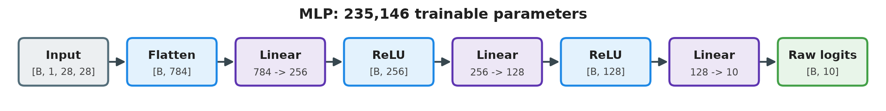

# Lab 1 / model: MLP baseline

- **Motivation/Background**: The brief asks to build a neural network in PyTorch; the MLP is the Lab 1 baseline that Member B trains and evaluates.
- **Purpose**: Describe the model with the lecturer's Model.md template: name, purpose, initial model (architecture, layers, input/output, source) and trained model (who trained it, results, saved paths).
- **Overview Pipeline**: `set_seed(42)` -> `MLP((256,128))` -> `count_parameters` -> `train_model` (Member B) -> `artifacts/models/mlp_baseline.pt`.
- **Detailed Plan**: 1. Name; 2. Purpose; 3. Initial model; 4. Trained model; Vietnamese version.
- **References**: [STATUS.md](STATUS.md), [PROMPTS.md](PROMPTS.md), [AUDIT.md](AUDIT.md), PyTorch (`torch.nn`), `labs/lab1/model/model.py`, `labs/lab1/tests/test_model.py`, `labs/lab1/main.py`, [train.md](../train.md), [experiment.md](../experiment.md).
- **Created**: 2026-10-13T00:00:00+07:00
- **Last Updated**: 2026-11-07T00:00:00+07:00

---

## Table of Contents

- [1. Name](#1-name)
- [2. Purpose](#2-purpose)
- [3. Initial model](#3-initial-model)
  - [Model architecture](#model-architecture)
  - [Input / output of the model](#input--output-of-the-model)
  - [Source file](#source-file)
  - [Model builder](#model-builder)
  - [Success criteria & retrial](#success-criteria--retrial)
  - [Risks](#risks)
- [4. Trained model](#4-trained-model)
  - [Update](#update)
  - [How the model is trained (how-to-do, Member B's `train.py`)](#how-the-model-is-trained-how-to-do-member-bs-trainpy)
  - [Evaluation (how to judge, output)](#evaluation-how-to-judge-output)
  - [Saved path](#saved-path)
  - [Note](#note)
- [Tiếng Việt](#tiếng-việt)

---

## 1. Name

- **Name:** MLP baseline for Fashion-MNIST (`labs/lab1/model/model.py`)
- **Created:** 2026-10-13, author: Toàn (Member A)
- **Updated:** 2026-11-07 by Toàn (Member A): restructured to the new model template
- **Status:** Done (unit tests pass; trained by Member B on the official data, 2026-11-04)

## 2. Purpose

- Build the neural network the brief asks for: a multilayer perceptron in PyTorch that classifies 28x28 grayscale clothing images into 10 classes.
- It is the non-convolutional baseline of Lab 1. Team decision 2026-11-04: Lab 1 is MLP only (no CNN).
- How it is judged: forward returns logits `[B,10]` (no softmax, because `CrossEntropyLoss` applies log-softmax itself); 235,146 trainable parameters; it can overfit one batch; after training, validation/test accuracy is reported by `evaluate` (Member B).

## 3. Initial model

### Model architecture



Figure: `labs/lab1/diagrams/lab1_mlp_architecture.png` (matches the code: 784 -> 256 -> 128 -> 10, 235,146 parameters).

- **Backbone:** none (not a pretrained model). Fully connected MLP built from scratch, random initial weights fixed by `set_seed(42)` right before the model is created.
- **Number of layers:** 3 fully connected (`Linear`) layers: 2 hidden layers (256, 128 neurons, ReLU) + 1 output layer (10 neurons). Plus 1 `Flatten` at the input (no weights). `nn.Sequential` holds 6 modules: Flatten, Linear, ReLU, Linear, ReLU, Linear (with `dropout > 0`, one Dropout after each ReLU).
- **Number of parameters:** 235,146 trainable (first layer holds 85.5%).

```
Input  [B, 1, 28, 28]
  |  Flatten
  v  [B, 784]
  |  Linear(784 -> 256)   200,960 params
  |  ReLU (+ Dropout if dropout > 0)
  v  [B, 256]
  |  Linear(256 -> 128)    32,896 params
  |  ReLU (+ Dropout if dropout > 0)
  v  [B, 128]
  |  Linear(128 -> 10)      1,290 params
  v
Output [B, 10] logits (NO softmax)        total 235,146
```

- Figure: `labs/lab1/diagrams/lab1_mlp_architecture.png`.
- Other sizes from the same class (used only in `experiment`): `hidden_sizes=()` = softmax regression, 7,850 params; `(512, 256, 128)` = `larger_network`, 567,434 params.

### Input / output of the model

| | Shape | Type | Comes from / goes to |
|---|---|---|---|
| Input | `[B, 1, 28, 28]` | float32, normalized with train mean 0.2859, std 0.3530 | `features.make_loaders` ([features.md](../features/features.md)), batch 64 |
| Output | `[B, 10]` | float32 logits, one score per class; prediction = argmax | `CrossEntropyLoss` in `train`, `evaluate` |

### Source file

- Code: `labs/lab1/model/model.py`: `class MLP(hidden_sizes=(256, 128), num_classes: int = 10, dropout: float = 0.0)`, `count_parameters(model) -> int` (signatures are a contract, see `project_description.md`).
- Tests: `labs/lab1/tests/test_model.py` (6 tests: shapes, logits, parameter count, frozen params, dropout, overfit one batch).
- Check: `python -m pytest labs/lab1/tests/test_model.py -q`; `python -c "from labs.lab1.model.model import MLP, count_parameters; print(count_parameters(MLP()))"` -> `235146`.

**Public API**

| Function / class | Parameters | Returns |
|---|---|---|
| `MLP(hidden_sizes=(256, 128), num_classes=10, dropout=0.0)` | `hidden_sizes`: tuple of hidden widths (`()` = no hidden layer); `num_classes`; `dropout`: added after each ReLU when > 0 | `nn.Module`; `forward(x [B,1,28,28]) -> logits [B,10]` |
| `count_parameters(model)` | any `nn.Module` | `int`: parameters with `requires_grad=True` |

```python
import torch
from labs.lab1.model.model import MLP, count_parameters

model = MLP()
print(count_parameters(model))              # 235146
print(model(torch.zeros(4, 1, 28, 28)).shape)  # torch.Size([4, 10])
```

**Integration (used by):** `labs/lab1/main.py` stage 4, `experiment.build_model` (all 7 configurations), notebook Stage 4 (cell `[5]`); the model object is then passed to `train`, `evaluate`, `visualize`.

### Model builder

How the model is built and where from:

- **From:** written from scratch by the team with `torch.nn` (subclass of `nn.Module`); no pretrained weights, no `torchvision.models`.
- **How (`MLP.__init__`):** a Python list starts with `nn.Flatten()`; a loop over `hidden_sizes` appends `nn.Linear(in_features, hidden)`, `nn.ReLU()` and, if `dropout > 0`, `nn.Dropout(dropout)`, then sets `in_features = hidden`; a last `nn.Linear(in_features, num_classes)` is appended; the list becomes `self.net = nn.Sequential(*layers)`. `forward(x)` returns `self.net(x)`.
- **Builders that call it:**
  - `labs/lab1/main.py` stage 4: `set_seed(seed)` then `MLP(hidden_sizes=(256, 128), num_classes=10, dropout=0.0)`.
  - `labs/lab1/experiment/experiment.py`: `build_model(cfg, num_classes=10)` returns `MLP(hidden_sizes=tuple(cfg.get("hidden_sizes", (256, 128))), num_classes=num_classes, dropout=float(cfg.get("dropout", 0.0)))`, so every configuration of the experiment is built from one dict.
- **Loading a trained model:** build the same `MLP()` first, then `train.load_checkpoint(model, path, device)` loads the state_dict (`weights_only=True`) and switches to eval mode.

### Success criteria & retrial

Initial model (Member A):

| Criterion | Correct value | If not met |
|---|---|---|
| Output shape | `[B,10]` | check `in_features` of each layer |
| Logits | not probabilities (rows do not sum to 1) | remove softmax from `forward` |
| Parameters | 235,146 | check `hidden_sizes` |
| Overfit one batch | loss goes close to 0 | check layer order and activations |
| Unit tests | 6 tests in `test_model.py` pass | fix the failing case, rerun |

Trained model (Member B, current rule in `main.py` / `train.py`):

| Criterion | Current rule | If not met |
|---|---|---|
| Training finished | fixed 5 epochs; the checkpoint with the lowest validation loss is kept | — |
| Model selection | lowest validation loss, never the test set | rerun from `main.py`; do not pick by test accuracy |
| Reproducible | rerun with seed 42 gives the same `mlp_baseline.pt` (same MD5) | check seed, thread count (4), split file |
| Reported numbers | validation accuracy from the same epoch as the saved checkpoint | recompute from that epoch, not `max(val_acc)` |

Not met yet against the new lecturer rules: no stopping rule such as "stop after 10 epochs without validation-loss improvement" (open question, see [Note](#note)).

### Risks

- Softmax inside `forward` -> `CrossEntropyLoss` applies log-softmax twice, training is wrong without any error; covered by `test_output_is_logits_not_probabilities`.
- Changing the default sizes -> `mlp_baseline.pt` no longer loads; change only with the team leader.
- 235,146 parameters ~ 4.4 x the training images -> overfitting; validation loss chooses the checkpoint.
- Lecturer's training rules not met (log file, stopping rule, train accuracy) -> open question for Member B.

## 4. Trained model

### Update

- **Who trained it:** Thư (Member B), with `train.train_model` called from `labs/lab1/main.py` (see [train.md](../train.md)).
- **Training setup:** official data, train 54,000 / validation 6,000; `CrossEntropyLoss`; Adam, lr 1e-3; batch 64; 5 epochs; seed 42; CPU, 4 threads. The checkpoint with the lowest validation loss is kept.
- **Training completed:** 2026-11-04 (Run, official data): best epoch 5, validation loss 0.3018, validation accuracy 89.05%; test accuracy 88.36% (test used once, after selection).
- **Changes to the source after training:** none. `model.py` is unchanged; the trained weights load into the same class (`train.load_checkpoint(MLP(), path, device)`, `weights_only=True`). Any change to the default sizes breaks the saved checkpoint and must be agreed with the team leader.
- **Experiments:** 7 configurations x 5 seeds (`42, 7, 123, 2024, 3407`), each changing one factor from this baseline (see [experiment.md](../experiment.md)); baseline test accuracy 88.00 +/- 0.39%.

### How the model is trained (how-to-do, Member B's `train.py`)

1. Choose the optimizer: Adam (`lr=1e-3`) for the baseline; SGD always uses momentum 0.9 (experiments only). Loss: `nn.CrossEntropyLoss()` on the logits.
2. For each epoch (5 epochs):
   1. `model.train()`; for each training batch: `zero_grad` (PyTorch adds gradients up), forward, loss, `backward` (gradients), `step` (update weights).
   2. Training loss of the epoch = loss weighted by batch size / number of images (the last batch has only 48 images).
   3. `model.eval()` + `torch.no_grad()`: validation loss and accuracy on the 6,000 validation images.
   4. If the validation loss is the lowest so far, save the state_dict to `artifacts/models/mlp_baseline.pt`.
3. Return `history` (`train_loss`, `val_loss`, `val_acc` per epoch); `main.py` reloads the best checkpoint before evaluation.

What the training loss is for: it measures the error on the training images and is what the optimizer minimizes (backward + step). It is not used to choose the model; the validation loss is.

### Evaluation (how to judge, output)

- **Metric:** accuracy (classes are balanced, random guess = 10%), plus per-class precision, recall, specificity, F1 and the confusion matrix, because the classes are not equally hard.
- **Rule:** choose the checkpoint and compare configurations on validation only; evaluate the test set **once**, at the end.
- **Correct when:** the reported validation accuracy comes from the same epoch as the saved checkpoint; numbers are reproducible with seed 42.
- **Output:** validation loss 0.3018, accuracy 89.05%; test accuracy 88.36%; best class Trouser 98.17%, worst Shirt 70.17%; ROC-AUC 0.9925 (2026-11-04). Files: `artifacts/runs/classification_report.csv`, `artifacts/figures/confusion_matrix.png`, `loss_curves.png`, `predictions_grid.png` (not committed). See [evaluate.md](../evaluate.md).

### Saved path

| What | Path | Committed |
|---|---|---|
| Baseline checkpoint (state_dict) | `labs/lab1/artifacts/models/mlp_baseline.pt` | No (`*.pt` ignored) |
| Experiment checkpoints | `labs/lab1/artifacts/models/exp_run_*.pt` (`ckpt_prefix='exp_run'`) | No |
| Per-epoch history of every run | `labs/lab1/artifacts/runs/` (written by `experiment.save_history`) | No |

### Note

- 235,146 parameters is about 4.4 times the 54,000 training images, so the model can memorize; validation chooses the checkpoint.
- The MLP ignores the 2-D layout of the image (known limit, not a task).
- The checkpoint is regenerated by `python -m labs.lab1.main` (seed 42); on 2026-11-04 a second run gave an identical `mlp_baseline.pt` (same MD5).
- Open question for Member B and the team leader: the new lecturer rules ask for a stopping rule (e.g. stop after 10 epochs without loss improvement) and a date-time named training log with parameters, architecture and per-epoch loss/accuracy. Training uses a fixed 5 epochs and has no such log file. The per-epoch `history` in `train.py` records `train_loss`, `val_loss`, `val_acc`, but **no training accuracy**. Checkpoints are saved in `artifacts/models/`, not in the `training/` or `model_present/` folders the new rules name.
- **Rules for AI agents:** never assign work to yourself, ask the team leader. May edit `model.py`, `tests/test_model.py`, this file. Must not edit other modules, saved checkpoints, other owners' notebook cells. Prohibited: softmax in `forward`; CNN or other architectures; changing the default sizes without the team leader.

---

## Tiếng Việt

### 1. Tên

- **Tên:** MLP baseline cho Fashion-MNIST (`labs/lab1/model/model.py`)
- **Tạo:** 13/10/2026, tác giả Toàn (Member A)
- **Cập nhật:** 07/11/2026 bởi Toàn (Member A): đổi sang mẫu Model.md mới
- **Trạng thái:** xong (unit test đạt; Thư (Member B) đã train trên dữ liệu chính thức, 04/11/2026)

### 2. Mục đích

- Xây mạng nơ-ron theo yêu cầu của đề: một MLP bằng PyTorch phân loại ảnh quần áo xám 28x28 vào 10 lớp.
- Đây là baseline không dùng tích chập của Lab 1. Nhóm đã chốt ngày 04/11/2026: Lab 1 chỉ làm MLP (không CNN).
- Đúng khi: forward trả logits `[B,10]` (không softmax, vì `CrossEntropyLoss` đã tự làm log-softmax); 235.146 tham số huấn luyện được; overfit được 1 batch; sau khi train, accuracy validation/test do `evaluate` (Member B) báo cáo.

### 3. Model ban đầu

#### Kiến trúc


- **Backbone:** không có (không dùng model pretrained). MLP kết nối đầy đủ, tự xây từ đầu; trọng số khởi tạo ngẫu nhiên nhưng cố định bằng `set_seed(42)` gọi ngay trước khi tạo model.
- **Số lớp:** 3 lớp kết nối đầy đủ (`Linear`): 2 lớp ẩn (256, 128 nơ-ron, ReLU) + 1 lớp đầu ra (10 nơ-ron). Thêm 1 `Flatten` ở đầu vào (không có trọng số). `nn.Sequential` gồm 6 thành phần: Flatten, Linear, ReLU, Linear, ReLU, Linear (khi `dropout > 0` thì thêm 1 Dropout sau mỗi ReLU).
- **Số tham số:** 235.146 (200.960 + 32.896 + 1.290); lớp đầu chiếm 85,5%.
- **Sơ đồ:** như hình vẽ ASCII ở phần tiếng Anh; hình: `labs/lab1/diagrams/lab1_mlp_architecture.png`.
- Cùng lớp `MLP` với kích thước khác (chỉ dùng trong `experiment`): `hidden_sizes=()` là softmax regression, 7.850 tham số; `(512, 256, 128)` là `larger_network`, 567.434 tham số.

#### Input / output của model

| | Shape | Kiểu | Lấy từ / đưa tới |
|---|---|---|---|
| Input | `[B, 1, 28, 28]` | float32, đã chuẩn hóa bằng mean 0,2859, std 0,3530 của train | `features.make_loaders` ([features.md](../features/features.md)), batch 64 |
| Output | `[B, 10]` | float32 logits, mỗi lớp một điểm số; dự đoán = argmax | `CrossEntropyLoss` trong `train`, `evaluate` |

#### File nguồn

- Code: `labs/lab1/model/model.py`: `class MLP(hidden_sizes=(256, 128), num_classes: int = 10, dropout: float = 0.0)`, `count_parameters(model) -> int` (chữ ký là hợp đồng, xem `project_description.md`).
- Test: `labs/lab1/tests/test_model.py` (6 test: shape, logits, số tham số, tham số bị đóng băng, dropout, overfit 1 batch).
- Kiểm tra: `python -m pytest labs/lab1/tests/test_model.py -q`; `count_parameters(MLP())` → `235146`.

| Hàm / lớp | Tham số | Trả về |
|---|---|---|
| `MLP(hidden_sizes=(256, 128), num_classes=10, dropout=0.0)` | `hidden_sizes`: tuple độ rộng các lớp ẩn (`()` = không có lớp ẩn); `num_classes`; `dropout`: thêm sau mỗi ReLU khi > 0 | `nn.Module`; `forward(x [B,1,28,28]) -> logits [B,10]` |
| `count_parameters(model)` | một `nn.Module` bất kỳ | `int`: số tham số có `requires_grad=True` |

- Ví dụ: xem đoạn code ở phần tiếng Anh (in `235146` và `torch.Size([4, 10])`).
- **Nơi sử dụng:** `labs/lab1/main.py` stage 4, `experiment.build_model` (cả 7 cấu hình), notebook Stage 4 (ô `[5]`); object model sau đó được truyền cho `train`, `evaluate`, `visualize`.

#### Model builder (model được xây dựng như nào, từ đâu)

- **Từ đâu:** nhóm tự viết từ đầu bằng `torch.nn` (lớp con của `nn.Module`); không dùng trọng số pretrained, không dùng `torchvision.models`.
- **Như nào (`MLP.__init__`):** tạo list bắt đầu bằng `nn.Flatten()`; vòng lặp qua `hidden_sizes` thêm `nn.Linear(in_features, hidden)`, `nn.ReLU()` và nếu `dropout > 0` thì thêm `nn.Dropout(dropout)`, rồi gán `in_features = hidden`; cuối cùng thêm `nn.Linear(in_features, num_classes)`; list được gói thành `self.net = nn.Sequential(*layers)`. `forward(x)` trả `self.net(x)`.
- **Nơi gọi builder:**
  - `labs/lab1/main.py` stage 4: `set_seed(seed)` rồi `MLP(hidden_sizes=(256, 128), num_classes=10, dropout=0.0)`.
  - `labs/lab1/experiment/experiment.py`: `build_model(cfg, num_classes=10)` trả `MLP(hidden_sizes=tuple(cfg.get("hidden_sizes", (256, 128))), num_classes=num_classes, dropout=float(cfg.get("dropout", 0.0)))`, nên mọi cấu hình thí nghiệm đều tạo từ một dict.
- **Nạp model đã train:** tạo lại đúng `MLP()` trước, rồi `train.load_checkpoint(model, path, device)` nạp state_dict (`weights_only=True`) và chuyển sang chế độ eval.

#### Tiêu chí thành công & làm lại

Model ban đầu (Member A):

| Tiêu chí | Giá trị đúng | Không đạt thì |
|---|---|---|
| Shape đầu ra | `[B,10]` | kiểm `in_features` từng lớp |
| Logits | không phải xác suất (tổng mỗi dòng khác 1) | bỏ softmax trong `forward` |
| Số tham số | 235.146 | kiểm `hidden_sizes` |
| Overfit 1 batch | loss giảm gần 0 | kiểm thứ tự lớp và hàm kích hoạt |
| Unit test | 6 test trong `test_model.py` đạt | sửa trường hợp lỗi, chạy lại |

Model đã train (Member B, quy tắc hiện tại trong `main.py` / `train.py`):

| Tiêu chí | Quy tắc hiện tại | Không đạt thì |
|---|---|---|
| Train xong | cố định 5 epoch; giữ checkpoint có validation loss thấp nhất | — |
| Chọn model | theo validation loss thấp nhất, không bao giờ theo tập test | chạy lại từ `main.py`; không chọn theo test accuracy |
| Tái lập | chạy lại với seed 42 ra đúng `mlp_baseline.pt` (cùng MD5) | kiểm seed, số luồng (4), file split |
| Số báo cáo | validation accuracy lấy đúng epoch của checkpoint đã lưu | tính lại theo epoch đó, không lấy `max(val_acc)` |

Chưa đạt so với quy định mới của cô: chưa có điều kiện dừng kiểu "dừng khi 10 epoch validation loss không giảm" (câu hỏi mở, xem Ghi chú).

#### Rủi ro

- Softmax trong `forward` -> `CrossEntropyLoss` làm log-softmax hai lần, train sai mà không báo lỗi; có test `test_output_is_logits_not_probabilities`.
- Đổi kích thước mặc định -> không nạp được `mlp_baseline.pt`; chỉ đổi khi nhóm trưởng đồng ý.
- 235.146 tham số ~ 4,4 lần số ảnh train -> dễ overfit; chọn checkpoint bằng validation loss.
- Quy định train của cô chưa đạt (file log, điều kiện dừng, train accuracy) -> câu hỏi mở cho Thư.

### 4. Model đã train

#### Cập nhật

- **Người train:** Thư (Member B), dùng `train.train_model` gọi từ `labs/lab1/main.py` (xem [train.md](../train.md)).
- **Cấu hình train:** dữ liệu chính thức, train 54.000 / validation 6.000; `CrossEntropyLoss`; Adam, lr 1e-3; batch 64; 5 epoch; seed 42; CPU, 4 luồng. Giữ checkpoint có validation loss thấp nhất.
- **Hoàn thành:** 04/11/2026 (đã chạy, dữ liệu chính thức): epoch tốt nhất 5, validation loss 0,3018, validation accuracy 89,05%; test accuracy 88,36% (test chỉ đo một lần, sau khi đã chọn model).
- **Thay đổi source sau khi train:** không có. `model.py` giữ nguyên; trọng số đã train nạp lại vào đúng lớp này (`train.load_checkpoint(MLP(), path, device)`, `weights_only=True`). Đổi kích thước mặc định sẽ làm hỏng checkpoint đã lưu, phải thống nhất với nhóm trưởng.
- **Thí nghiệm:** 7 cấu hình × 5 seed (`42, 7, 123, 2024, 3407`), mỗi cấu hình đổi một yếu tố so với baseline (xem [experiment.md](../experiment.md)); test của baseline 88,00 ± 0,39%.

#### Model được train như nào (các bước, `train.py` của Thư)

1. Chọn optimizer: Adam (`lr=1e-3`) cho baseline; SGD luôn dùng momentum 0,9 (chỉ trong thí nghiệm). Loss: `nn.CrossEntropyLoss()` trên logits.
2. Mỗi epoch (5 epoch):
   1. `model.train()`; với mỗi batch train: `zero_grad` (PyTorch cộng dồn gradient), forward, tính loss, `backward` (tính gradient), `step` (cập nhật trọng số).
   2. Training loss của epoch = loss nhân số ảnh mỗi batch rồi chia tổng số ảnh (batch cuối chỉ có 48 ảnh).
   3. `model.eval()` + `torch.no_grad()`: tính validation loss và accuracy trên 6.000 ảnh validation.
   4. Nếu validation loss thấp nhất từ trước tới giờ thì lưu state_dict vào `artifacts/models/mlp_baseline.pt`.
3. Trả `history` (`train_loss`, `val_loss`, `val_acc` từng epoch); `main.py` nạp lại checkpoint tốt nhất trước khi đánh giá.

Training loss để làm gì: đo sai số trên ảnh train, là đại lượng optimizer giảm dần (backward + step). Không dùng để chọn model; chọn model bằng validation loss.

#### Đánh giá (thế nào là đúng, output là gì)

- **Thước đo:** accuracy (lớp cân bằng, đoán bừa = 10%), thêm precision, recall, specificity, F1 từng lớp và confusion matrix, vì các lớp khó dễ khác nhau.
- **Quy tắc:** chọn checkpoint và so cấu hình chỉ trên validation; tập test chỉ đo **một lần** ở cuối.
- **Đúng khi:** accuracy validation báo cáo lấy đúng epoch của checkpoint đã lưu; chạy lại với seed 42 ra cùng số.
- **Output:** validation loss 0,3018, accuracy 89,05%; test accuracy 88,36%; lớp tốt nhất Trouser 98,17%, kém nhất Shirt 70,17%; ROC-AUC 0,9925 (04/11/2026). File: `artifacts/runs/classification_report.csv`, `artifacts/figures/confusion_matrix.png`, `loss_curves.png`, `predictions_grid.png` (không commit). Xem [evaluate.md](../evaluate.md).

#### Nơi lưu

| Lưu gì | Đường dẫn | Commit |
|---|---|---|
| Checkpoint baseline (state_dict) | `labs/lab1/artifacts/models/mlp_baseline.pt` | Không (`*.pt` bị bỏ qua) |
| Checkpoint thí nghiệm | `labs/lab1/artifacts/models/exp_run_*.pt` (`ckpt_prefix='exp_run'`) | Không |
| Lịch sử từng epoch của mọi lần chạy | `labs/lab1/artifacts/runs/` (do `experiment.save_history` ghi) | Không |

#### Ghi chú

- 235.146 tham số gấp khoảng 4,4 lần 54.000 ảnh train, nên model đủ sức học thuộc; validation dùng để chọn checkpoint.
- MLP bỏ qua bố cục 2 chiều của ảnh (giới hạn đã biết, không phải việc cần làm).
- Checkpoint được tạo lại bằng `python -m labs.lab1.main` (seed 42); ngày 04/11/2026 chạy lần hai ra `mlp_baseline.pt` giống hệt (cùng MD5).
- Câu hỏi mở cho Thư và nhóm trưởng: quy định mới của cô yêu cầu điều kiện dừng (ví dụ dừng khi 10 epoch loss không giảm) và file log tên theo ngày giờ, có tham số, kiến trúc, loss/accuracy từng epoch. Hiện train cố định 5 epoch và chưa có file log như vậy. `history` từng epoch trong `train.py` chỉ ghi `train_loss`, `val_loss`, `val_acc`, **chưa có train accuracy**. Checkpoint đang lưu ở `artifacts/models/`, chưa theo thư mục `training/` hoặc `model_present/` như quy định mới.
- **Quy tắc cho AI:** không tự giao việc cho mình, hỏi nhóm trưởng. Được sửa `model.py`, `tests/test_model.py`, file này. Cấm sửa module khác, checkpoint đã lưu, ô notebook của người khác. Cấm thêm softmax trong `forward`; cấm thêm CNN hay kiến trúc khác; cấm đổi kích thước mặc định khi chưa hỏi nhóm trưởng.
