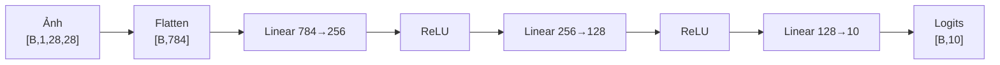

# Model card — mlp_baseline (v1)

- **Created**: 2026-11-14T01:38:51+07:00 (Thư)
- **Last Updated**: 2026-11-14T01:38:51+07:00 (Thư)
- Khuôn: [../templates/MODEL_CARD_TEMPLATE_v1.md](../templates/MODEL_CARD_TEMPLATE_v1.md)

## Purpose
Model mốc của Lab 1: MLP 2 tầng ẩn phân loại 10 lớp Fashion-MNIST. Bốn cấu hình còn lại trong desc lab mỗi cấu hình đổi đúng một yếu tố so với model này. Baseline cũng là model dùng để kiểm mức test ≥ 87% (bài báo gốc Fashion-MNIST, Xiao et al. 2017, Bảng 3: MLP 0,871).

## Initial model
- **Architecture:** 784 → 256 → 128 → 10, ReLU sau mỗi tầng ẩn, không dropout, tầng cuối trả logits (không softmax vì `nn.CrossEntropyLoss` đã gộp log-softmax).
- **Xây từ đâu:** tự viết bằng `nn.Sequential`, không dùng pretrained hay backbone; trọng số khởi tạo mặc định của PyTorch theo seed 42.
- **Số param:** 235.146 | **Input:** `[B,1,28,28]` float32, ảnh chia 255 rồi chuẩn hoá theo mean 0,2859 / std 0,3530 của tập train | **Output:** logits `[B,10]`
- **Source:** `labs/lab1/model/model.py` (`class MLP`, dòng 17; `count_parameters`, dòng 49). Cấu hình: `BASELINE_CONFIG` trong `labs/lab1/experiment/experiment.py:25`.

| Lớp | Phép tính | Số param |
|---|---|---:|
| Linear 1 | 784 × 256 + 256 | 200.960 |
| Linear 2 | 256 × 128 + 128 | 32.896 |
| Linear 3 (ra) | 128 × 10 + 10 | 1.290 |
| **Tổng** | | **235.146** |

Flatten và ReLU không có tham số. Số tổng khớp `count_parameters` và cột `n_params` của `outputs/results/experiment_results.csv`.

## Trained model
- **Người train:** Thư | **Ngày train xong:** 2026-11-14T01:32:18+07:00 (normal run `python -m labs.lab1.main`, CPU 4 thread, Python 3.13.7, torch 2.14.1)
- **Huấn luyện:** Adam lr 1e-3, batch 64, seed 42, tối đa 30 epoch, dừng sớm theo `val_loss` (patience 5, `min_delta` 1e-4)
- **Log / config:** `labs/lab1/outputs/logs/20261114_013050_baseline.log`, `_history.csv`, `_config.json`
- **Checkpoint:** `labs/lab1/outputs/models/20261114_013050_baseline_best.pt` (best_epoch 8, stopped_epoch 13, stop_reason `early_stopping`); `_last.pt` là trọng số epoch 13
- **Kết quả** (`outputs/results/test_results.csv`):

| Tập | Loss | Accuracy |
|---|---:|---:|
| Train (epoch 8, đo lúc train) | 0,2224 | 91,55% |
| Validation 6.000 ảnh | 0,2943 | 88,97% |
| Test 10.000 ảnh (chạy một lần) | 0,3239 | **88,60%** — đạt mức ≥ 87% |

- **Ghi chú:**
  - Sau epoch 8, train loss vẫn giảm (0,2224 → 0,1724 ở epoch 13) còn val loss tăng (0,2943 → 0,3263): model bắt đầu overfit, nên đánh giá và demo dùng `_best.pt`.
  - Kết quả của một seed (42); desc lab đã bỏ đa seed, nên chênh lệch dưới khoảng 0,5 điểm giữa các cấu hình không đủ để kết luận.
  - Giới hạn: MLP làm phẳng ảnh nên bỏ qua cấu trúc không gian; lớp Shirt khó nhất (xem [mlp_larger_network_v1.md](mlp_larger_network_v1.md) và notebook Stage 9).
