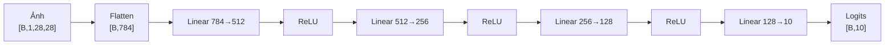

# Model card — mlp_larger_network (v1)

- **Created**: 2026-11-14T01:38:51+07:00 (Thư)
- **Last Updated**: 2026-11-14T01:38:51+07:00 (Thư)
- Khuôn: [../templates/MODEL_CARD_TEMPLATE_v1.md](../templates/MODEL_CARD_TEMPLATE_v1.md)

## Purpose
Cấu hình `larger_network` của desc lab: giống baseline ([mlp_baseline_v1.md](mlp_baseline_v1.md)), chỉ thêm một tầng ẩn và tăng độ rộng. Đây là cấu hình **được chọn trên validation** ở normal run 2026-11-14 (val_acc cao nhất), nên được chạy test và dùng cho demo.

## Initial model
- **Architecture:** 784 → 512 → 256 → 128 → 10, ReLU sau mỗi tầng ẩn, không dropout, tầng cuối trả logits.
- **Xây từ đâu:** cùng class `MLP` (`labs/lab1/model/model.py:17`) với `hidden_sizes=(512, 256, 128)`; tự viết, khởi tạo theo seed 42.
- **Số param:** 567.434 | **Input:** `[B,1,28,28]`, chuẩn hoá như baseline | **Output:** logits `[B,10]`
- **Source:** `labs/lab1/model/model.py`; cấu hình `VARIANTS["larger_network"]` trong `labs/lab1/experiment/experiment.py:29`.

| Lớp | Phép tính | Số param |
|---|---|---:|
| Linear 1 | 784 × 512 + 512 | 401.920 |
| Linear 2 | 512 × 256 + 256 | 131.328 |
| Linear 3 | 256 × 128 + 128 | 32.896 |
| Linear 4 (ra) | 128 × 10 + 10 | 1.290 |
| **Tổng** | | **567.434** |

## Trained model
- **Người train:** Thư | **Ngày train xong:** 2026-11-14T01:35:01+07:00 (cùng normal run với baseline)
- **Huấn luyện:** Adam lr 1e-3, batch 64, seed 42, tối đa 30 epoch, dừng sớm theo `val_loss` (patience 5, `min_delta` 1e-4)
- **Log / config:** `labs/lab1/outputs/logs/20261114_013314_larger_network.log`, `_history.csv`, `_config.json`
- **Checkpoint:** `labs/lab1/outputs/models/20261114_013314_larger_network_best.pt` (best_epoch 7, stopped_epoch 12, `early_stopping`)
- **Kết quả** (`outputs/results/test_results.csv`, `classification_report_val_larger_network.csv`):

| Tập | Loss | Accuracy |
|---|---:|---:|
| Train (epoch 7, đo lúc train) | — | 90,98% |
| Validation 6.000 ảnh | 0,3009 | 89,28% |
| Test 10.000 ảnh (chạy một lần) | 0,3315 | 88,46% |

- **Lý do chọn:** val_acc cao nhất tại best_epoch (89,28%), hơn `sgd_lr_0.01` 0,15 điểm và baseline 0,31 điểm.
- **Ghi chú:**
  - Trên test, model này thấp hơn baseline 0,14 điểm (88,46% so với 88,60%). Với một seed, chênh lệch cỡ này nằm trong mức dao động; không kết luận mạng lớn hơn tốt hơn.
  - Theo lớp (validation): Shirt recall 68,67% là thấp nhất, bị nhầm nhiều nhất sang T-shirt/top (71 ảnh), Pullover (56), Coat (37); Trouser, Bag, Sandal, Ankle boot trên 95%.
  - Demo 16 ảnh test đầu: 15/16 đúng (`outputs/demo/20261114_013036_predictions.png`, `.csv`).
