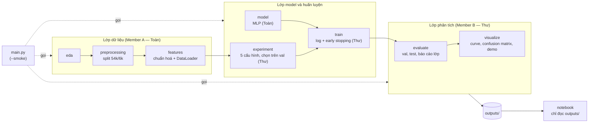

# Lab 1: Phân loại Fashion-MNIST bằng MLP (PyTorch) — tổng quan dự án (Define + Design)

- **Created**: 2026-10-12T10:27:18+07:00 (pptthu)
- **Last Updated**: 2026-11-14T01:50:00+07:00 (pptthu)
- File này là bản tổng quan để trình bày. Desc hiện hành (nguồn của mọi quyết định): [`docs/lab1_description_v1.md`](docs/lab1_description_v1.md). Kết quả: [`README.md`](README.md). Mục lục tài liệu: [`docs/00_README_v2.md`](docs/00_README_v2.md).

## 1. Define

| Mục | Nội dung |
|---|---|
| Bài toán | Phân loại ảnh quần áo xám 28×28 thành 10 lớp bằng mạng nơ-ron train trong PyTorch (đề P1) |
| Người dùng | Cô (chấm, vấn đáp) và nhóm (học quy trình làm bài có kiểm chứng) |
| Dữ liệu | Fashion-MNIST chính thức của Zalando, ghi ra CSV (`label` + 784 pixel): 60.000 train, 10.000 test, 10 lớp cân bằng |
| Input / Output | Input: CSV trong `data/raw/`. Output: checkpoint, log mỗi lần chạy, bảng so sánh, kết quả test, hình, demo trong `outputs/` |
| Yêu cầu của đề | Load dữ liệu + transform; build NN; training loop; đánh giá accuracy; save/load model; thử network/hyperparameter; vẽ loss; hiện ảnh dự đoán so với nhãn thật |
| Phạm vi | 5 cấu hình MLP, seed 42, tối đa 30 epoch + early stopping. Không làm: CNN, Optuna, đa seed, kiểm định thống kê, ảnh ngoài dataset |
| Tiêu chí đạt | Mọi run đủ 3 file log và `_best.pt` nạp lại được; baseline test ≥ 87% (bài báo gốc Fashion-MNIST: MLP 0,871); baseline val_acc > softmax_regression; đủ hình và bảng |
| Kết quả (14/11) | Baseline test **88,60%** ✔; baseline val 88,97% > softmax 85,15% ✔; cấu hình chọn trên val: larger_network (val 89,28%, test 88,46%) |

## 2. Design

### 2.1 Kiến trúc hệ thống
Ba lớp, một điểm chạy, một notebook chỉ đọc kết quả:

### 2.2 Luồng một lần chạy (`python -m labs.lab1.main`)
1. EDA trên file train → `outputs/figures/class_counts.png`, `sample_grid.png`
2. Đọc CSV, dùng file split đã commit `data/splits/train_val_split.json`
3. Mean/std chỉ từ phần train, tạo loader (batch 64; val/test không xáo)
4. Train 5 cấu hình (`experiment` gọi `train`): mỗi run ghi `<ts>_<run>.log`, `_history.csv`, `_config.json`, lưu `_best.pt` và `_last.pt`
5. Chọn cấu hình theo val_acc tại best_epoch (`select_config`) — không nhìn test
6. Test đúng một lần cho baseline và cấu hình được chọn → `outputs/results/test_results.csv`
7. Hình từ `_history.csv`, confusion matrix trên val, ảnh dự đoán test; demo nạp lại `_best.pt` → `outputs/demo/`
8. Ghi `outputs/results/run_summary.json` cho notebook và tài liệu

`--smoke`: 1 epoch, 2 batch, mọi đầu ra vào `outputs/_smoke/` (khoảng 20 giây), số liệu không dùng để báo cáo.

### 2.3 Quy tắc dừng và log
Theo [`docs/templates/LOG_TEMPLATE_v1.md`](docs/templates/LOG_TEMPLATE_v1.md): theo dõi `val_loss`; giảm ít nhất 1e-4 thì lưu `_best.pt` và đặt lại bộ đếm; 5 epoch không giảm thì dừng; tối đa 30 epoch. Training loss dùng để biết model có đang học không và, đặt cạnh val loss, để thấy overfit.

### 2.4 Module, người phụ trách, interface

| Module | Phụ trách | Hàm chính | Desc |
|---|---|---|---|
| `eda` | Member A (Toàn) | `run_eda(train_csv, out_dir) -> dict` | [eda_v1](docs/phases/eda_v1.md) |
| `preprocessing` | Member A (Toàn) | `load_csv`, `make_split(labels, 0.1, 42)`, `save_split`, `load_split` | [preprocessing_v1](docs/phases/preprocessing_v1.md) |
| `features` | Member A (Toàn) | `compute_mean_std`, `build_transform`, `FashionDataset`, `make_loaders(..., batch_size=64)` | [features_v1](docs/phases/features_v1.md) |
| `model` | Member A (Toàn) | `MLP(hidden_sizes, num_classes=10, dropout=0.0)` → logits `[B,10]`; `count_parameters` | [model_v1](docs/phases/model_v1.md) |
| `train` | Member B (Thư) | `train_model(..., patience, min_delta, last_ckpt_path, log_dir, run_name, run_info, max_batches)`; `save_checkpoint`, `load_checkpoint` | [train_v1](docs/phases/train_v1.md) |
| `experiment` | Member B (Thư) | `make_configs`, `build_model`, `run_experiments`, `save_results`, `save_history`, `select_config` | [experiment_v1](docs/phases/experiment_v1.md) |
| `evaluate` | Member B (Thư) | `evaluate`, `confusion_matrix`, `save_classification_report`, `save_test_results` (mức 0,87) | [evaluate_v1](docs/phases/evaluate_v1.md) |
| `visualize` | Member B (Thư) | `load_history`, `plot_loss_curves`, `plot_accuracy_curves`, `show_predictions`, `plot_confusion_matrix`, `demo_predictions` | [visualize_v1](docs/phases/visualize_v1.md), [demo_v1](docs/phases/demo_v1.md) |
| `main.py`, notebook | Thư | `main(seed, epochs, smoke)` | [demo_v1](docs/phases/demo_v1.md) |

Tên hàm là hợp đồng giữa các module; `tests/test_smoke.py` kiểm đủ tên. Chữ ký đầy đủ kèm số dòng code nằm trong mục "Detailed plan" của từng file phase.

### 2.5 Năm cấu hình (mỗi cấu hình khác baseline đúng một yếu tố)

| Cấu hình | Đổi gì so với baseline | Tham số |
|---|---|---:|
| `baseline` | — (784→256→128→10, ReLU, Adam lr 1e-3) | 235.146 |
| `softmax_regression` | bỏ tầng ẩn (784→10) | 7.850 |
| `larger_network` | 784→512→256→128→10 | 567.434 |
| `sgd_lr_0.01` | SGD momentum 0,9, lr 0,01 | 235.146 |
| `dropout_0.2` | dropout 0,2 sau mỗi tầng ẩn | 235.146 |

Sơ đồ kiến trúc và bảng tham số từng lớp: [`docs/models/mlp_baseline_v1.md`](docs/models/mlp_baseline_v1.md), [`docs/models/mlp_larger_network_v1.md`](docs/models/mlp_larger_network_v1.md).

### 2.6 Cấu trúc thư mục
`data/` (vào), `outputs/` (ra), `docs/` (tài liệu), 8 folder module, `notebook/`, `tests/`. Chi tiết: [`docs/rules/FOLDER_STRUCTURE_v2.md`](docs/rules/FOLDER_STRUCTURE_v2.md). Dữ liệu thô, checkpoint, log, hình không commit; file split có commit.

### 2.7 Quy trình làm việc
Desc → hỏi lại chỗ chưa rõ → detail plan → Thư duyệt → lưu có version → small prompt từng bước → smoke run → normal run → audit ([`docs/rules/RULES_v1.md`](docs/rules/RULES_v1.md)). Người viết dàn ý, mục tiêu, tiêu chí đạt; AI chỉ chi tiết hoá và đánh dấu `[đề xuất]` tới khi được duyệt. Mỗi module có mục "Kết quả audit (2026-11-14)" đối chiếu từng tiêu chí với bằng chứng.

### 2.8 Rủi ro kỹ thuật và cách xử lý

| Rủi ro | Cách xử lý trong code |
|---|---|
| Softmax trước CrossEntropyLoss | `MLP.forward` trả logits; softmax chỉ dùng trong demo để hiện xác suất |
| Dùng test để chọn model | Chọn cấu hình và checkpoint trên val; test chạy một lần sau khi chọn |
| Chuẩn hoá bằng thống kê của cả dữ liệu | `compute_mean_std(images[train_idx])` |
| Overfit khi train lâu | Early stopping theo `val_loss`, giữ `_best.pt` |
| Ghi đè kết quả cũ | Tên file có `<ts>`; smoke run tách riêng `outputs/_smoke/` |
| Kết quả không lặp lại | Seed 42, split đã commit, số thread CPU cố định (4) |
| Kiến trúc nạp lại không khớp checkpoint | Dựng lại bằng `build_model(cfg)` cùng config; `_config.json` lưu config của từng run |
