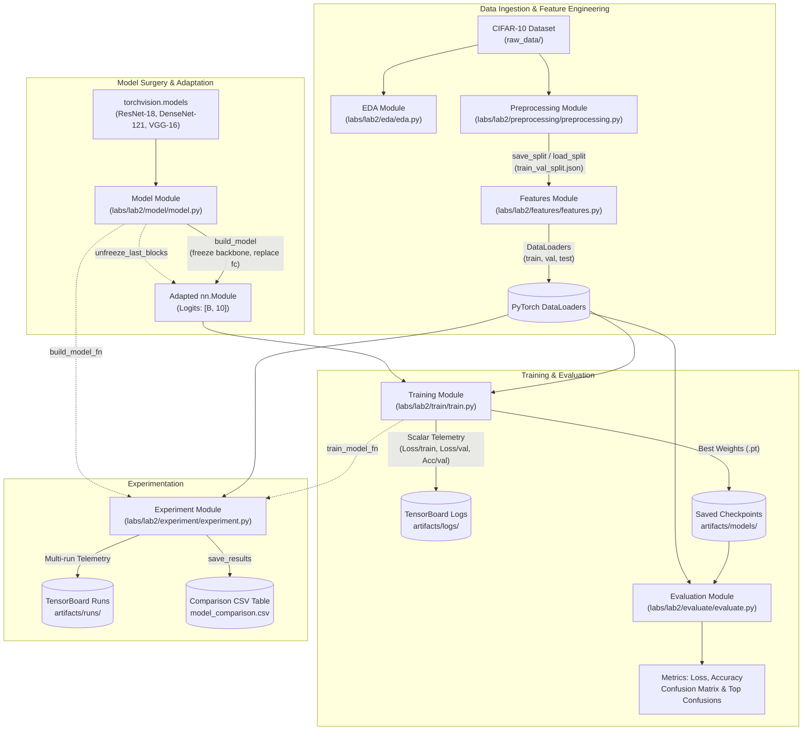

# Lab 2: Pre-trained CNNs and Fine-Tuning on CIFAR-10 (PyTorch)

## 1. Project Overview
This project investigates Transfer Learning and Fine-Tuning using state-of-the-art Convolutional Neural Networks (CNNs) pre-trained on ImageNet (ResNet-18, DenseNet-121, VGG-16) to classify images from the CIFAR-10 dataset. Built using PyTorch and Torchvision, the codebase follows a clean, modular design pattern covering Exploratory Data Analysis (EDA), reproducible data splitting, input pipelines with custom PyTorch transforms, model surgery (layer freezing, header replacement, selective block unfreezing), training with TensorBoard scalar telemetry, comprehensive error evaluation via confusion matrices, and multi-model experiment tracking.

## 2. Learning Objectives
1. **Architectural Understanding:** Comprehend the architecture of deep pre-trained CNN backbones (residual connections in ResNet, dense connectivity in DenseNet, sequential feature stages in VGG).
2. **Transfer Learning Principles:** Leverage features learned on ImageNet (1.2M images, 1,000 classes) to downstream classification tasks with limited target data.
3. **Model Surgery:** Replace the final classification head (linear layer) to match the target class count ($C = 10$).
4. **Layer Freezing & Fine-Tuning:** Freeze feature extraction backbones to train only the classifier head; selectively unfreeze upper convolutional blocks to adapt high-level visual features.
5. **Modern PyTorch & Torchvision Best Practices:** Use modern weights-based instantiation (`weights=ResNet18_Weights.DEFAULT`), avoid deprecated APIs (`pretrained=True`), and enforce reproducible dataset subsetting.
6. **Telemetry & Experiment Tracking:** Monitor training dynamics (loss, accuracy) in real time using TensorBoard and log hyperparameter search runs.
7. **Error Analysis:** Go beyond global accuracy by constructing confusion matrices and identifying top misclassified class pairs.

## 3. Problem Definition
- **Input:** $32 \times 32$ RGB images belonging to 10 mutually exclusive object classes.
- **Output:** Predicted class logit vectors $\hat{\mathbf{z}} \in \mathbb{R}^{10}$ transformed via softmax into posterior probabilities $P(y = c \mid \mathbf{x})$.
- **Objective:** Maximize classification accuracy and minimize Cross-Entropy Loss on unseen validation/test splits while mitigating overfitting and managing computational resource constraints.
- **Constraints:** CIFAR-10 images are natively $32 \times 32$, whereas pre-trained CNN backbones were designed and optimized for $224 \times 224$ ImageNet images. Training $224 \times 224$ images on CPU devices introduces severe computational bottlenecks; hence, resolution scaling (e.g., $128 \times 128$ or $32 \times 32$) and efficient mini-batch loading must be handled properly.

## 4. Dataset Description
- **Dataset:** CIFAR-10 (Canadian Institute for Advanced Research, 10 classes).
- **Lecturer Confirmation Status:** **ASSUMPTION**. The project description and assignment slides use CIFAR-10 as the primary working example. Confirmation with the course lecturer is pending.
- **Total Samples:** 60,000 color images ($50,000$ train, $10,000$ test).
- **Resolution & Channels:** $32 \times 32$ pixels, 3 color channels (RGB).
- **Classes (10):** `airplane`, `automobile`, `bird`, `cat`, `deer`, `dog`, `frog`, `horse`, `ship`, `truck`.
- **Class Balance:** Perfectly balanced (5,000 images per class in the training set; 1,000 images per class in the test set).
- **Dataset Statistics (Calculated via EDA module on train set scaled to $[0, 1]$):**
  - Channel Mean ($R, G, B$): `[0.4914, 0.4822, 0.4465]`
  - Channel Std ($R, G, B$): `[0.2470, 0.2435, 0.2616]`
- **Data Partitioning:**
  - `Train` split: 45,000 samples (90% of raw train set).
  - `Validation` split: 5,000 samples (10% of raw train set), partitioned reproducibly with fixed `seed=42`.
  - `Test` split: 10,000 samples (unaltered official CIFAR-10 test set, reserved strictly for final verification).

## 5. Technologies and Libraries
- **Language:** Python 3.10+
- **Deep Learning Framework:** `torch` (>= 2.0.0), `torchvision` (>= 0.15.0)
- **Logging & Monitoring:** `tensorboard` (>= 2.12.0)
- **Scientific Computing & Data Handling:** `numpy` (>= 1.23.0), `scipy`
- **Visualization:** `matplotlib` (>= 3.7.0) (configured with headless `"Agg"` backend for safe script execution)
- **Testing & Quality Assurance:** `pytest` (>= 7.0.0), `pytest-cov`

## 6. Deep Learning Concepts
- **Convolutional Feature Extraction:** Deep CNN layers hierarchically learn primitive visual concepts (edges, textures in early layers) up to semantic parts and complex object shapes in deep layers.
- **Transfer Learning (Feature Extraction):** Because early convolutional filters capture universal visual primitives, freezing the backbone weights ($\nabla_{\theta_{\text{backbone}}} = \mathbf{0}$) prevents catastrophic forgetting and allows rapid convergence by optimizing only the newly initialized linear classifier head ($W_{\text{fc}} \in \mathbb{R}^{d \times 10}, b_{\text{fc}} \in \mathbb{R}^{10}$).
- **Fine-Tuning:** Unfreezing the top-most residual or dense blocks allows high-level filters to adjust their receptive fields to the nuances of CIFAR-10 domain distributions. Fine-tuning is typically performed with a lower learning rate ($\text{lr} \le 10^{-4}$) to preserve stable lower-level features.
- **ImageNet Normalization:** Pre-trained weights require input tensors normalized using ImageNet statistics: $\mu = [0.485, 0.456, 0.406]$, $\sigma = [0.229, 0.224, 0.225]$.
- **Data Augmentation:** Preventing overfitting when fine-tuning via `RandomResizedCrop(scale=(0.8, 1.0))` and `RandomHorizontalFlip()`.
- **Optimization:** Mini-batch Stochastic Gradient Descent with momentum ($\beta = 0.9$) and Adam optimizer, coupled with Cross-Entropy Loss:
  $$\mathcal{L}_{\text{CE}} = -\frac{1}{B} \sum_{i=1}^B \log\left(\frac{\exp(z_{i, y_i})}{\sum_{j=1}^C \exp(z_{i, j})}\right)$$

## 7. System Architecture
The system architecture follows a linear, staged pipeline where modules communicate through explicitly typed contracts and persisted artifacts.



## 8. Project Structure
The repository layout for Lab 2 is organized into dedicated single-responsibility submodules:

```text
labs/lab2/
├── README.md                           # Comprehensive bilingual lab documentation and report
├── project_description.md              # Formal Define & Design specification (contracts)
├── progress_status.md                  # Milestone progress tracking, audit logs, and blocker notes
├── main.py                             # Pipeline entrypoint (orchestrator; pending wiring)
├── requirements.txt                    # Project-level dependencies
├── eda/
│   ├── __init__.py
│   └── eda.py                          # Exploratory Data Analysis & figure generation
├── preprocessing/
│   ├── __init__.py
│   └── preprocessing.py                # Raw dataset loading, reproducible train/val splitting
├── features/
│   ├── __init__.py
│   └── features.py                     # Transform pipelines & PyTorch DataLoaders
├── model/
│   ├── __init__.py
│   └── model.py                        # Pre-trained CNN loaders, backbone freeze/unfreeze
├── train/
│   ├── __init__.py
│   └── train.py                        # Training loop, validation, checkpoints & TensorBoard
├── evaluate/
│   ├── __init__.py
│   └── evaluate.py                     # Loss/accuracy evaluation, confusion matrix calculation
├── experiment/
│   ├── __init__.py
│   └── experiment.py                   # Multi-architecture grid comparison & CSV export
├── notebook/
│   └── lab2_presentation.ipynb         # Interactive presentation and demonstration notebook
├── raw_data/                           # Raw CIFAR-10 data files (git-ignored, .gitkeep committed)
├── artifacts/                          # Generated runtime outputs
│   ├── figures/                        # Generated plots (sample grid, curves, confusion heatmaps)
│   ├── logs/                           # TensorBoard training scalar logs
│   ├── models/                         # Trained PyTorch checkpoint state dicts (.pt)
│   ├── runs/                           # TensorBoard runs for hyperparameter comparison
│   └── splits/                         # Committed train/val split indices (train_val_split.json)
├── logbook/                            # Bug reports and post-mortem notes
└── tests/                              # PyTest test suite
    ├── __init__.py
    ├── test_smoke.py                   # Interface contract verification for all modules
    ├── test_eda.py                     # EDA unit tests
    ├── test_preprocessing.py           # Preprocessing & split persistence unit tests
    ├── test_feature.py                 # Transform & DataLoader unit tests
    ├── test_model.py                   # Model surgery & parameter count unit tests
    ├── test_train.py                   # Training loop & checkpoint roundtrip tests
    ├── test_evaluate.py                # Accuracy, loss, and confusion matrix unit tests
    └── test_experiment.py              # Grid runner & CSV export unit tests
```

## 9. Module Descriptions

### Member A Modules
- **`eda.py` (`labs/lab2/eda/`):**
  - `run_eda(data_root: str, out_dir: str) -> dict`: Inspects raw CIFAR-10 data without transforms, computes sample counts, verifies class balance, calculates RGB channel mean and standard deviation, and outputs sample grid (`cifar10_sample_grid.png`) and class distribution (`cifar10_class_distribution.png`) plots.
- **`preprocessing.py` (`labs/lab2/preprocessing/`):**
  - `load_raw_dataset(data_root: str, download: bool = True) -> tuple`: Loads raw CIFAR-10 `train` and `test` datasets without transforms.
  - `make_split(n_samples: int, val_ratio: float = 0.1, seed: int = 42) -> tuple`: Generates deterministic, mutually disjoint train and validation index lists.
  - `save_split(train_idx: list[int], val_idx: list[int], path: str) -> None`: Serializes split indices to a JSON file.
  - `load_split(path: str) -> tuple[list[int], list[int]]`: Reloads split indices from JSON to ensure reproducible evaluations.
- **`features.py` (`labs/lab2/features/`):**
  - `build_transforms(image_size: int = 224, augment: bool = False) -> tuple`: Constructs `train_transform` (optional `RandomResizedCrop` and `RandomHorizontalFlip`) and `eval_transform` with ImageNet normalization.
  - `make_loaders(train_set, test_set, train_idx, val_idx, train_tf, eval_tf, batch_size: int = 64) -> tuple[DataLoader, DataLoader, DataLoader]`: Uses `TransformedSubset` to build train, validation, and test `DataLoader` instances with `num_workers=0` (cross-platform compatibility).
- **`model.py` (`labs/lab2/model/`):**
  - `build_model(name: str, num_classes: int = 10, freeze_backbone: bool = True, pretrained: bool = True) -> nn.Module`: Loads `resnet18`, `densenet121`, or `vgg16` using modern Torchvision weights; freezes parameters if requested; swaps the final fully connected layer for a new 10-class linear projection.
  - `describe_model(model: nn.Module) -> dict`: Returns parameter metrics (`total_params`, `trainable_params`, `layer_names`).
  - `unfreeze_last_blocks(model: nn.Module, n_blocks: int) -> None`: Unfreezes the topmost structural blocks (e.g., `layer4`, `layer3` in ResNet) for fine-tuning.

### Member B Modules
- **`train.py` (`labs/lab2/train/`):**
  - `train_model(model, train_loader, val_loader, epochs: int, lr: float, device, ckpt_path: str, writer=None, optimizer_name: str = "adam", weight_decay: float = 0.0) -> dict`: Implements the full epoch-by-epoch training and validation loops, batch-size-weighted loss accumulation, Adam/SGD optimizer configuration, TensorBoard logging, and best-validation-loss checkpoint preservation.
  - `save_checkpoint(model: nn.Module, path: str) -> None`: Saves `model.state_dict()` ensuring parent directories exist.
  - `load_checkpoint(model: nn.Module, path: str, device: Any) -> nn.Module`: Restores weights from a checkpoint file, transfers the model to the target device, and switches to `.eval()` mode.
- **`evaluate.py` (`labs/lab2/evaluate/`):**
  - `evaluate(model: nn.Module, loader: DataLoader, device: Any) -> tuple[float, float]`: Evaluates a model under `torch.no_grad()`, computing sample-weighted average loss and exact classification accuracy.
  - `confusion_matrix(model: nn.Module, loader: DataLoader, device: Any, num_classes: int = 10) -> np.ndarray`: Computes the $C \times C$ confusion matrix where rows denote ground truth classes and columns denote predicted classes.
  - `top_confusions(cm: np.ndarray, class_names: list[str], k: int = 5) -> list[tuple[str, str, int]]`: Filters out the main diagonal and identifies the top $k$ most frequent error pairs.
- **`experiment.py` (`labs/lab2/experiment/`):**
  - `run_comparison(model_names: list, hparam_grid: list, loaders: tuple, device, log_root: str, ...) -> list[dict]`: Orchestrates multi-model, multi-hyperparameter training sessions, recording execution time, best validation accuracy, checkpoints, and dedicated TensorBoard runs.
  - `save_results(results: list[dict], csv_path: str) -> None`: Flattens hyperparameter dictionaries and exports the comparison matrix into a structured CSV file.

### Team Leader Files
- **`main.py` (`labs/lab2/main.py`):** Scaffolded pipeline orchestrator. Note: stages are currently un-wired and will raise `NotImplementedError` until integration is completed by the team leader.

## 10. Data Processing Pipeline
1. **Raw Loading:** CIFAR-10 batches are loaded into memory without transforms via `load_raw_dataset`.
2. **Stratification & Split:** A reproducible permutation (`seed=42`) splits the 50,000 training images into 45,000 training samples and 5,000 validation samples (`make_split`). Split indices are stored in `train_val_split.json`.
3. **Dynamic Transformations:**
   - Samples are wrapped in `TransformedSubset` to prevent data leakage.
   - Images are resized to target resolution (default $128 \times 128$ for CPU feasibility or $224 \times 224$ for standard ImageNet dimensions).
   - Training pipeline applies random horizontal flips and random resized crops when `augment=True`.
   - Normalization applies ImageNet channel constants: $\mu = [0.485, 0.456, 0.406], \sigma = [0.229, 0.224, 0.225]$.
4. **Mini-batch Construction:** `make_loaders` yields batches with configurable size (default $B=64$) and `num_workers=0`.

## 11. Training Process
1. **Optimizer & Loss Selection:**
   - Loss function: `nn.CrossEntropyLoss()`.
   - Optimizer: Configurable between `Adam` (adaptive learning rates) and `SGD` (momentum $= 0.9$), with configurable `weight_decay` (L2 penalty).
   - Only parameters with `requires_grad=True` are passed to the optimizer.
2. **Training Loop:**
   - For each epoch, `model.train()` is set. Gradients are zeroed via `optimizer.zero_grad()`.
   - Forward pass computes logits; backward pass computes $\nabla_\theta \mathcal{L}$; `optimizer.step()` updates weights.
   - Running loss is weighted by individual batch sizes to handle variable-sized final batches correctly.
3. **Validation & Checkpointing:**
   - At the conclusion of each epoch, the model is switched to `model.eval()`.
   - Under `torch.no_grad()`, validation loss and accuracy are computed across all validation batches.
   - If validation loss achieves a new minimum, the model state is persisted to `ckpt_path`.
4. **Telemetry:**
   - When a `SummaryWriter` is provided, `Loss/train`, `Loss/val`, and `Accuracy/val` are logged at every epoch.

## 12. Model Evaluation
- **Average Loss & Accuracy:** Computed strictly without gradients on the validation or test loader via `evaluate()`.
- **Confusion Matrix:** Evaluated via `confusion_matrix()`, accumulating counts $M_{i, j} = \sum \mathbb{I}(y = i \land \hat{y} = j)$.
- **Error Mining:** `top_confusions()` extracts off-diagonal counts $M_{i, j}$ ($i \neq j$) sorted in descending order, pinpointing visual ambiguities between semantically or visually related categories.

## 13. Experiment and Comparison
- The `experiment.py` module facilitates structured ablation studies:
  - Architecture comparisons (e.g., `resnet18` vs. `densenet121`).
  - Transfer learning strategies (pure feature extraction `freeze_backbone=True` vs. partial fine-tuning `unfreeze_blocks=1`).
  - Learning rate schedules ($10^{-3}$ vs. $10^{-4}$).
- Results are saved to CSV (`model_comparison.csv`) and logged to isolated TensorBoard runs within `artifacts/runs/`.

## 14. Installation
Set up a clean virtual environment and install the required dependencies:

```bash
# 1. Create and activate a Python virtual environment
python3 -m venv .venv
source .venv/bin/activate       # On Linux / macOS
# .venv\Scripts\activate        # On Windows

# 2. Upgrade pip and install repository dependencies
pip install --upgrade pip
pip install -r labs/lab2/requirements.txt
```

Verify that PyTorch and Torchvision can access CPU or GPU resources:
```bash
python -c "import torch, torchvision; print('PyTorch:', torch.__version__, '| CUDA available:', torch.cuda.is_available())"
```

## 15. Dataset Setup
The CIFAR-10 dataset can be downloaded automatically via Torchvision:
```bash
# Trigger automated download to labs/lab2/raw_data/
python -c "from shared.paths import raw_data_dir; from labs.lab2.preprocessing.preprocessing import load_raw_dataset; load_raw_dataset(str(raw_data_dir('lab2')), download=True)"
```
Alternatively, if CIFAR-10 batch files (`cifar-10-batches-py/`) already exist, place them directly into `labs/lab2/raw_data/`.

## 16. How to Run

### Running Unit & Contract Tests
All module interfaces and functionality are verified via PyTest:
```bash
pytest labs/lab2/tests/ -v
```

### Running Presentation Notebook
The primary interactive execution workflow is contained within the presentation notebook:
```bash
jupyter notebook labs/lab2/notebook/lab2_presentation.ipynb
```
Execute cells sequentially to run EDA, preprocessing, feature engineering, ResNet-18 baseline training, evaluation, and confusion matrix visualization.

### End-to-End Pipeline Status
Running the pipeline CLI:
```bash
python -m labs.lab2.main
```
> [!NOTE]
> `labs/lab2/main.py` is currently a scaffold with stubbed stages. Executing `python -m labs.lab2.main` will output stage statuses and raise `NotImplementedError("TODO(leader): wire the stages in main()")` until the team leader completes pipeline integration.

### Launching TensorBoard
To inspect real-time training telemetry and comparison runs:
```bash
tensorboard --logdir labs/lab2/artifacts/logs
# Or for experiment comparison runs:
tensorboard --logdir labs/lab2/artifacts/runs
```
Navigate to `http://localhost:6006` in your web browser.

## 17. Testing
The test suite consists of 23 automated tests across 8 test files in `labs/lab2/tests/`:

| Test File | Target Module | Scope & Verification | Status |
|---|---|---|---|
| `test_smoke.py` | All modules | Interface contract: asserts existence of all 18 specified functions/classes | **Passed** (8 tests) |
| `test_eda.py` | `eda` | Validates dictionary keys, CIFAR-10 shape `(32, 32, 3)`, mean/std ranges, figure creation | **Passed** (1 test) |
| `test_preprocessing.py` | `preprocessing` | Validates 90/10 split size, disjoint sets, deterministic seed, JSON save/load roundtrip | **Passed** (1 test) |
| `test_feature.py` | `features` | Tests `build_transforms`, output tensor shapes, loader batch sizes, `num_workers=0` | **Passed** (1 test) |
| `test_model.py` | `model` | Tests `resnet18`/`densenet121` construction, parameter count, logits output, unfreezing | **Passed** (2 tests) |
| `test_train.py` | `train` | Synthetic tests for Adam/SGD training loops, loss history, checkpoint save/load | **Passed** (4 tests) |
| `test_evaluate.py` | `evaluate` | Synthetic tests for loss/accuracy, confusion matrix sums, top confusion sorting | **Passed** (4 tests) |
| `test_experiment.py` | `experiment` | Mocks `run_comparison`, verifies execution records, checks CSV export headers | **Passed** (2 tests) |

**Verification Command Execution:**
`pytest labs/lab2/tests/` passed: **23 passed in 12.20s**.

## 18. Results and Visualizations

### Unit and Smoke Test Results
All 23 contract and functional tests pass without warnings or errors. Unit tests for `train`, `evaluate`, and `experiment` run on synthetic tensor datasets to guarantee swift execution without requiring heavyweight pre-trained weight downloads during CI.

### Exploratory Data Analysis Results
Calculated directly on CIFAR-10 raw training data ($N = 50,000$):
- **Image Dimensions:** $32 \times 32 \times 3$
- **Channel Statistics ($[0, 1]$ interval):**
  - Red Channel: Mean $= 0.4914$, Std $= 0.2470$
  - Green Channel: Mean $= 0.4822$, Std $= 0.2435$
  - Blue Channel: Mean $= 0.4465$, Std $= 0.2616$
- **Class Distribution:** Perfectly balanced with exactly 5,000 images per class in the train set.
- **Generated Figures:**
  - `cifar10_sample_grid.png`: $10 \times 3$ image grid displaying 3 random examples per category.
  - `cifar10_class_distribution.png`: Bar chart confirming uniform class counts.

### Baseline Model Training Results (ResNet-18)
The baseline experiment employs ResNet-18 with ImageNet pre-trained weights, a frozen backbone, and a newly initialized linear classification head.

- **Parameter Counts:**
  - Total Parameters: **11,181,642**
  - Trainable Parameters (Header only): **5,130** (0.05% of total)
  - Non-Trainable Parameters (Frozen Backbone): **11,176,512** (99.95%)
- **Training Configuration:**
  - Device: CPU
  - Image Resolution: $128 \times 128$
  - Mini-batch Size: 64
  - Optimizer: Adam (`lr=0.001`, `weight_decay=1e-4`)
  - Epochs: 3

**Training & Validation Progression:**

| Epoch | Training Loss | Validation Loss | Validation Accuracy | Checkpoint Action |
|:---:|:---:|:---:|:---:|:---:|
| 1 / 3 | 0.8373 | 0.6903 | 77.02% | Checkpoint saved |
| 2 / 3 | 0.6587 | 0.6404 | 78.10% | Checkpoint saved |
| 3 / 3 | 0.6379 | 0.6293 | 78.18% | Checkpoint saved (`resnet18_baseline_best.pt`) |

- **Final Evaluation of Best Checkpoint on Validation Set (5,000 samples):**
  - Validation Loss: **0.6293**
  - Validation Accuracy: **78.18%** (3,909 / 5,000 correctly classified)
  - Generated Loss Curves: `resnet18_baseline_curves.png`
  - Generated Confusion Heatmap: `val_confusion_matrix_baseline.png`

### Top 5 Class Confusions (Error Analysis)
Computed from the validation confusion matrix on the baseline model:

| Rank | True Class | Predicted Class | Misclassified Count | Dominant Error Cause |
|:---:|:---:|:---:|:---:|:---|
| 1 | `cat` | `dog` | 92 | Quadruped domestic pets sharing similar fur textures, facial features, and indoor poses. |
| 2 | `automobile` | `truck` | 64 | Wheeled automotive vehicles sharing metallic bodies, wheels, and road backgrounds. |
| 3 | `horse` | `deer` | 54 | Four-legged animals with similar elongated snouts, hooves, and outdoor pasture settings. |
| 4 | `ship` | `airplane` | 43 | Vehicles depicted against blue uniform backgrounds (sky vs. ocean waters). |
| 5 | `bird` | `frog` | 38 | Small creatures with similar color patches and natural outdoor textures. |

### Hyperparameter Comparison & Multi-Model Experiments
> [!NOTE]
> The automated grid comparison was configured for 2 models (`resnet18`, `densenet121`) across 2 hyperparameter settings (Feature Extraction with $\text{lr}=10^{-3}$ vs. Partial Fine-Tuning unfreezing block 1 with $\text{lr}=10^{-4}$) at $128 \times 128$ resolution on CPU. Because training full CIFAR-10 splits on CPU requires substantial execution time, partial runs (`resnet18_run0`, `resnet18_run1`, and `densenet121_run0`) were completed in `artifacts/runs/`, but the complete grid execution and final CSV export remain in progress.

**Planned vs. Actual Multi-Model Grid Comparison:**

| Model | Backbone Strategy | Learning Rate | Epochs | Execution Status | Best Val Accuracy |
|---|---|:---:|:---:|:---:|:---:|
| `resnet18` | Frozen (Feature Extraction) | $10^{-3}$ | 2 | Completed (`resnet18_run0`) | Recorded in TensorBoard |
| `resnet18` | Unfreeze 1 Block (Fine-Tuning) | $10^{-4}$ | 2 | Completed (`resnet18_run1`) | Recorded in TensorBoard |
| `densenet121` | Frozen (Feature Extraction) | $10^{-3}$ | 2 | Completed (`densenet121_run0`) | Recorded in TensorBoard |
| `densenet121` | Unfreeze 1 Block (Fine-Tuning) | $10^{-4}$ | 2 | Pending Execution | *To be evaluated* |

## 19. Team Contributions
- **Member A (Đại):**
  - Implemented `eda.py`: data loading, RGB statistics, grid visualization, and class distribution charting.
  - Implemented `preprocessing.py`: dataset ingestion, deterministic splitting, JSON serialization.
  - Implemented `features.py`: dataset subsetting wrappers, transform pipelines, DataLoader creation.
  - Implemented `model.py`: pre-trained model loading via modern weights API, classification head replacement, backbone parameter freezing, and selective block unfreezing.
  - Authored unit test suites: `test_eda.py`, `test_preprocessing.py`, `test_feature.py`, `test_model.py`.
- **Member B (Bảo):**
  - Implemented `train.py`: modular training loop, batch-weighted loss calculation, optimizer dispatch (Adam/SGD), checkpoint persistence, and TensorBoard logging.
  - Implemented `evaluate.py`: evaluation without gradients, confusion matrix accumulation, and top confusion ranking.
  - Implemented `experiment.py`: multi-model grid execution orchestrator, execution timer, TensorBoard run management, and CSV export.
  - Authored unit test suites: `test_train.py`, `test_evaluate.py`, `test_experiment.py`.
  - Executed baseline training, evaluation, and confusion matrix demonstrations in `lab2_presentation.ipynb`.
- **Team Leader (Thư):**
  - Scaffolded repository structure, interface contracts, and smoke testing harness (`test_smoke.py`).
  - Supervised code reviews, PR approvals, and branch integration into `main`.
  - Authored comprehensive lab documentation (`README.md`, `project_description.md`).
  - *Pending Task:* Full end-to-end integration and stage wiring in `main.py`.

## 20. Limitations and Future Improvements
1. **Computational Speed on CPU:** Training pre-trained CNN backbones at high resolutions on CPU is time-prohibitive. Moving to GPU instances (e.g., CUDA or Google Colab T4) will enable full 10-20 epoch training across all models.
2. **Resolution Mismatch:** CIFAR-10 images are natively $32 \times 32$. Upsampling to $128 \times 128$ or $224 \times 224$ introduces interpolation artifacts. Training on modern lightweight backbones native to $32 \times 32$ or tuning convolutional stem strides could improve efficiency.
3. **Hyperparameter Tuning:** Current grid compares only two learning rates and Adam optimizer. Further experiments with learning rate schedulers (`CosineAnnealingLR`), label smoothing, and heavier data augmentations (e.g., `AutoAugment`, `RandAugment`) could push validation accuracy beyond 85%.
4. **End-to-End Orchestration:** `main.py` requires final wiring to execute the entire pipeline from CLI without opening Jupyter Notebook.

## 21. References
1. He, K., Zhang, X., Ren, S., & Sun, J. (2016). *Deep Residual Learning for Image Recognition*. IEEE Conference on Computer Vision and Pattern Recognition (CVPR), 770-778.
2. Huang, G., Liu, Z., Van Der Maaten, L., & Weinberger, K. Q. (2017). *Densely Connected Convolutional Networks*. IEEE Conference on Computer Vision and Pattern Recognition (CVPR), 4700-4708.
3. Simonyan, K., & Zisserman, A. (2015). *Very Deep Convolutional Networks for Large-Scale Image Recognition*. International Conference on Learning Representations (ICLR).
4. Krizhevsky, A. (2009). *Learning Multiple Layers of Features from Tiny Images*. Technical Report, University of Toronto.
5. PyTorch Documentation: *Torchvision Models and Pretrained Weights*. https://pytorch.org/vision/stable/models.html
6. PyTorch Documentation: *Transfer Learning for Computer Vision Tutorial*. https://pytorch.org/tutorials/beginner/transfer_learning_tutorial.html

---

**Tiếng Việt**

# Lab 2: Mạng CNN Pre-trained và Fine-Tuning trên CIFAR-10 (PyTorch)

## 1. Tổng quan dự án
Dự án nghiên cứu kỹ thuật Học chuyển giao (Transfer Learning) và Tinh chỉnh mô hình (Fine-Tuning) sử dụng các kiến trúc mạng nơ-ron tích chập (CNN) hiện đại đã được huấn luyện sẵn trên tập dữ liệu ImageNet (ResNet-18, DenseNet-121, VGG-16) nhằm phân loại ảnh thuộc tập dữ liệu CIFAR-10. Được xây dựng trên nền tảng PyTorch và Torchvision, mã nguồn tuân thủ thiết kế hướng module rõ ràng: Khám phá dữ liệu (EDA), phân chia tập dữ liệu có tính tái lập, xây dựng pipeline biến đổi ảnh với PyTorch transforms, can thiệp cấu trúc mô hình (đóng băng backbone, thay thế lớp phân loại, mở khóa chọn lọc các khối tích chập), huấn luyện và giám sát qua TensorBoard, phân tích lỗi chi tiết qua ma trận nhầm lẫn (Confusion Matrix), và so sánh thử nghiệm nhiều mô hình.

## 2. Mục tiêu học tập
1. **Hiểu rõ kiến trúc CNN pre-trained:** Nắm vững cấu trúc các backbone kinh điển (kết nối tắt residual trong ResNet, liên kết dày đặc trong DenseNet, các tầng tuần tự trong VGG).
2. **Nguyên lý Học chuyển giao (Transfer Learning):** Tận dụng các đặc trưng thị giác học được từ ImageNet (1,2 triệu ảnh, 1.000 lớp) để áp dụng vào bài toán phân loại mới với lượng dữ liệu nhỏ hơn.
3. **Phẫu thuật mô hình (Model Surgery):** Thay thế tầng phân loại tuyến tính cuối cùng (fully-connected layer) để phù hợp với số lượng nhãn mục tiêu ($C = 10$).
4. **Đóng băng tầng & Fine-Tuning:** Đóng băng backbone để huấn luyện nhanh tầng phân loại; sau đó mở khóa các khối tích chập cấp cao để tinh chỉnh mô hình theo phân phối dữ liệu mới.
5. **Thực hành chuẩn mực PyTorch & Torchvision:** Sử dụng API trọng số hiện đại (`weights=ResNet18_Weights.DEFAULT`), loại bỏ API cũ (`pretrained=True`), đảm bảo tính tái lập khi chia dữ liệu.
6. **Theo dõi huấn luyện với TensorBoard:** Giám sát trực quan hàm mất mát và độ chính xác theo từng epoch trong thời gian thực.
7. **Phân tích lỗi (Error Analysis):** Không chỉ dừng lại ở độ chính xác tổng thể mà xây dựng ma trận nhầm lẫn và trích xuất các cặp nhãn thường xuyên bị dự đoán sai nhất.

## 3. Định nghĩa bài toán
- **Đầu vào:** Ảnh màu RGB kích thước $32 \times 32$ thuộc 10 lớp đối tượng khác nhau.
- **Đầu ra:** Vector logits dự đoán $\hat{\mathbf{z}} \in \mathbb{R}^{10}$, được chuyển đổi qua hàm softmax thành phân phối xác suất $P(y = c \mid \mathbf{x})$.
- **Mục tiêu:** Tối đa hóa độ chính xác phân loại và tối thiểu hóa hàm mất mát Cross-Entropy trên tập kiểm định/tập kiểm thử, hạn chế hiện tượng quá khớp (overfitting) và tối ưu hóa tài nguyên tính toán.
- **Ràng buộc:** Ảnh CIFAR-10 có kích thước gốc $32 \times 32$, trong khi các mô hình pre-trained được thiết kế cho ảnh ImageNet $224 \times 224$. Việc huấn luyện ảnh $224 \times 224$ trên CPU tốn nhiều thời gian, do đó cần điều chỉnh kích thước ảnh phù hợp (như $128 \times 128$ hoặc $32 \times 32$) và cấu hình mini-batch hợp lý.

## 4. Mô tả tập dữ liệu
- **Tập dữ liệu:** CIFAR-10 (Canadian Institute for Advanced Research, 10 lớp).
- **Trạng thái xác nhận từ giảng viên:** **GIẢ ĐỊNH (ASSUMPTION)**. Bản mô tả dự án và slide bài tập sử dụng CIFAR-10 làm ví dụ điển hình. Nhóm cần xác nhận lại với giảng viên phụ trách.
- **Tổng số mẫu:** 60.000 ảnh màu ($50.000$ ảnh train, $10.000$ ảnh test).
- **Độ phân giải & Kênh màu:** $32 \times 32$ pixels, 3 kênh màu (RGB).
- **10 lớp đối tượng:** `airplane` (máy bay), `automobile` (ô tô con), `bird` (chim), `cat` (mèo), `deer` (hươu), `dog` (chó), `frog` (ếch), `horse` (ngựa), `ship` (tàu thủy), `truck` (xe tải).
- **Cân bằng lớp:** Phân bố hoàn toàn đồng đều (5.000 ảnh/lớp trong tập train; 1.000 ảnh/lớp trong tập test).
- **Thống kê dữ liệu (Tính toán bởi module EDA trên tập train quy về đoạn $[0, 1]$):**
  - Giá trị Mean các kênh màu ($R, G, B$): `[0.4914, 0.4822, 0.4465]`
  - Giá trị Std các kênh màu ($R, G, B$): `[0.2470, 0.2435, 0.2616]`
- **Phân chia dữ liệu:**
  - Tập `Train`: 45.000 mẫu (90% tập train gốc).
  - Tập `Validation`: 5.000 mẫu (10% tập train gốc), được chia ngẫu nhiên có kiểm soát với `seed=42`.
  - Tập `Test`: 10.000 mẫu (tập test chuẩn của CIFAR-10, giữ nguyên để đánh giá cuối cùng).

## 5. Công nghệ và Thư viện
- **Ngôn ngữ:** Python 3.10+
- **Deep Learning Framework:** `torch` (>= 2.0.0), `torchvision` (>= 0.15.0)
- **Giám sát & Đồ thị:** `tensorboard` (>= 2.12.0)
- **Tính toán khoa học & Xử lý số liệu:** `numpy` (>= 1.23.0), `scipy`
- **Trực quan hóa:** `matplotlib` (>= 3.7.0) (cấu hình backend `"Agg"` để chạy an toàn dạng dòng lệnh)
- **Kiểm thử tự động:** `pytest` (>= 7.0.0), `pytest-cov`

## 6. Các khái niệm Deep Learning cốt lõi
- **Trích xuất đặc trưng tích chập (Convolutional Feature Extraction):** Các tầng sâu trong CNN học các mẫu thị giác phân tầng: từ các cạnh, đường nét cơ bản ở tầng đầu đến các hình thái, bộ phận phức tạp ở các tầng sâu.
- **Học chuyển giao (Feature Extraction):** Do các bộ lọc ở tầng thấp mang tính tổng quát cao, việc đóng băng toàn bộ backbone ($\nabla_{\theta_{\text{backbone}}} = \mathbf{0}$) giúp giữ nguyên tri thức từ ImageNet và chỉ cần tối ưu hóa tầng phân loại mới ($W_{\text{fc}} \in \mathbb{R}^{d \times 10}, b_{\text{fc}} \in \mathbb{R}^{10}$), giúp mô hình hội tụ rất nhanh.
- **Fine-Tuning:** Mở khóa các khối tích chập trên cùng để các bộ lọc cấp cao thích ứng với đặc thù của dữ liệu CIFAR-10. Quá trình này cần dùng tốc độ học nhỏ ($\text{lr} \le 10^{-4}$) để không làm phá vỡ các đặc trưng ổn định đã học trước đó.
- **Chuẩn hóa ImageNet:** Trọng số pre-trained yêu cầu chuẩn hóa ảnh đầu vào theo phân phối ImageNet: $\mu = [0.485, 0.456, 0.406]$, $\sigma = [0.229, 0.224, 0.225]$.
- **Tăng cường dữ liệu (Data Augmentation):** Áp dụng `RandomResizedCrop(scale=(0.8, 1.0))` và `RandomHorizontalFlip()` để chống quá khớp khi fine-tune.
- **Tối ưu hóa:** Sử dụng thuật toán Adam hoặc SGD kết hợp Momentum ($\beta = 0.9$), kiểm soát trọng số bằng L2 regularization (`weight_decay`) cùng hàm mất mát Cross-Entropy.

## 7. Kiến trúc hệ thống
Hệ thống tuân thủ luồng xử lý tuần tự, kết nối giữa các module thông qua hợp đồng dữ liệu rõ ràng và các artifact lưu trữ trên đĩa:

*(Xem biểu đồ Mermaid ở phần tiếng Anh phía trên - mô tả chi tiết các khối Ingestion, Modeling, Training/Evaluation, và Experimentation).*

## 8. Cấu trúc thư mục dự án
Cấu trúc thư mục thực tế của Lab 2:
*(Xem cây thư mục chi tiết ở phần tiếng Anh phía trên).*

Các thư mục quan trọng:
- `eda/`: Chứa hàm khám phá dữ liệu và xuất biểu đồ phân bố, lưới ảnh mẫu.
- `preprocessing/`: Nạp dataset thô và chia tập train/val độc lập, lưu chỉ số vào file JSON.
- `features/`: Xây dựng transform và đóng gói DataLoader cho PyTorch.
- `model/`: Khởi tạo model pre-trained, đóng băng backbone, thay thế head phân loại và mở khóa block.
- `train/`: Vòng lặp huấn luyện, tính loss theo mẫu, ghi log TensorBoard và lưu checkpoint.
- `evaluate/`: Đánh giá loss, accuracy không gradient, lập ma trận nhầm lẫn và lọc top lỗi.
- `experiment/`: Điều phối thử nghiệm so sánh nhiều model, siêu tham số và xuất bảng CSV.
- `artifacts/`: Nơi lưu trữ các kết quả sinh ra trong quá trình chạy (figures, models, logs, runs, splits).
- `tests/`: Bộ kiểm thử tự động đảm bảo tính toàn vẹn của mã nguồn.

## 9. Mô tả chi tiết các module

### Các module của Member A
- **`eda.py`:** `run_eda(data_root, out_dir)` phân tích tập train CIFAR-10 thô, tính số lượng mẫu, kiểm tra cân bằng nhãn, tính mean/std của 3 kênh màu và xuất 2 biểu đồ PNG.
- **`preprocessing.py`:**
  - `load_raw_dataset(data_root, download)`: Nạp CIFAR-10 gốc chưa qua transform.
  - `make_split(n_samples, val_ratio, seed)`: Phân chia 45.000 train / 5.000 val với seed cố định.
  - `save_split` & `load_split`: Đọc/ghi chỉ số phân chia vào file `train_val_split.json`.
- **`features.py`:**
  - `build_transforms(image_size, augment)`: Thiết lập transform huấn luyện (có/không augmentation) và transform đánh giá với chuẩn hóa ImageNet.
  - `make_loaders(...)`: Đóng gói `TransformedSubset` thành các `DataLoader` chuẩn (`num_workers=0`).
- **`model.py`:**
  - `build_model(name, num_classes, freeze_backbone, pretrained)`: Hỗ trợ `resnet18`, `densenet121`, `vgg16` với weights chuẩn; đóng băng backbone và thay thế tầng phân loại 10 lớp.
  - `describe_model(model)`: Đếm tổng tham số và tham số cần huấn luyện.
  - `unfreeze_last_blocks(model, n_blocks)`: Mở khóa các khối cuối (như `layer4` của ResNet) phục vụ fine-tuning.

### Các module của Member B
- **`train.py`:**
  - `train_model(...)`: Thực hiện vòng lặp huấn luyện từng epoch, tính loss có trọng số theo kích thước batch, tích hợp optimizer Adam/SGD, ghi telemetry lên TensorBoard và lưu checkpoint có `val_loss` tốt nhất.
  - `save_checkpoint` & `load_checkpoint`: Quản lý lưu và phục hồi trọng số mô hình dạng `.pt`.
- **`evaluate.py`:**
  - `evaluate(model, loader, device)`: Đánh giá loss trung bình và accuracy trên tập dữ liệu chỉ định dưới chế độ `torch.no_grad()`.
  - `confusion_matrix(model, loader, device, num_classes)`: Tính ma trận nhầm lẫn $10 \times 10$.
  - `top_confusions(cm, class_names, k)`: Lọc bỏ đường chéo chính và trả về top $k$ cặp nhãn bị nhầm lẫn nhiều nhất.
- **`experiment.py`:**
  - `run_comparison(...)`: Huấn luyện tự động lưới mô hình và siêu tham số, ghi log TensorBoard riêng cho từng cấu hình.
  - `save_results(results, csv_path)`: Làm phẳng dict siêu tham số và xuất bảng kết quả so sánh ra file CSV.

### File của Nhóm trưởng
- **`main.py`:** Khung chạy toàn bộ pipeline. *Lưu ý:* Hiện tại các bước chưa được nối và sẽ báo `NotImplementedError` khi chạy trực tiếp.

## 10. Pipeline xử lý dữ liệu
1. **Nạp dữ liệu thô:** CIFAR-10 được tải hoặc đọc từ thư mục `labs/lab2/raw_data/` mà không áp dụng transform trước.
2. **Phân chia độc lập:** Sử dụng `make_split` với `seed=42` để tách 50.000 mẫu train thành 45.000 mẫu train và 5.000 mẫu validation, đảm bảo 2 tập hoàn toàn tách biệt và lưu vết tại `train_val_split.json`.
3. **Áp dụng Transform động:** Lớp `TransformedSubset` giúp áp dụng biến đổi ảnh độc lập cho từng tập: tập train có thể áp dụng lật ngẫu nhiên và cắt ngẫu nhiên, trong khi tập val và test chỉ resize và chuẩn hóa theo phân phối ImageNet.
4. **Tạo DataLoader:** Cung cấp dữ liệu theo từng batch 64 mẫu, xáo trộn tập train và giữ nguyên thứ tự tập val/test.

## 11. Quy trình huấn luyện
1. **Thiết lập:** Khởi tạo `nn.CrossEntropyLoss()`, lọc các tham số có `requires_grad=True` đưa vào optimizer (Adam hoặc SGD).
2. **Huấn luyện:** Chuyển `model.train()`, xóa gradient, truyền xuôi, tính loss, truyền ngược và cập nhật trọng số.
3. **Kiểm định:** Chuyển `model.eval()`, chạy qua tập validation dưới `torch.no_grad()`, tính loss và accuracy tổng hợp.
4. **Lưu Checkpoint & Ghi Log:** Nếu validation loss đạt kỷ lục mới, tự động lưu trọng số vào file `.pt`. Đồng thời ghi nhận scalar lên TensorBoard.

## 12. Đánh giá mô hình
- Đánh giá tổng quát thông qua hàm mất mát và độ chính xác phân loại bằng hàm `evaluate()`.
- Phân tích sâu sai số thông qua ma trận nhầm lẫn và hàm `top_confusions()`, giúp xác định chính xác các lớp đối tượng mà mạng còn gặp khó khăn trong việc phân biệt.

## 13. Thử nghiệm và So sánh
Module `experiment.py` cho phép so sánh định lượng:
- Các kiến trúc khác nhau (`resnet18` vs `densenet121`).
- Chiến lược học chuyển giao (Đóng băng hoàn toàn vs Fine-tune 1 khối).
- Siêu tham số (Learning rate $10^{-3}$ vs $10^{-4}$).
Kết quả được lưu vào file CSV và lưu vết TensorBoard trong thư mục `artifacts/runs/`.

## 14. Cài đặt môi trường
Khởi tạo môi trường ảo và cài đặt các thư viện cần thiết:

```bash
# 1. Tạo và kích hoạt môi trường ảo
python3 -m venv .venv
source .venv/bin/activate       # Trên Linux / macOS
# .venv\Scripts\activate        # Trên Windows

# 2. Cài đặt các thư viện phụ thuộc
pip install --upgrade pip
pip install -r labs/lab2/requirements.txt
```

Kiểm tra trạng thái PyTorch:
```bash
python -c "import torch, torchvision; print('PyTorch:', torch.__version__, '| CUDA available:', torch.cuda.is_available())"
```

## 15. Thiết lập tập dữ liệu
Tải tập dữ liệu CIFAR-10 tự động:
```bash
python -c "from shared.paths import raw_data_dir; from labs.lab2.preprocessing.preprocessing import load_raw_dataset; load_raw_dataset(str(raw_data_dir('lab2')), download=True)"
```
Dữ liệu sẽ được lưu tại `labs/lab2/raw_data/` (thư mục này đã được cấu hình loại trừ trong `.gitignore`).

## 16. Hướng dẫn chạy

### Chạy kiểm thử tự động (Unit & Smoke Tests)
```bash
pytest labs/lab2/tests/ -v
```

### Chạy Notebook trình bày (Presentation Notebook)
```bash
jupyter notebook labs/lab2/notebook/lab2_presentation.ipynb
```
Chạy tuần tự các ô trong notebook để xem toàn bộ quy trình: phân tích EDA, nạp dữ liệu, huấn luyện mô hình ResNet-18 cơ sở, đánh giá và vẽ ma trận nhầm lẫn.

### Trạng thái chạy pipeline toàn diện (main.py)
```bash
python -m labs.lab2.main
```
> [!NOTE]
> File `labs/lab2/main.py` hiện là khung chờ tích hợp. Khi chạy lệnh trên, hệ thống sẽ in trạng thái các bước và báo lỗi `NotImplementedError` do nhóm trưởng đang trong quá trình nối các module.

### Khởi chạy TensorBoard
Xem biểu đồ huấn luyện và các lần chạy thử nghiệm:
```bash
tensorboard --logdir labs/lab2/artifacts/logs
# Hoặc xem các lần chạy so sánh:
tensorboard --logdir labs/lab2/artifacts/runs
```
Truy cập `http://localhost:6006` trên trình duyệt web.

## 17. Kết quả kiểm thử
Hệ thống kiểm thử gồm 23 test case tự động thuộc 8 file trong thư mục `labs/lab2/tests/`:

- `test_smoke.py`: Kiểm tra hợp đồng chữ ký hàm cho toàn bộ 7 module (8 passed).
- `test_eda.py`: Kiểm tra tính hợp lệ của phân tích EDA và biểu đồ sinh ra (1 passed).
- `test_preprocessing.py`: Kiểm tra tính tái lập khi chia tập train/val và lưu/nạp file JSON (1 passed).
- `test_feature.py`: Kiểm tra kích thước tensor qua transform và DataLoader (1 passed).
- `test_model.py`: Kiểm tra phẫu thuật mô hình, số lượng tham số đóng băng và mở khóa (2 passed).
- `test_train.py`: Kiểm tra vòng lặp huấn luyện, optimizer Adam/SGD và lưu checkpoint với tensor giả lập (4 passed).
- `test_evaluate.py`: Kiểm tra độ chính xác, ma trận nhầm lẫn và thuật toán lọc top nhầm lẫn (4 passed).
- `test_experiment.py`: Kiểm tra runner so sánh và xuất file CSV (2 passed).

**Kết quả chạy thực tế:** Toàn bộ **23 passed trong 12.20s**.

## 18. Kết quả thực nghiệm và Trực quan hóa

### Kết quả Phân tích Khám phá Dữ liệu (EDA)
Thực hiện trên 50.000 ảnh tập train CIFAR-10 thô:
- **Kích thước ảnh:** $32 \times 32 \times 3$
- **Thống kê kênh màu:**
  - Kênh Đỏ (R): Mean $= 0.4914$, Std $= 0.2470$
  - Kênh Xanh lá (G): Mean $= 0.4822$, Std $= 0.2435$
  - Kênh Xanh dương (B): Mean $= 0.4465$, Std $= 0.2616$
- **Phân bố nhãn:** Hoàn toàn đồng đều với đúng 5.000 mẫu cho mỗi lớp.
- **Biểu đồ đã xuất:** `cifar10_sample_grid.png` và `cifar10_class_distribution.png`.

### Kết quả Huấn luyện Mô hình Cơ sở (ResNet-18 Baseline)
Thử nghiệm với kiến trúc ResNet-18 pre-trained từ ImageNet, đóng băng hoàn toàn backbone và chỉ huấn luyện tầng phân loại mới:

- **Số lượng tham số:**
  - Tổng số tham số: **11.181.642**
  - Tham số được huấn luyện: **5.130** (chiếm 0,05%)
  - Tham số bị đóng băng: **11.176.512** (chiếm 99,95%)
- **Cấu hình huấn luyện:**
  - Thiết bị: CPU
  - Kích thước ảnh: $128 \times 128$
  - Kích thước batch: 64
  - Optimizer: Adam (`lr=0.001`, `weight_decay=1e-4`)
  - Số epoch: 3

**Tiến trình qua từng Epoch:**

| Epoch | Train Loss | Validation Loss | Validation Accuracy | Hành động Checkpoint |
|:---:|:---:|:---:|:---:|:---:|
| 1 / 3 | 0.8373 | 0.6903 | 77.02% | Đã lưu checkpoint |
| 2 / 3 | 0.6587 | 0.6404 | 78.10% | Đã lưu checkpoint |
| 3 / 3 | 0.6379 | 0.6293 | 78.18% | Đã lưu checkpoint tốt nhất (`resnet18_baseline_best.pt`) |

- **Đánh giá lại checkpoint tốt nhất trên tập Validation (5.000 mẫu):**
  - Validation Loss: **0.6293**
  - Validation Accuracy: **78.18%** (3.909 / 5.000 mẫu chính xác)
  - Biểu đồ đường cong học tập: `resnet18_baseline_curves.png`
  - Biểu đồ ma trận nhầm lẫn: `val_confusion_matrix_baseline.png`

### Top 5 Cặp Nhãn Dễ Nhầm Lẫn Nhất
Trích xuất từ ma trận nhầm lẫn của mô hình ResNet-18 cơ sở trên tập validation:

| Thứ hạng | Lớp thực tế | Bị đoán sai thành | Số mẫu nhầm | Phân tích nguyên nhân |
|:---:|:---:|:---:|:---:|:---|
| 1 | `cat` (mèo) | `dog` (chó) | 92 | Động vật bốn chân nuôi trong nhà, hình thái khuôn mặt và lông tương tự nhau. |
| 2 | `automobile` (ô tô) | `truck` (xe tải) | 64 | Phương tiện giao thông đường bộ, có bánh xe và cấu trúc kim loại tương đồng. |
| 3 | `horse` (ngựa) | `deer` (hươu) | 54 | Động vật bốn chân ăn cỏ, tư thế đứng và bối cảnh đồng cỏ ngoài trời giống nhau. |
| 4 | `ship` (tàu thủy) | `airplane` (máy bay) | 43 | Bối cảnh nền màu xanh đơn sắc (mặt biển xanh nhầm với bầu trời xanh). |
| 5 | `bird` (chim) | `frog` (ếch) | 38 | Động vật nhỏ ngoài thiên nhiên có kích thước tương đồng trên ảnh độ phân giải thấp. |

### Thử nghiệm So sánh Nhiều Mô hình (Ablation Study)
> [!NOTE]
> Thử nghiệm so sánh tự động được thiết kế cho 2 mô hình (`resnet18`, `densenet121`) với 2 cấu hình siêu tham số (Feature Extraction $\text{lr}=10^{-3}$ vs Fine-Tuning mở 1 block $\text{lr}=10^{-4}$) ở kích thước $128 \times 128$ trên CPU. Do huấn luyện toàn bộ dữ liệu trên CPU tốn nhiều thời gian, các lượt chạy đã hoàn thành một phần (`resnet18_run0`, `resnet18_run1`, `densenet121_run0`) được lưu trong `artifacts/runs/`, bảng so sánh hoàn chỉnh vẫn đang tiếp tục được hoàn thiện.

**Bảng Theo dõi Kế hoạch Thử nghiệm So sánh:**

| Mô hình | Chiến lược Backbone | Learning Rate | Số Epoch | Trạng thái thực tế | Accuracy Val tốt nhất |
|---|---|:---:|:---:|:---:|:---:|
| `resnet18` | Đóng băng (Feature Extraction) | $10^{-3}$ | 2 | Đã hoàn thành (`resnet18_run0`) | Ghi nhận trên TensorBoard |
| `resnet18` | Mở 1 Block (Fine-Tuning) | $10^{-4}$ | 2 | Đã hoàn thành (`resnet18_run1`) | Ghi nhận trên TensorBoard |
| `densenet121` | Đóng băng (Feature Extraction) | $10^{-3}$ | 2 | Đã hoàn thành (`densenet121_run0`) | Ghi nhận trên TensorBoard |
| `densenet121` | Mở 1 Block (Fine-Tuning) | $10^{-4}$ | 2 | Chưa hoàn thành | *Chờ chạy đánh giá* |

## 19. Phân công đóng góp trong nhóm
- **Member A (Đại):**
  - Xây dựng module `eda.py`: tính thống kê dữ liệu, vẽ biểu đồ phân bố và lưới ảnh mẫu.
  - Xây dựng module `preprocessing.py`: nạp dữ liệu thô, phân chia train/val tái lập, lưu/nạp JSON.
  - Xây dựng module `features.py`: tạo dataset subset áp dụng transform độc lập, đóng gói DataLoader.
  - Xây dựng module `model.py`: khởi tạo mô hình pre-trained với weights mới, thay thế lớp linear, đóng băng backbone và mở khóa block.
  - Viết bộ kiểm thử: `test_eda.py`, `test_preprocessing.py`, `test_feature.py`, `test_model.py`.
- **Member B (Bảo):**
  - Xây dựng module `train.py`: vòng lặp huấn luyện, tính loss có trọng số theo kích thước batch, tích hợp optimizer Adam/SGD, lưu checkpoint và ghi log TensorBoard.
  - Xây dựng module `evaluate.py`: hàm đánh giá loss/acc, lập ma trận nhầm lẫn và trích xuất top lỗi.
  - Xây dựng module `experiment.py`: hàm điều phối chạy lưới thử nghiệm, bấm giờ thực thi, ghi log TensorBoard và lưu file CSV.
  - Viết bộ kiểm thử: `test_train.py`, `test_evaluate.py`, `test_experiment.py`.
  - Thực thi kiểm chứng mô hình cơ sở ResNet-18 và biểu đồ ma trận nhầm lẫn trên notebook `lab2_presentation.ipynb`.
- **Nhóm trưởng (Thư):**
  - Khởi tạo khung cấu trúc thư mục, quy ước giao diện và harness kiểm thử hợp đồng (`test_smoke.py`).
  - Quản lý mã nguồn, duyệt Pull Request và tích hợp các nhánh vào `main`.
  - Soạn thảo tài liệu kỹ thuật toàn diện (`README.md`, `project_description.md`).
  - *Việc còn lại:* Nối toàn diện các bước trong pipeline `main.py`.

## 20. Hạn chế và Hướng phát triển
1. **Tốc độ tính toán trên CPU:** Việc huấn luyện mô hình CNN sâu ở độ phân giải cao trên CPU mất nhiều thời gian. Chuyển sang môi trường GPU (CUDA hoặc Google Colab T4) sẽ giúp huấn luyện đầy đủ 10-20 epoch cho tất cả mô hình.
2. **Sự sai khác độ phân giải:** Ảnh gốc CIFAR-10 là $32 \times 32$, khi phóng to lên $128 \times 128$ hoặc $224 \times 224$ sẽ sinh hiện tượng nội suy làm mờ ảnh. Có thể nghiên cứu các biến thể ResNet điều chỉnh stride của tầng conv đầu để nhận trực tiếp ảnh $32 \times 32$.
3. **Mở rộng tinh chỉnh siêu tham số:** Cần thử nghiệm thêm các bộ lập lịch tốc độ học (`CosineAnnealingLR`), label smoothing, và tăng cường dữ liệu mạnh hơn (`AutoAugment`, `RandAugment`) để nâng độ chính xác vượt mức 85%.
4. **Hoàn thiện pipeline main.py:** Nối các module trong `main.py` để người dùng có thể chạy toàn bộ quy trình chỉ bằng một dòng lệnh.

## 21. Tài liệu tham khảo
1. He, K., Zhang, X., Ren, S., & Sun, J. (2016). *Deep Residual Learning for Image Recognition*. IEEE Conference on Computer Vision and Pattern Recognition (CVPR), 770-778.
2. Huang, G., Liu, Z., Van Der Maaten, L., & Weinberger, K. Q. (2017). *Densely Connected Convolutional Networks*. IEEE Conference on Computer Vision and Pattern Recognition (CVPR), 4700-4708.
3. Simonyan, K., & Zisserman, A. (2015). *Very Deep Convolutional Networks for Large-Scale Image Recognition*. International Conference on Learning Representations (ICLR).
4. Krizhevsky, A. (2009). *Learning Multiple Layers of Features from Tiny Images*. Technical Report, University of Toronto.
5. PyTorch Documentation: *Torchvision Models and Pretrained Weights*. https://pytorch.org/vision/stable/models.html
6. PyTorch Documentation: *Transfer Learning for Computer Vision Tutorial*. https://pytorch.org/tutorials/beginner/transfer_learning_tutorial.html
