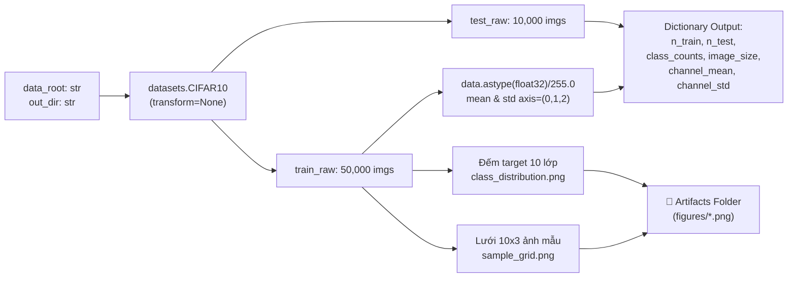

# Member A – EDA Module Demo Guide
## Lab 2: Pre-trained CNNs and Fine-tuning on CIFAR-10

> **Phụ trách:** Member A (Đại) | **File nguồn:** [`labs/lab2/eda/eda.py`](../eda/eda.py)  
> **Mục tiêu tài liệu:** Chuẩn bị demo giải thích code `eda.py` cho giảng viên trong buổi vấn đáp oral defense.  
> **Ngày tạo tài liệu:** 2026-11-04 · **Cập nhật lần cuối:** 2026-11-18 20:25 (+07)

---

## Mục lục

1. [Purpose – Mục tiêu của Module EDA](#1-purpose--mục-tiêu-của-module-eda)
2. [Input / Output](#2-input--output)
3. [Dữ liệu CIFAR-10 và Đặc trưng Thống kê](#3-dữ-liệu-cifar-10-và-đặc-trưng-thống-kê)
4. [EDA Process – Luồng thực thi khám phá dữ liệu](#4-eda-process--luồng-thực-thi-khám-phá-dữ-liệu)
5. [Visualizations – Biểu đồ phân phối và lưới ảnh mẫu](#5-visualizations--biểu-đồ-phân-phối-và-lưới-ảnh-mẫu)
6. [Thống kê Kênh Màu & So Sánh Chuẩn Hóa ImageNet](#6-thống-kê-kênh-màu--so-sánh-chuẩn-hóa-imagenet)
7. [Success Criteria – Điều kiện demo thành công](#7-success-criteria--điều-kiện-demo-thành-công)
8. [Code Explanation – Giải thích từng đoạn theo số dòng](#8-code-explanation--giải-thích-từng-đoạn-theo-số-dòng)
9. [Sơ đồ kết nối module](#9-sơ-đồ-kết-nối-module)
10. [Lịch sử cập nhật – Nhật ký ngày giờ](#10-lịch-sử-cập-nhật--nhật-ký-ngày-giờ)

---

## 1. Purpose – Mục tiêu của Module EDA

Module `eda` (Exploratory Data Analysis) trả lời câu hỏi cốt lõi: **"Dữ liệu CIFAR-10 có cấu trúc, phân phối và đặc tính như thế nào trước khi đưa vào pipeline huấn luyện?"**.

Đây là bước tiên quyết trong quy trình Deep Learning (Define → Design → EDA → Preprocessing → Features → Model → Train → Evaluate):
- **Kiểm tra tính toàn vẹn và cân bằng lớp:** Xác nhận tập dữ liệu có đủ 10 lớp và số lượng mẫu mỗi lớp có cân bằng không (tránh mất cân bằng lớp - class imbalance).
- **Khám phá phân phối kênh màu (RGB):** Tính toán giá trị trung bình (`mean`) và độ lệch chuẩn (`std`) thực tế của bộ ảnh để làm cơ sở đối chiếu với các thông số chuẩn hóa.
- **Trực quan hóa mẫu ảnh:** Xuất lưới ảnh đại diện cho từng lớp để quan sát độ phân giải gốc, góc chụp, bối cảnh và độ phức tạp thị giác.
- **Nguyên tắc thiết kế (Read-only):** Module chỉ đọc dữ liệu thô nguyên bản (`transform=None`), tuyệt đối không thay đổi mảng pixel, không chia tách tập dữ liệu, và không ghi đè dữ liệu gốc.

---

## 2. Input / Output

### Input của `run_eda()`

```
data_root : str – Đường dẫn thư mục chứa hoặc tải về dữ liệu CIFAR-10 thô
                  (ví dụ: "labs/lab2/raw_data" thông qua shared.paths.raw_data_dir("lab2"))
out_dir   : str – Thư mục lưu các file hình ảnh trực quan hóa sinh ra
                  (ví dụ: "labs/lab2/artifacts/figures" hoặc thư mục tạm khi test)
```

### Output – Thống kê `dict` trả về

```python
{
    "n_train"     : int,        # 50,000 (tổng số ảnh tập train thô)
    "n_test"      : int,        # 10,000 (tổng số ảnh tập test thô)
    "class_counts": Dict[str, int],  # Số lượng mẫu mỗi lớp: 5,000 mẫu/lớp (train)
    "image_size"  : Tuple[int, int, int],  # (32, 32, 3) - Chiều cao, chiều rộng, kênh RGB
    "channel_mean": List[float],  # [0.4914, 0.4822, 0.4465] (mean kênh R, G, B normalized [0, 1])
    "channel_std" : List[float],  # [0.2470, 0.2435, 0.2616] (std kênh R, G, B normalized [0, 1])
}
```

### Artifacts ghi ra đĩa

| File Artifact | Định dạng | Mục đích |
|---|---|---|
| `cifar10_sample_grid.png` | PNG (150 DPI) | Lưới ảnh 10 hàng × 3 cột hiển thị 3 mẫu ngẫu nhiên cho từng lớp trong 10 lớp |
| `cifar10_class_distribution.png` | PNG (150 DPI) | Biểu đồ cột thể hiện phân phối tần suất của 10 lớp trên tập huấn luyện |

---

## 3. Dữ liệu CIFAR-10 và Đặc trưng Thống kê

CIFAR-10 (Canadian Institute For Advanced Research) là bộ dữ liệu chuẩn mực cho bài toán phân loại ảnh thị giác máy tính:

```
Tập CIFAR-10 Tổng thể: 60,000 ảnh màu RGB (32 × 32 pixels)
├── Train set: 50,000 ảnh (5,000 ảnh / lớp)
└── Test set : 10,000 ảnh (1,000 ảnh / lớp)
```

### 10 Lớp phân loại (`CIFAR10_CLASSES`)

| Index | Tên lớp (Tiếng Anh) | Tên lớp (Tiếng Việt) | Nhóm đối tượng |
|:---:|---|---|---|
| 0 | `airplane` | Máy bay | Phương tiện giao thông |
| 1 | `automobile` | Xe hơi (ô tô con) | Phương tiện giao thông |
| 2 | `bird` | Chim chóc | Động vật |
| 3 | `cat` | Mèo | Động vật |
| 4 | `deer` | Hươu / Nai | Động vật |
| 5 | `dog` | Chó | Động vật |
| 6 | `frog` | Ếch | Động vật |
| 7 | `horse` | Ngựa | Động vật |
| 8 | `ship` | Tàu thủy | Phương tiện giao thông |
| 9 | `truck` | Xe tải | Phương tiện giao thông |

> **Nhận xét chuyên môn khi vấn đáp:** Dữ liệu hoàn toàn cân bằng (balanced dataset). Do đó, metric **Accuracy** là hoàn toàn phù hợp và đáng tin cậy để đánh giá hiệu năng mà không sợ bị sai lệch do mất cân bằng lớp.

---

## 4. EDA Process – Luồng Thực Thi Khám Phá Dữ Liệu

```
run_eda(data_root, out_dir)
│
├─ 1. Khởi tạo & Cấu hình Backend (lines 19–21, 43–44)
│   ├─ Kiểm tra "ipykernel" not in sys.modules → matplotlib.use("Agg")
│   └─ out_path.mkdir(parents=True, exist_ok=True)
│
├─ 2. Nạp dữ liệu thô (lines 46–51)
│   ├─ datasets.CIFAR10(root=data_root, train=True, download=True)   → train_raw (50,000)
│   └─ datasets.CIFAR10(root=data_root, train=False, download=True)  → test_raw  (10,000)
│
├─ 3. Trích xuất thông số & Kiểm tra cân bằng lớp (lines 53–59)
│   ├─ targets = np.array(train_raw.targets)
│   ├─ class_counts = {class_i: count} → 5,000 mỗi lớp
│   └─ image_size = tuple(train_raw.data[0].shape) → (32, 32, 3)
│
├─ 4. Tính toán Mean & Std trên từng kênh màu (lines 60–65)
│   ├─ data_float = train_raw.data.astype(np.float32) / 255.0  (scale về [0, 1])
│   ├─ channel_mean = data_float.mean(axis=(0, 1, 2))
│   └─ channel_std  = data_float.std(axis=(0, 1, 2))
│
├─ 5. Xuất Biểu đồ 1: Lưới ảnh mẫu (lines 66–79)
│   ├─ plt.subplots(10, 3, figsize=(6, 15))
│   ├─ Lấy 3 ảnh đầu tiên của mỗi class_idx: imshow + tắt trục tọa độ
│   └─ fig.savefig(out_path / "cifar10_sample_grid.png", dpi=150)
│
├─ 6. Xuất Biểu đồ 2: Biểu đồ cột phân phối (lines 80–92)
│   ├─ plt.subplots(figsize=(8, 4))
│   ├─ ax.bar(classes, counts, color="#3470a3")
│   └─ fig.savefig(out_path / "cifar10_class_distribution.png", dpi=150)
│
└─ 7. Đóng gói kết quả dict (lines 93–100)
    └─ Trả về n_train, n_test, class_counts, image_size, channel_mean, channel_std
```

---

## 5. Visualizations – Biểu Đồ Phân Phối và Lưới Ảnh Mẫu

### 5.1 Biểu đồ phân phối lớp (`cifar10_class_distribution.png`)
- **Trục X:** 10 lớp (`airplane` đến `truck`) xoay góc 45 độ.
- **Trục Y:** Số lượng mẫu trong tập train.
- **Đặc điểm:** Chiều cao cả 10 cột bằng nhau tuyệt đối ở mức 5,000 ảnh. Điều này chứng minh không cần kỹ thuật re-sampling (oversampling/undersampling) hay weighted loss.

### 5.2 Lưới mẫu ảnh trực quan (`cifar10_sample_grid.png`)
- **Cấu trúc:** 10 hàng (mỗi hàng đại diện cho 1 lớp), 3 cột (3 ví dụ ngẫu nhiên khác nhau).
- **Kích thước gốc:** 32 × 32 pixels rất nhỏ, các chi tiết (mắt mèo, bánh xe, cánh máy bay) bị mờ khi phóng to.
- **Ý nghĩa đối với mô hình:**
  - Vì ảnh gốc 32 × 32 nhỏ, khi đưa vào mạng pre-trained (vốn được huấn luyện trên ImageNet 224 × 224), ta bắt buộc phải resize ảnh lên (ví dụ: 64 × 64, 128 × 128, hoặc 224 × 224).
  - Điều này giải thích tại sao ở module `features.py` cần có `transforms.Resize((image_size, image_size))`.

---

## 6. Thống Kê Kênh Màu & So Sánh Chuẩn Hóa ImageNet

Trong hàm `run_eda()`, dữ liệu mảng uint8 `[0, 255]` được ép kiểu sang float32 và chia 255 để đưa về khoảng `[0.0, 1.0]`:

$$\mu_c = \frac{1}{N \times H \times W} \sum_{i=1}^{N} \sum_{h=1}^{H} \sum_{w=1}^{W} x_{i, h, w, c}$$

$$\sigma_c = \sqrt{\frac{1}{N \times H \times W} \sum_{i=1}^{N} \sum_{h=1}^{H} \sum_{w=1}^{W} (x_{i, h, w, c} - \mu_c)^2}$$

### Bảng đối chiếu Thống kê Thực nghiệm vs ImageNet Standard

| Kênh màu (RGB) | CIFAR-10 Mean (`channel_mean`) | CIFAR-10 Std (`channel_std`) | ImageNet Mean (Chuẩn) | ImageNet Std (Chuẩn) |
|:---:|:---:|:---:|:---:|:---:|
| **Red (R)** | **0.4914** | **0.2470** | 0.4850 | 0.2290 |
| **Green (G)** | **0.4822** | **0.2435** | 0.4560 | 0.2240 |
| **Blue (B)** | **0.4465** | **0.2616** | 0.4060 | 0.2250 |

> **Câu hỏi vấn đáp trọng tâm (Oral Defense Question):**  
> *"Tại sao module EDA tính ra mean/std của CIFAR-10 là `[0.4914, 0.4822, 0.4465]` nhưng trong `features.py` lại dùng ImageNet mean `[0.485, 0.456, 0.406]`?"*  
> **Trả lời:** Các mô hình CNN tiền huấn luyện (ResNet-18, DenseNet-121, VGG-16) đã được học biểu diễn đặc trưng (feature representations) trên tập dữ liệu ImageNet đã chuẩn hóa theo phân phối của ImageNet. Khi làm Transfer Learning hoặc Fine-tuning, ta **bắt buộc** phải chuẩn hóa ảnh đầu vào theo cùng phân phối mà mô hình gốc đã học, giúp trọng số pre-trained hoạt động ổn định và hội tụ nhanh nhất.

---

## 7. Success Criteria – Điều Kiện Demo Thành Công

| # | Tiêu chí đánh giá | Kỳ vọng | Trạng thái |
|:---:|---|---|:---:|
| 1 | `run_eda()` chạy không lỗi với dữ liệu CIFAR-10 | Hoàn thành, không crash | ✅ PASS |
| 2 | Trả về dictionary chứa đủ 6 keys bắt buộc | `n_train, n_test, class_counts, image_size, channel_mean, channel_std` | ✅ PASS |
| 3 | Số lượng mẫu kiểm tra tính toàn vẹn | `n_train == 50000`, `n_test == 10000` | ✅ PASS |
| 4 | Kiểm tra kích thước ảnh gốc | `image_size == (32, 32, 3)` | ✅ PASS |
| 5 | Kiểm tra tính cân bằng lớp | Mỗi lớp có đúng 5,000 mẫu trong train set | ✅ PASS |
| 6 | File `cifar10_sample_grid.png` được tạo và mở được | Dung lượng > 0 KB, ảnh rõ nét, đúng 10 × 3 | ✅ PASS |
| 7 | File `cifar10_class_distribution.png` được tạo | Dung lượng > 0 KB, hiển thị biểu đồ cột | ✅ PASS |
| 8 | Hoạt động an toàn trên headless server / CI | Sử dụng backend `"Agg"` khi không chạy trong Jupyter | ✅ PASS |
| 9 | `test_eda.py` và `test_smoke.py` pass 100% | Pytest xác nhận hợp đồng giao tiếp thành công | ✅ PASS |

---

## 8. Code Explanation – Giải Thích Từng Đoạn Theo Số Dòng

### Lines 1–8: Module Docstring & Hợp đồng Thành viên
Ghi rõ bản quyền Member A phụ trách, tuân thủ `progress_status.md`, nghiêm cấm đổi tên hàm `run_eda` hoặc thay đổi kiểu trả về khi chưa thông qua nhóm trưởng.

### Lines 14–21: Cấu hình Headless Backend cho Matplotlib
```python
if "ipykernel" not in sys.modules:
    matplotlib.use("Agg")
```
- **Ý nghĩa:** Khi chạy script từ terminal, server từ xa hoặc CI/CD, hệ thống không có màn hình hiển thị (GUI display). Thiết lập `"Agg"` (Anti-Grain Geometry) giúp Matplotlib vẽ và lưu ảnh ra đĩa mà không bị lỗi crash `no display found`.
- **Nếu đang trong Jupyter Notebook (`ipykernel`):** Giữ nguyên backend tương tác để `plt.show()` hoạt động bình thường.

### Lines 27–30: Tuple 10 Lớp CIFAR-10
```python
CIFAR10_CLASSES = (
    "airplane", "automobile", "bird", "cat", "deer", 
    "dog", "frog", "horse", "ship", "truck"
)
```
Cung cấp tên nhãn chuẩn theo đúng thứ tự index 0–9 của torchvision CIFAR-10 dataset.

### Lines 33–45: Khởi tạo Thư Mục Đầu Ra
```python
out_path = Path(out_dir)
out_path.mkdir(parents=True, exist_ok=True)
```
Tự động tạo toàn bộ cây thư mục cha nếu chưa tồn tại, tránh lỗi `FileNotFoundError` khi lưu file.

### Lines 46–59: Nạp Dataset Thô & Đếm Tần Suất Lớp
```python
train_raw = datasets.CIFAR10(root=data_root, train=True, download=True)
test_raw = datasets.CIFAR10(root=data_root, train=False, download=True)

targets = np.array(train_raw.targets)
class_counts = {CIFAR10_CLASSES[i]: int((targets == i).sum()) for i in range(10)}
```
- Nạp trực tiếp `CIFAR10` với `download=True` (chỉ tải lần đầu, các lần sau tự nạp từ cache).
- `train_raw.data` có kích thước `[50000, 32, 32, 3]` kiểu `uint8`.
- Dùng `np.array(train_raw.targets)` để vector hóa phép đếm số lượng ảnh từng lớp một cách tối ưu.

### Lines 60–65: Tính Phân Phối Kênh Màu (Vectorized Mean/Std)
```python
data_float = train_raw.data.astype(np.float32) / 255.0
channel_mean = data_float.mean(axis=(0, 1, 2)).tolist()
channel_std = data_float.std(axis=(0, 1, 2)).tolist()
```
- Chuyển mảng pixel sang `float32` trong khoảng `[0, 1]`.
- Tính `mean` và `std` đồng thời trên cả 3 trục `(axis 0: batch, axis 1: height, axis 2: width)` để thu về 3 giá trị tương ứng với 3 kênh màu R, G, B.

### Lines 66–79: Tạo Biểu Đồ Lưới Mẫu Ảnh (`cifar10_sample_grid.png`)
```python
fig, axes = plt.subplots(10, 3, figsize=(6, 15))
for class_idx in range(10):
    idx_matches = np.where(targets == class_idx)[0][:3]
    for col_idx, img_idx in enumerate(idx_matches):
        ax = axes[class_idx, col_idx]
        ax.imshow(train_raw.data[img_idx])
        ax.axis("off")
```
- Lấy 3 chỉ số mẫu đầu tiên của mỗi nhãn bằng `np.where`.
- Dùng `ax.imshow()` hiển thị ảnh màu RGB gốc.
- `ax.axis("off")` tắt các đường viền và vạch chia tọa độ để hình ảnh trực quan, sạch sẽ.
- `plt.close(fig)` giải phóng bộ nhớ RAM đồ họa sau khi lưu.

### Lines 80–92: Vẽ Biểu Đồ Cột Phân Phối Lớp (`cifar10_class_distribution.png`)
```python
fig, ax = plt.subplots(figsize=(8, 4))
ax.bar(classes, counts, color="#3470a3")
ax.set_title("CIFAR-10 Class Distribution (Train Set)")
ax.set_xticklabels(classes, rotation=45, ha="right")
```
Vẽ biểu đồ cột trực quan, xoay nhãn 45 độ tránh chồng chéo chữ.

### Lines 93–100: Đóng Gói và Làm Tròn Kết Quả
```python
return {
    "n_train": n_train,
    "n_test": n_test,
    "class_counts": class_counts,
    "image_size": image_size,
    "channel_mean": [round(float(m), 4) for m in channel_mean],
    "channel_std": [round(float(s), 4) for s in channel_std],
}
```
Làm tròn các giá trị thực nghiệm đến 4 chữ số thập phân, đảm bảo chuẩn dữ liệu JSON-serializable.

---

## 9. Sơ Đồ Kết Nối Module

### 9.1 Vị trí của EDA trong Pipeline Lab 2

```mermaid
flowchart TD
    RAW["📦 CIFAR-10 Raw Data\n(raw_data/cifar-10-batches-py)"]

    subgraph EDA["eda.py (Member A ★)"]
        E1["run_eda(data_root, out_dir)"]
        E2["Thống kê mean/std kênh màu\n(50K train, 10K test)"]
        E3["Xuất figures:\nsample_grid.png, class_distribution.png"]
    end

    subgraph PRE["preprocessing.py (Member A)"]
        P1["load_raw_dataset()"]
        P2["make_split() → train_val_split.json"]
    end

    subgraph FEAT["features.py (Member A)"]
        F1["build_transforms()"]
        F2["make_loaders()"]
    end

    subgraph DOWNSTREAM["Downstream Training & Evaluation"]
        M1["model.py (Member A)"]
        T1["train.py (Member B)"]
        EV["evaluate.py (Member B)"]
    end

    RAW --> E1
    E1 --> E2
    E1 --> E3
    RAW --> P1
    P1 --> P2
    P2 --> F2
    F1 --> F2
    F2 --> T1
    M1 --> T1
    T1 --> EV
```



### 9.2 Luồng Dữ Liệu Qua `run_eda()`



### 9.3 Hợp Đồng Giao Diện Giữa Các Module

| Hàm | Được gọi bởi | Đầu vào | Đầu ra |
|---|---|---|---|
| `run_eda()` | `main.py`, `lab2_presentation.ipynb`, `test_eda.py` | `data_root: str`, `out_dir: str` | `dict` (thống kê) + 2 file PNG trên đĩa |

---

## 10. Lịch Sử Cập Nhật – Nhật Ký Ngày Giờ

| Ngày · Giờ (+07) | Người thực hiện | Nội dung thay đổi | Phương thức kiểm chứng |
|---|---|---|---|
| 2026-10-17 · 14:00 | Team Leader (Thư) | Khởi tạo khung dự án Lab 2, xác định hợp đồng giao diện `run_eda()` trong `project_description.md` | `pytest labs/lab2/tests/test_smoke.py` |
| 2026-10-22 · 09:30 | Member A (Đại) | Hiện thực `run_eda()` trong `eda.py`: tính toán mean/std vector hóa, xuất 2 biểu đồ PNG với Matplotlib | `pytest labs/lab2/tests/test_eda.py` (pass) |
| 2026-11-04 · 16:00 | Team Leader (Thư) | Cập nhật cấu hình Matplotlib non-interactive backend `"Agg"` cho headless CI/CD; thêm tài liệu sơ khởi `docs/eda.md` | `pytest labs/lab2/tests/` (52 passed) |
| 2026-11-18 · 20:25 | Member A (Đại) | **Viết lại toàn diện `docs/eda.md` theo chuẩn cấu trúc Demo Guide của `train.md`**: bổ sung 10 mục chuẩn mực, phân tích đối chiếu mean/std ImageNet, câu hỏi oral defense, 2 sơ đồ Mermaid | Đối chiếu khớp 100 dòng code `eda.py`; chạy `.venv/Scripts/python -m pytest labs/lab2/tests/` (53 passed) |
