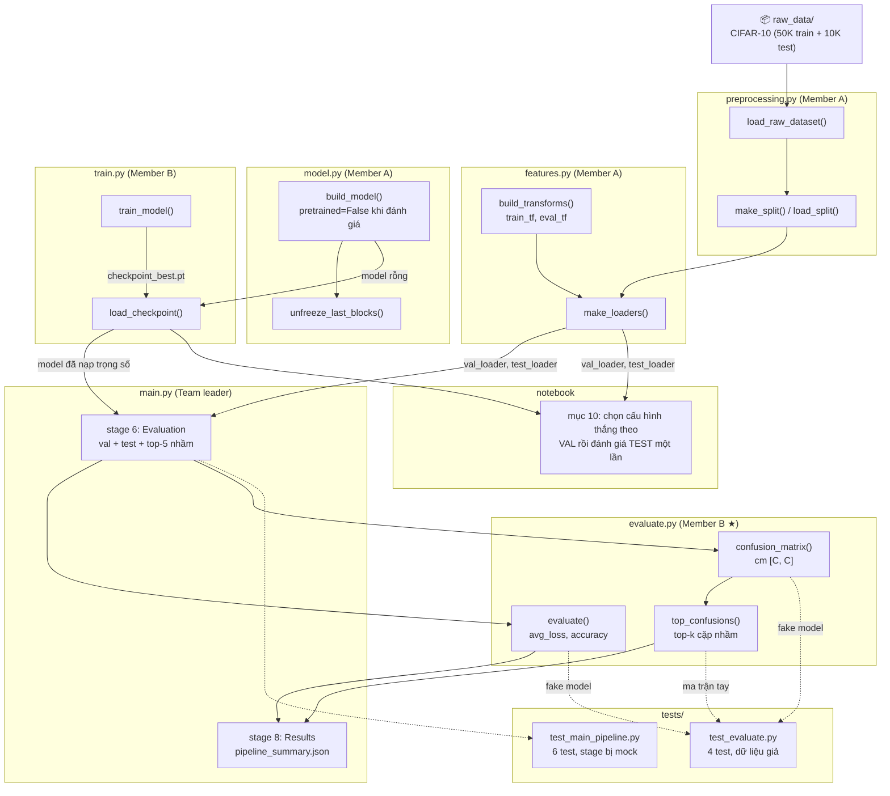
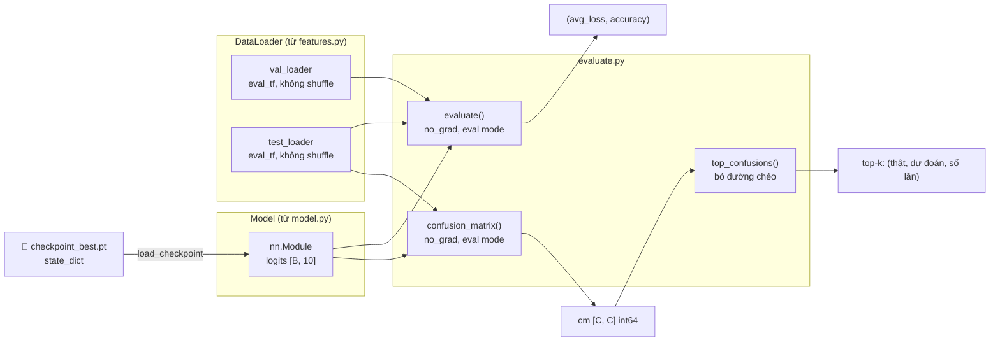

# Member B – Evaluate Module Demo Guide
## Lab 2: Pre-trained CNNs and Fine-tuning on CIFAR-10

> **Phụ trách:** Member B | **File nguồn:** [`labs/lab2/evaluate/evaluate.py`](../evaluate/evaluate.py)
> **Mục tiêu tài liệu:** Chuẩn bị demo giải thích code `evaluate.py` cho giảng viên.
> **Ngày tạo tài liệu:** 2026-11-04 · **Cập nhật lần cuối:** 2026-11-13 20:45 (+07)

---

## Mục lục

1. [Purpose – Mục tiêu](#1-purpose--mục-tiêu-của-module-evaluation)
2. [Input / Output](#2-input--output)
3. [Dữ liệu và Model được đánh giá](#3-dữ-liệu-và-model-được-đánh-giá)
4. [Evaluation Process – Luồng đánh giá](#4-evaluation-process--luồng-đánh-giá)
5. [Metrics – Loss, Accuracy và Confusion Matrix](#5-metrics--loss-accuracy-và-confusion-matrix)
6. [Top Confusions – Phân tích lỗi](#6-top-confusions--phân-tích-lỗi)
7. [Success Criteria – Điều kiện demo thành công](#7-success-criteria--điều-kiện-demo-thành-công)
8. [Code Explanation – Giải thích từng đoạn theo số dòng](#8-code-explanation--giải-thích-từng-đoạn-theo-số-dòng)
9. [Sơ đồ kết nối module](#9-sơ-đồ-kết-nối-module)
10. [Lịch sử cập nhật – Nhật ký ngày giờ](#10-lịch-sử-cập-nhật--nhật-ký-ngày-giờ)
---

## 1. Purpose – Mục tiêu của Module Evaluation

Module `evaluate` trả lời câu hỏi **"mô hình đã học tốt đến đâu?"** trên dữ liệu *không dùng để huấn luyện*, mà không sửa gì vào mô hình.

**Ba nhiệm vụ của `evaluate.py`:**

| Hàm | Nhiệm vụ | Kết quả |
|-----|----------|---------|
| `evaluate()` | Đo loss trung bình + độ chính xác top-1 | `(avg_loss, accuracy)` |
| `confusion_matrix()` | Đếm ma trận nhầm lẫn `[C, C]` | `np.ndarray` kiểu `int64` |
| `top_confusions()` | Tìm các cặp nhầm lẫn nhiều nhất | `[(lớp thật, lớp dự đoán, số lần), ...]` |

**Nguyên tắc thiết kế (quan trọng khi bị hỏi):**
- **Validation dùng để chọn** cấu hình/checkpoint; **Test chỉ chạy một lần** cho checkpoint đã chọn → notebook (mục 10) đọc `best_val_acc` để chọn cấu hình thắng, rồi mới gọi `evaluate()` trên test.
- Module **chỉ đọc**: không train, không cập nhật trọng số, không ghi file. Việc ghi `pipeline_summary.json` / hình là của `main.py` và notebook.
- `evaluate()` **không tự chọn model hay checkpoint** – nó nhận một `nn.Module` đã nạp sẵn trọng số.

---

## 2. Input / Output

### Input của ba hàm public

```
evaluate(model, loader, device)
    model  : nn.Module          – model đã nạp trọng số, trả logits [B, 10]
    loader : DataLoader         – val_loader hoặc test_loader từ features.make_loaders
    device : torch.device | str – 'cpu' / 'cuda'

confusion_matrix(model, loader, device, num_classes=10)
    num_classes : int           – số lớp (CIFAR-10 = 10), phải > 0

top_confusions(cm, class_names, k=5)
    cm          : np.ndarray    – ma trận [C, C] do confusion_matrix() trả về
    class_names : List[str]     – tên lớp, len(class_names) phải bằng C
    k           : int           – số cặp nhầm lẫn muốn lấy (mặc định 5)
```

### Output

```python
# evaluate()
(avg_loss, accuracy)          # cả hai là float, accuracy ∈ [0, 1]

# confusion_matrix()
np.ndarray shape [C, C], dtype int64
# hàng = nhãn thật, cột = nhãn dự đoán; tổng các ô = số mẫu đã đánh giá

# top_confusions()
[("cat", "dog", 92), ("automobile", "truck", 64), ...]   # tối đa k phần tử
```

### Artifacts

| Artifact | Ai ghi |
|----------|--------|
| Không có | `evaluate.py` **không ghi file nào** |
| `pipeline_summary.json` | `main.py` (chứa `val_*`, `test_*`, `top_confusions`) |
| Hình / bảng trong notebook | notebook `lab2_presentation.ipynb` |

---

## 3. Dữ liệu và Model được đánh giá

`evaluate()` nhận **bất kỳ `nn.Module`** nào có output `[B, 10]` logits – nó không biết kiến trúc bên trong.

### 3.1 Model

```
Model (ResNet-18 / DenseNet-121 / VGG-16 ...)
  Input  [B, 3, 128, 128]   ← ảnh đã resize + normalize (eval_tf)
  Output [B, 10]            ← logits thô, CHƯA softmax
```

- Trong `main.py`, model được **dựng lại** bằng `build_model(..., pretrained=False)` rồi nạp trọng số bằng `load_checkpoint()` – không tải lại weights ImageNet vì checkpoint đã có đủ.
- `nn.CrossEntropyLoss` được tạo **bên trong** `evaluate()` nên loss luôn cùng công thức với lúc train (xem mục 5).

### 3.2 DataLoader

| Loader | Transform | Shuffle | Vai trò |
|--------|-----------|---------|---------|
| `val_loader` | `eval_tf` (resize + normalize) | ❌ | chọn cấu hình / checkpoint |
| `test_loader` | `eval_tf` | ❌ | đánh giá cuối, **một lần duy nhất** |

> **Điểm quan trọng:** cả hai loader đều **không augment** và **không shuffle**. Nếu augment/ shuffle tập đánh giá thì con số accuracy sẽ dao động theo từng lần chạy và không so sánh được giữa các cấu hình.

---

## 4. Evaluation Process – Luồng đánh giá

```
evaluate(model, loader, device)                    ← lines 18–56
│
├─ Chuẩn bị (L28–L32)
│   ├─ device = torch.device(device)   # nhận cả 'cpu' và torch.device
│   ├─ model.to(device)
│   ├─ model.eval()                    # tắt Dropout, BN dùng running stats
│   └─ criterion = nn.CrossEntropyLoss()
│
├─ Vòng lặp không gradient (L37–L49)
│   └─ with torch.no_grad():
│       └─ for images, targets in loader:
│           ├─ images / targets → device
│           ├─ outputs = model(images)          # [B, 10] logits
│           ├─ loss = criterion(outputs, targets)
│           ├─ total_loss   += loss.item() * batch_size   # trọng số theo số mẫu
│           ├─ preds = outputs.argmax(dim=1)    # lớp có score cao nhất
│           ├─ correct     += (preds == targets).sum()
│           └─ total_samples += batch_size
│
├─ Kiểm tra rỗng (L51–L52)
│   └─ total_samples == 0 → raise ValueError
│
└─ Trả kết quả (L54–L56)
    ├─ avg_loss = total_loss / total_samples
    ├─ accuracy = correct / total_samples
    └─ return float(avg_loss), float(accuracy)
```

### Chi tiết một batch

```
images  [B, 3, 128, 128]
   ↓ model(images)
logits  [B, 10]
   ├─↓ criterion(logits, targets)        → loss (scalar, trung bình batch)
   └─↓ argmax(dim=1)                     → preds [B] ∈ {0..9}
        ↓ so với targets [B]
      đếm số đúng
```

### `confusion_matrix()` – luồng riêng

```
confusion_matrix(model, loader, device, num_classes=10)   ← lines 59–95
├─ num_classes <= 0 → ValueError                      (L69–70)
├─ model.to(device); model.eval()
├─ cm = np.zeros((C, C), dtype=np.int64)              (L76)
├─ with torch.no_grad():
│   └─ for mỗi batch:
│       ├─ preds = model(images).argmax(dim=1)
│       └─ for (t, p) trong (targets, preds):
│           ├─ 0 <= t < C và 0 <= p < C → cm[t, p] += 1
│           └─ ngược lại → ValueError (dữ liệu/nhãn sai)   (L89–93)
└─ return cm
```

---

## 5. Metrics – Loss, Accuracy và Confusion Matrix

### 5.1 Cross-Entropy Loss

```
loss = -log( softmax(logits)[target] )
     = -logits[target] + log( Σ_k exp(logits[k]) )
```

- Model trả **logits thô**; `CrossEntropyLoss` tự làm softmax + log bên trong → **không được thêm softmax vào head**.
- Loss càng nhỏ thì xác suất model gán cho lớp đúng càng cao.

### 5.2 `avg_loss` – trung bình **theo số mẫu**, không phải trung bình theo batch

```python
total_loss += loss.item() * batch_size      # (L46)
avg_loss = total_loss / total_samples       # (L54)
```

Vì `loss.item()` là trung bình của batch, phải **nhân lại `batch_size`** rồi chia cho tổng số mẫu.

> **Vì sao quan trọng:** batch cuối thường nhỏ hơn (ví dụ 5.000 mẫu / batch 64 → batch cuối 8 mẫu). Nếu lấy trung bình cộng các batch thì batch nhỏ bị đếm ngang batch lớn → `avg_loss` bị lệch. Cách nhân theo số mẫu cho ra **trung bình trên từng mẫu**, đúng nghĩa.
>
> **Điểm cộng khi demo:** `train.py` (validation loop) dùng **đúng công thức này**, nên `val_loss` in lúc train và `avg_loss` do `evaluate()` trả về là **cùng một đại lượng** – hai con số so sánh được trực tiếp.

### 5.3 Accuracy

```
accuracy = số dự đoán đúng / tổng số mẫu   ∈ [0, 1]      (L48, L55)
```

- Top-1 accuracy: chỉ tính đúng khi `argmax` trùng nhãn.
- Trả về **tỉ lệ 0–1**, nơi in ra mới nhân 100 (notebook in `90.71%`).

### 5.4 Confusion Matrix

```
M[i, j] = số mẫu có nhãn thật i nhưng bị dự đoán là j
```

| Tính chất | Giá trị |
|-----------|---------|
| Kích thước | `[num_classes, num_classes]` = `[10, 10]` |
| Tổng toàn ma trận | = số mẫu được đánh giá (ví dụ 10.000) |
| Đường chéo `M[i, i]` | số mẫu dự đoán **đúng** lớp `i` |
| Ngoài đường chéo `M[i, j], i≠j` | số lần nhầm `i → j` |
| Kiểu dữ liệu | `np.int64` (đếm, không phải xác suất) |

**Các guard trong code:**
- `num_classes <= 0` → `ValueError` (L69–70)
- nhãn thật hoặc nhãn dự đoán ngoài `[0, C-1]` → `ValueError` (L92–93) – chặn lỗi im lặng khi loader trả nhãn lạ.

### 5.5 Kết quả đã ghi lại (notebook, Reported only)

| Hạng mục | Giá trị | Nguồn |
|----------|---------|-------|
| Baseline ResNet-18 đóng băng, 3 epoch, ảnh 128 – validation | 78,18% (3.909/5.000) | `README.md` |
| Cấu hình thắng (ResNet-18, `lr=1e-4`, mở 1 khối, 2 epoch) – validation | 91,16% | notebook mục 10 |
| Cùng checkpoint – **test** (10.000 mẫu) | **90,71%** (9.071/10.000), loss 0,2727 | notebook mục 10 |
| Chênh lệch val–test | 0,45 điểm % | notebook mục 10 |

---

## 6. Top Confusions – Phân tích lỗi

**Hàm `top_confusions()` (lines 98–125):**

```python
confusions = []
for i in range(num_classes):
    for j in range(num_classes):
        if i != j and cm[i, j] > 0:          # bỏ đường chéo, bỏ ô = 0
            confusions.append((class_names[i], class_names[j], int(cm[i, j])))
confusions.sort(key=lambda x: x[2], reverse=True)
return confusions[:k]                        # cắt còn tối đa k cặp
```

**Điểm quan trọng:**
- **Bỏ đường chéo** – dự đoán đúng không phải "nhầm lẫn".
- **Bỏ ô bằng 0** – không đưa cặp chưa từng nhầm vào bảng.
- Trả về **ít hơn `k`** nếu không đủ cặp khác 0 (không lỗi).
- Kiểm tra `cm.shape == (len(class_names), len(class_names))`, lệch → `ValueError` (L111–113) – tránh gán sai tên lớp.

**Ví dụ chạy tay (lấy từ `tests/test_evaluate.py`):**

```
cm = [[50,  5,  0],      A→B: 5
      [ 0, 40, 10],      B→C: 10
      [ 2,  0, 30]]      C→A: 2

top_confusions(cm, ["A","B","C"], k=2) → [("B","C",10), ("A","B",5)]
```

**Top-5 nhầm lẫn của baseline (README, tính trên **validation**):**

| Hạng | Thật → Dự đoán | Số lần | Lý do chính |
|:---:|---|:---:|---|
| 1 | `cat` → `dog` | 92 | Thú 4 chân, lông và khuôn mặt tương tự |
| 2 | `automobile` → `truck` | 64 | Cùng là xe có bánh, nền đường |
| 3 | `horse` → `deer` | 54 | Động vật 4 chân, mõm dài, nền đồng cỏ |
| 4 | `ship` → `airplane` | 43 | Nền xanh đồng nhất (biển vs trời) |
| 5 | `bird` → `frog` | 38 | Mảng màu và texture thiên nhiên giống nhau |

---

## 7. Success Criteria – Điều kiện demo thành công

| # | Tiêu chí | Trạng thái |
|---|----------|------------|
| 1 | `evaluate()` trả `float`, `0 ≤ acc ≤ 1`, `loss ≥ 0`, model ở `eval` mode | ✅ PASS |
| 2 | Loader rỗng → `ValueError("Loader yielded 0 samples for evaluation.")` | ✅ PASS |
| 3 | `confusion_matrix()` đúng shape `[C, C]`, tổng = số mẫu, các ô `[t, p]` đúng | ✅ PASS |
| 4 | `top_confusions()` bỏ đường chéo, sắp giảm dần, cắt đúng `k` | ✅ PASS |
| 5 | `tests/test_evaluate.py` – 4 test | ✅ 4/4 PASS (2026-11-04) |
| 6 | `main.py` gọi được ở stage 6 và ghi vào `pipeline_summary.json` | ✅ `test_main_pipeline.py` 6 PASS (2026-11-04) |
| 7 | Chạy thật: đánh giá checkpoint thắng trên test | ✅ test 90,71% / val 91,16% (notebook) |

**Điểm cần nói khi bảo vệ:**
- Test **chỉ dùng một lần** cho cấu hình thắng theo validation (chống "nhìn test rồi chọn").
- `avg_loss` của `evaluate()` **cùng công thức** với `val_loss` trong `train.py` (trung bình theo số mẫu).
- Confusion matrix: **hàng = nhãn thật, cột = nhãn dự đoán** – hay bị hỏi và hay bị nhầm.
- `argmax` trên logits tương đương `argmax` trên softmax → không cần softmax khi đánh giá.
- Không augment/ shuffle tập đánh giá; `torch.no_grad()` giảm bộ nhớ và tăng tốc.

**Giới hạn / lưu ý (nói thật nếu bị hỏi):**
- Trong phiên viết tài liệu 2026-11-13, **chưa chạy lại** `pytest` vì máy không có `torch` trong Python mặc định; số test lấy từ `progress_status.md` (lần chạy 2026-11-04).
- `evaluate()` để model ở `eval` mode sau khi xong (không khôi phục mode cũ). Không ảnh hưởng vì `train_model()` tự gọi `model.train()` ở mỗi epoch.
- `top_confusions()` cần `class_names` khớp đúng thứ tự lớp trong dataset (thứ tự CIFAR-10 chuẩn).

---

## 8. Code Explanation – Giải Thích Từng Đoạn Theo Số Dòng

### Lines 1–8: Module Docstring

Nêu owner (Member B) và quy tắc: **không đổi tên hàm/chữ ký** khi chưa báo nhóm trưởng, vì module khác phụ thuộc.

### Lines 9–15: Imports

```python
from __future__ import annotations
from typing import Any, List, Tuple
import numpy as np
import torch
import torch.nn as nn
from torch.utils.data import DataLoader
```

### Lines 18–27: `evaluate()` – Signature + Docstring

```python
def evaluate(model: nn.Module, loader: DataLoader, device: Any) -> Tuple[float, float]:
```

Docstring song ngữ theo đúng format: `Input / Output` (EN) và `Vào / Ra` (VI).

### Lines 28–32: Chuẩn bị device + eval mode

```python
device = torch.device(device)     # (L28) nhận cả 'cpu' và torch.device
model.to(device)                  # (L29)
model.eval()                      # (L30) Dropout off, BN dùng running stats
criterion = nn.CrossEntropyLoss() # (L32)
```

### Lines 33–37: Khởi tạo counters + `no_grad`

```python
total_loss = 0.0      # tổng loss ĐÃ NHÂN batch_size
correct = 0           # số mẫu dự đoán đúng
total_samples = 0     # tổng số mẫu
with torch.no_grad(): # (L37) không dựng đồ thị gradient
```

### Lines 38–49: Vòng lặp batch

```python
for images, targets in loader:
    images = images.to(device); targets = targets.to(device)   # (L39–40)
    outputs = model(images)                                    # (L42) [B,10]
    loss = criterion(outputs, targets)                         # (L43)
    batch_size = images.size(0)                                # (L45)
    total_loss += loss.item() * batch_size                     # (L46)
    preds = outputs.argmax(dim=1)                              # (L47)
    correct += (preds == targets).sum().item()                 # (L48)
    total_samples += batch_size                                # (L49)
```

### Lines 51–56: Guard + trả kết quả

```python
if total_samples == 0:                                          # (L51)
    raise ValueError("Loader yielded 0 samples for evaluation.") # (L52)
avg_loss = total_loss / total_samples                           # (L54)
accuracy = correct / total_samples                              # (L55)
return float(avg_loss), float(accuracy)                         # (L56)
```

### Lines 59–70: `confusion_matrix()` – Signature + guard

```python
def confusion_matrix(model, loader, device, num_classes: int = 10) -> np.ndarray:
    if num_classes <= 0:                                        # (L69)
        raise ValueError(f"num_classes must be positive, got {num_classes}")  # (L70)
```

### Lines 72–76: Chuẩn bị + cấp phát ma trận

```python
device = torch.device(device); model.to(device); model.eval()   # (L72–74)
cm = np.zeros((num_classes, num_classes), dtype=np.int64)       # (L76)
```

### Lines 78–93: Đếm từng mẫu

```python
with torch.no_grad():
    for images, targets in loader:
        images = images.to(device); targets = targets.to(device)
        outputs = model(images)
        preds = outputs.argmax(dim=1)                       # (L84)
        t_np = targets.cpu().numpy(); p_np = preds.cpu().numpy()   # (L86–87)
        for t, p in zip(t_np, p_np):
            if 0 <= t < num_classes and 0 <= p < num_classes:
                cm[t, p] += 1                                # (L91)
            else:
                raise ValueError(...)                        # (L93)
```

`.cpu().numpy()` cần thiết vì tensor có thể đang ở GPU.

### Lines 98–113: `top_confusions()` – Signature + validate

```python
def top_confusions(cm, class_names: List[str], k: int = 5):
    if not isinstance(cm, np.ndarray):
        cm = np.array(cm)                                    # (L108–109) chấp nhận list
    num_classes = len(class_names)
    if cm.shape != (num_classes, num_classes):
        raise ValueError(...)                                # (L112–113)
```

### Lines 115–125: Thu thập, sắp xếp, cắt `k`

```python
confusions = []
for i in range(num_classes):
    for j in range(num_classes):
        if i != j:
            count = int(cm[i, j])
            if count > 0:
                confusions.append((class_names[i], class_names[j], count))
confusions.sort(key=lambda x: x[2], reverse=True)             # (L124)
return confusions[:k]                                         # (L125)
```

Độ phức tạp `O(C²)` = 100 phép so sánh với CIFAR-10 → không đáng tối ưu.

---

## 9. Sơ Đồ Kết Nối Module

### 9.1 Tổng quan pipeline Lab 2



### 9.2 Luồng dữ liệu qua `evaluate.py`



### 9.3 Vị trí `evaluate.py` trong cấu trúc thư mục

```
Lab-DL/
└── labs/lab2/
    ├── preprocessing/preprocessing.py   ← load data, split
    ├── features/features.py             ← transforms, DataLoaders
    ├── model/model.py                   ← build_model, freeze/unfreeze
    ├── train/train.py                   ← train_model, save/load checkpoint
    ├── evaluate/
    │   └── evaluate.py  ★ Member B      ← evaluate, confusion_matrix, top_confusions
    ├── experiment/experiment.py         ← run_comparison, save_results
    ├── docs/
    │   ├── evaluate.md                  ← tài liệu này
    │   └── ...
    ├── artifacts/
    │   └── runs/
    │       ├── checkpoint_best.pt       ← input của module này
    │       └── pipeline_summary.json    ← chứa val/test accuracy do main.py ghi
    └── tests/
        ├── test_evaluate.py             ← 4 unit test
        └── test_main_pipeline.py        ← 6 test tích hợp (mock)
```

### 9.4 Interface giữa các module (hợp đồng giao diện)

| Hàm | Được gọi bởi | Nhận input từ | Trả output cho |
|-----|-------------|---------------|----------------|
| `evaluate()` | `main.py` (stage 6), notebook | `model.py`, `features.py`, `train.load_checkpoint` | `(avg_loss, accuracy)` → `main.py` / notebook |
| `confusion_matrix()` | `main.py` (stage 6), notebook | `features.py` loader | `np.ndarray [C, C]` → `top_confusions` |
| `top_confusions()` | `main.py` (stage 6), notebook | `confusion_matrix()` | Danh sách top-k → `pipeline_summary.json` |

> **Quy tắc nhóm:** không đổi tên hay chữ ký 3 hàm public trên khi chưa báo nhóm trưởng. `main.py`, notebook và test đang gọi trực tiếp theo đúng chữ ký này.

---

## 10. Lịch sử cập nhật – Nhật ký ngày giờ

| Ngày · Giờ (+07) | Người | Thay đổi | Kiểm chứng |
|---|---|---|---|
| 2026-10-26 · — | Member B (Bảo) | Viết `evaluate.py` (3 hàm public) + `tests/test_evaluate.py` | `pytest labs/lab2/tests` – 18 passed (ghi trong `progress_status.md`) |
| 2026-11-04 · — | Team leader (Thư) | Audit: siết guard (`num_classes`, nhãn ngoài miền), thống nhất loss theo số mẫu | `pytest labs/lab2/tests` – 52 passed; `test_evaluate.py` 4 passed |
| 2026-11-04 · — | Team leader (Thư) | Tạo tài liệu module `docs/evaluate.md` (bản "guide for AI agents") | Đối chiếu chữ ký bằng `inspect` |
| 2026-11-13 · 20:45 | Member B | Viết lại tài liệu theo cấu trúc Demo Guide (9 mục + mermaid), **thêm ngày giờ** ở header và mục 10 | Đối chiếu số dòng với `evaluate.py` hiện tại (125 dòng); số liệu lấy từ notebook mục 10 và README. **Chưa chạy lại pytest** (máy không có `torch` trong Python mặc định) |
