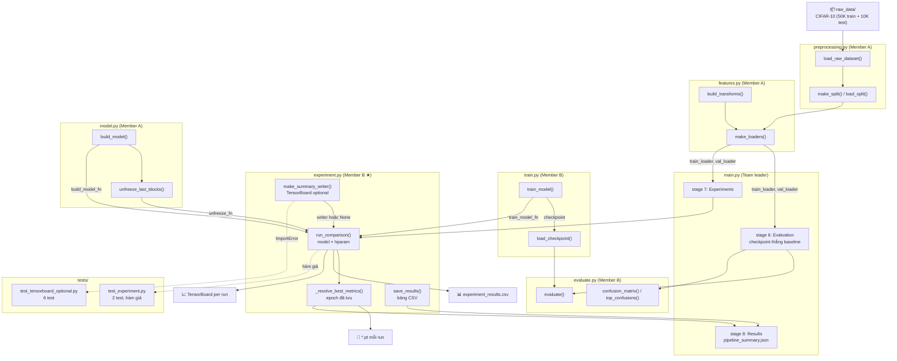
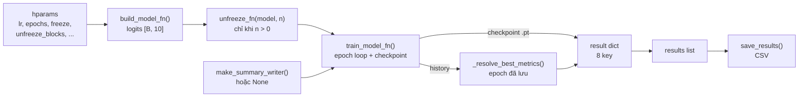

# Member B – Experiment Module Demo Guide
## Lab 2: Pre-trained CNNs and Fine-tuning on CIFAR-10

> **Phụ trách:** Member B | **File nguồn:** [`labs/lab2/experiment/experiment.py`](../experiment/experiment.py)
> **Mục tiêu tài liệu:** Chuẩn bị demo giải thích code `experiment.py` cho giảng viên.
> **Ngày tạo tài liệu:** 2026-11-04 · **Cập nhật lần cuối:** 2026-11-13 20:45 (+07)

---

## Mục lục

1. [Purpose – Mục tiêu](#1-purpose--mục-tiêu-của-module-experiments)
2. [Input / Output](#2-input--output)
3. [Thành phần được lắp ghép](#3-thành-phần-được-lắp-ghép--build--unfreeze--train--writer)
4. [Experiment Process – Luồng so sánh](#4-experiment-process--luồng-so-sánh)
5. [TensorBoard optional và chọn epoch báo cáo](#5-tensorboard-optional-và-chọn-epoch-báo-cáo)
6. [save_results – Xuất bảng CSV](#6-save_results--xuất-bảng-csv)
7. [Success Criteria – Điều kiện demo thành công](#7-success-criteria--điều-kiện-demo-thành-công)
8. [Code Explanation – Giải thích từng đoạn theo số dòng](#8-code-explanation--giải-thích-từng-đoạn-theo-số-dòng)
9. [Sơ đồ kết nối module](#9-sơ-đồ-kết-nối-module)
10. [Lịch sử cập nhật – Nhật ký ngày giờ](#10-lịch-sử-cập-nhật--nhật-ký-ngày-giờ)
---

## 1. Purpose – Mục tiêu của Module Experiments

Module `experiment` trả lời câu hỏi **"cấu hình nào tốt nhất?"** – nó chạy cùng một quy trình train cho nhiều `(model × siêu tham số)` và gom kết quả thành **một bảng so sánh**.

**Ba chiến lược được so sánh trong lab:**

| Chiến lược | `freeze_backbone` | `unfreeze_blocks` | Trainable |
|------------|:---:|:---:|---|
| **B – Feature Extraction** | `True` | `0` | chỉ classifier head |
| **C – Fine-tuning** | `True` | `1` | head + khối tích chập cuối |
| **A – Scratch** | — | — | (không dùng trong lưới hiện tại: `pretrained=True`) |

**Trách nhiệm của `experiment.py`:**
- Duyệt `model_names × hparam_grid`, mỗi cặp là **một run độc lập** (checkpoint + TensorBoard run riêng).
- Gọi `build_model()` → (tuỳ chọn) `unfreeze_last_blocks()` → `train_model()`.
- Báo cáo **đúng epoch đã lưu checkpoint**, không lấy `max(val_acc)` (có thể thuộc epoch khác).
- Xuất CSV để notebook/README dùng lại.

> **Nguyên tắc:** chỉ so sánh trên **validation**. Test không xuất hiện trong module này – test chỉ được gọi một lần cho cấu hình thắng (notebook mục 10).

---

## 2. Input / Output

### Input của `run_comparison()`

```
model_names   : List[str]                     – ví dụ ['resnet18', 'densenet121']
hparam_grid   : List[Dict]                    – mỗi dict: lr, epochs, optimizer_name, weight_decay,
                                                freeze_backbone, pretrained, unfreeze_blocks
loaders       : Tuple[DataLoader, DataLoader, DataLoader]  – (train, val, test); test bị bỏ qua
device        : torch.device | str            – 'cpu' / 'cuda'
log_root      : str                           – thư mục gốc cho checkpoint + TensorBoard

# Tham số tuỳ chọn (dùng cho test / tắt TensorBoard)
build_model_fn    : Optional[Callable] = None – mặc định import labs.lab2.model.model.build_model
unfreeze_fn       : Optional[Callable] = None – mặc định import unfreeze_last_blocks
train_model_fn    : Optional[Callable] = None – mặc định import labs.lab2.train.train.train_model
enable_tensorboard: bool = True               – False → không tạo writer dù đã cài TensorBoard
```

### Giá trị mặc định cho từng ô của `hparam_grid`

| Key | Default | Ý nghĩa |
|-----|---------|---------|
| `lr` | `1e-3` | learning rate |
| `epochs` | `1` | số epoch |
| `optimizer_name` | `'adam'` | `adam` hoặc `sgd` |
| `weight_decay` | `0.0` | L2 |
| `freeze_backbone` | `True` | đóng băng backbone |
| `pretrained` | `True` | nạp weights ImageNet |
| `unfreeze_blocks` | `0` | số khối cuối mở khoá (fine-tuning) |

### Output – list kết quả

```python
[
    {
        "model"              : str,            # 'resnet18'
        "hparams"            : dict,           # bản sao cấu hình của run này
        "best_val_acc"       : float,          # accuracy của ĐÚNG epoch đã lưu
        "best_val_loss"      : float | None,   # loss của epoch đó
        "best_epoch"         : int | None,     # epoch 1-based
        "train_seconds"      : float,          # wall-clock của run
        "checkpoint"         : str,            # đường dẫn .pt
        "tensorboard_logged" : bool,           # writer khác None?
    },
    ...
]   # độ dài = len(model_names) × len(hparam_grid)
```

### Artifacts ghi ra disk

| Artifact | Vị trí | Mô tả |
|----------|--------|-------|
| Checkpoint mỗi run | `{log_root}/{run_name}_best.pt` | state_dict của epoch tốt nhất |
| TensorBoard run | `{log_root}/{run_name}/events.out.tfevents...` | 3 scalar mỗi epoch (nếu có TensorBoard) |
| Bảng so sánh CSV | do `save_results()` quyết định | `model, hp_*, best_val_acc, best_val_loss, best_epoch, train_seconds, checkpoint` |

`run_name = f"{model_name}_run{idx}_lr{lr}_freeze{freeze_backbone}"` – ví dụ `resnet18_run1_lr0.0001_freezeTrue`.

---

## 3. Thành phần được lắp ghép – build → unfreeze → train → writer

`experiment.py` **không tự viết vòng lặp train**; nó là lớp điều phối (orchestrator) ghép 3 module của nhóm:

```
build_model_fn(name, num_classes=10, freeze_backbone, pretrained)
    │  model.py (Member A)
    │  → nn.Module với logits [B, 10]
    ▼
unfreeze_fn(model, unfreeze_blocks)        # chỉ khi unfreeze_blocks > 0
    │  model.py (Member A)
    │  → mở khoá khối tích chập cuối + head
    ▼
train_model_fn(model, train_loader, val_loader, epochs, lr, device,
               ckpt_path, writer, optimizer_name, weight_decay)
    │  train.py (Member B)
    │  → history (train_loss, val_loss, val_acc, best_epoch, best_val_loss, best_val_acc)
    ▼
writer.close()                             # trong finally, luôn chạy
```

**Vì sao có tham số `*_fn`?** Để unit test thay bằng hàm giả (`mock_build_model`, `mock_train_model`) mà không cần CIFAR-10 hay tải weights – test chạy trong vài giây trên CPU.

### Import động (dynamic import)

| Hàm | Nếu thiếu | Hành vi |
|-----|-----------|---------|
| `build_model` | **không được** | `raise ImportError` với hướng dẫn truyền `build_model_fn` (L105–110) |
| `unfreeze_last_blocks` | được | `unfreeze_fn = None` → bỏ qua mở khoá (L112–117) |
| `train_model` | không được | lỗi import nổi lên (L119–125) |

> **Điểm quan trọng:** import nằm **bên trong** hàm, không ở đầu file → module import được ngay cả khi chưa cài TensorBoard / chưa có model, và test có thể inject hàm giả.

---

## 4. Experiment Process – Luồng so sánh

```
run_comparison(model_names, hparam_grid, loaders, device, log_root, ...)
│
├─ Resolve dependencies (L104–125)
│   ├─ build_model_fn    (bắt buộc)
│   ├─ unfreeze_fn       (tuỳ chọn)
│   └─ train_model_fn
│
├─ train_loader, val_loader, _ = loaders          # test KHÔNG dùng (L127)
├─ results = []; os.makedirs(log_root)            # (L129–130)
│
└─ for model_name in model_names:                 # (L132)
    └─ for idx, hparams in enumerate(hparam_grid):   # (L133)
        │
        ├─ Đọc hyperparameter (có default)       # (L135–141)
        ├─ run_name = "{model}_run{idx}_lr{lr}_freeze{freeze}"   # (L143)
        ├─ writer = make_summary_writer(run_log_dir) nếu bật TB  # (L146)
        ├─ ckpt_path = "{run_name}_best.pt"                      # (L148)
        │
        ├─ model = build_model_fn(...)                           # (L151–156)
        ├─ if unfreeze_blocks > 0: unfreeze_fn(model, n)         # (L159–160)
        │
        ├─ t0 = time.perf_counter()                              # (L162)
        ├─ try:
        │     history = train_model_fn(model, ..., writer=writer) # (L164–175)
        │  finally:
        │     writer.close() nếu writer ≠ None                    # (L176–179)
        ├─ train_seconds = perf_counter() − t0                    # (L180)
        │
        ├─ best_val_acc, best_val_loss, best_epoch =
        │       _resolve_best_metrics(history)                    # (L183)
        │
        └─ results.append({model, hparams, best_*, train_seconds,
                           checkpoint, tensorboard_logged})       # (L185–195)
│
└─ return results                                              # (L197)
```

### Ví dụ một run (lưới mặc định của `main.py`)

```
model_names = ['resnet18', 'densenet121']
hparam_grid = [ {lr:1e-3, freeze_backbone:True, unfreeze_blocks:0},   # feature extraction
                {lr:1e-3, freeze_backbone:True, unfreeze_blocks:1} ]  # fine-tuning khối cuối

→ 4 run: resnet18_run0, resnet18_run1, densenet121_run0, densenet121_run1
→ 4 checkpoint + 4 thư mục TensorBoard + 4 dòng CSV
```

---

## 5. TensorBoard optional và chọn epoch báo cáo

### 5.1 `make_summary_writer()` – TensorBoard là tuỳ chọn

```python
def make_summary_writer(log_dir: str) -> Optional[Any]:
    try:
        from torch.utils.tensorboard import SummaryWriter   # import TRỄ (L36)
    except ImportError:
        return None                                          # (L38)
    return SummaryWriter(log_dir=log_dir)                    # (L39)
```

- `requirements.txt` có `tensorboard`, nhưng **lúc chạy là tuỳ chọn**: máy không cài vẫn import module và chạy test bình thường.
- Chỉ bắt `ImportError` → lỗi khác (ví dụ lỗi quyền ghi) **không bị che**.
- `writer = None` → `train_model` bỏ qua toàn bộ phần ghi scalar; `tensorboard_logged = False`.

**Vì sao đóng writer trong `finally` (L176–179):** nếu training raise giữa chừng, file handle của TensorBoard vẫn được giải phóng – không rò rỉ và không khoá thư mục log. Test `test_writer_is_closed_when_training_raises` kiểm đúng điều này.

### 5.2 `_resolve_best_metrics()` – báo cáo đúng epoch đã lưu

`train_model()` lưu checkpoint theo **validation loss nhỏ nhất**, nên bảng kết quả phải đọc accuracy **của chính epoch đó**:

```
Thứ tự ưu tiên (L49–53, L63–69):
  1. history["best_epoch"]                  ← train_model ghi trực tiếp (chuẩn)
  2. argmin(history["val_loss"])            ← fallback cho history kiểu cũ
  3. argmax(history["val_acc"])             ← nếu không có val_loss
  4. val_acc rỗng → (0.0, None, None)
```

> **Vì sao không dùng `max(val_acc)`:** accuracy cao nhất và loss thấp nhất có thể rơi vào **hai epoch khác nhau**. Khi đó bảng CSV sẽ ghi điểm của một model khác với file `.pt` đang có → giảng viên đối chiếu là thấy lệch ngay.

`best_epoch` là **1-based**, khớp với epoch in ra lúc train; CSV ghi `best_epoch` dạng số nguyên.

### 5.3 Kết quả đã ghi lại (notebook mục 11, Reported only – 2 epoch, ảnh 128)

| Model | Chiến lược | Val accuracy |
|-------|-----------|:---:|
| ResNet-18 | Frozen (feature extraction) | 77,60% |
| ResNet-18 | Mở 1 khối (fine-tuning) | **91,16%** ← thắng theo validation |
| DenseNet-121 | Frozen (feature extraction) | 82,46% |
| DenseNet-121 | Mở 1 khối (fine-tuning) | 90,22% |

Cấu hình thắng (ResNet-18, `lr=1e-4`, `unfreeze_blocks=1`) được đem đánh giá **một lần** trên test: **90,71%** (9.071/10.000), val 91,16%, lệch 0,45 điểm %.

---

## 6. `save_results()` – Xuất bảng CSV

**Hàm `save_results()` (lines 200–253):**

```python
headers = ["model"] + [f"hp_{k}" for k in sorted_hp_keys] + [
    "best_val_acc", "best_val_loss", "best_epoch", "train_seconds", "checkpoint",
]
```

**Điểm quan trọng:**
- **Tạo thư mục cha** trước khi ghi (L210–212) → không lỗi `FileNotFoundError`.
- **`results` rỗng** → ghi CSV chỉ có header (L214–222) → notebook đọc file không bị lỗi thiếu cột.
- **Làm phẳng `hparams`** thành các cột `hp_lr`, `hp_epochs`, `hp_unfreeze_blocks`..., sắp xếp **alphabet** (L224–230) → mọi dòng cùng bộ cột, ô thiếu để trống.
- **Định dạng số:** `best_val_acc` / `best_val_loss` 4 chữ số thập phân, `train_seconds` 2 chữ số (L248–251).
- `best_val_loss` / `best_epoch` có thể `None` → ghi chuỗi rỗng, không ghi `"None"`.

**Ví dụ CSV:**

```csv
model,hp_epochs,hp_freeze_backbone,hp_lr,hp_unfreeze_blocks,best_val_acc,best_val_loss,best_epoch,train_seconds,checkpoint
resnet18,2,True,0.0001,1,0.9116,0.2610,2,1830.42,/.../resnet18_run1_lr0.0001_freezeTrue_best.pt
```

Notebook mục 10 đọc lại CSV này, chọn dòng có `best_val_acc` lớn nhất (dựa trên validation), rồi mới đánh giá test.

---

## 7. Success Criteria – Điều kiện demo thành công

| # | Tiêu chí | Trạng thái |
|---|----------|------------|
| 1 | `run_comparison()` trả list dài đúng `len(model_names) × len(grid)` | ✅ PASS |
| 2 | Mỗi kết quả đủ 8 key; `checkpoint` tồn tại trên disk | ✅ PASS |
| 3 | Module import + chạy được khi **không** có TensorBoard (`writer=None`) | ✅ PASS |
| 4 | `writer.close()` đúng **một lần** khi thành công và khi train raise | ✅ PASS |
| 5 | Có TensorBoard: sinh `events.out.tfevents...`; `enable_tensorboard=False` thì không | ✅ PASS |
| 6 | CSV hợp lệ: có `model`, `hp_*`, `best_val_acc`, `train_seconds` | ✅ PASS |
| 7 | `tests/test_experiment.py` – 2 test | ✅ 2/2 PASS (2026-11-04) |
| 8 | `tests/test_tensorboard_optional.py` – 6 test | ✅ 6/6 PASS (2026-11-04) |
| 9 | `main.py` stage 7 xuất `experiment_results.csv` | ✅ `test_main_pipeline.py` 6 PASS (2026-11-04) |
| 10 | Chạy thật: bảng 4 cấu hình + chọn winner theo validation | ✅ notebook mục 10–11 |

**Điểm cần nói khi bảo vệ:**
- So sánh **chỉ trên validation**; test dùng một lần cho winner.
- Mỗi run là một thư mục TensorBoard riêng → so đường cong loss giữa các cấu hình.
- Báo cáo theo **epoch đã lưu checkpoint** (`best_epoch`), không phải `max(val_acc)`.
- TensorBoard **tuỳ chọn** – import trễ, chỉ bắt `ImportError`.
- `writer` đóng trong `finally` – an toàn cả khi lỗi giữa chừng.

**Giới hạn / lưu ý (nói thật nếu bị hỏi):**
- `batch_size` đặt trong `hparam_grid` **không có tác dụng**: loader được tạo một lần trong `main.py` rồi truyền vào; muốn đổi batch size phải tạo loader mới.
- **Một seed cho mỗi cấu hình**: `main.py` gọi `set_seed(seed)` một lần trước `run_comparison`; chênh lệch vài điểm % **chưa kiểm định ý nghĩa thống kê**.
- `lr` và `unfreeze_blocks` thay đổi **đồng thời** trong lưới hiện tại → chưa tách riêng được đóng góp của từng yếu tố (notebook đã ghi chú điều này).
- `README.md` ghi lưới so sánh "partial runs / CSV export in progress", trong khi notebook mục 11 ghi đủ 4 con số → **hai nguồn chưa khớp nhau**, cần thống nhất trước khi nộp.
- Trong phiên viết tài liệu 2026-11-13 **chưa chạy lại** `pytest` (máy không có `torch` trong Python mặc định); số test lấy từ `progress_status.md` (lần chạy 2026-11-04).
- Chạy đủ lưới trên CIFAR-10 rất chậm trên CPU (mỗi run hàng chục phút) – chỉ chạy khi cả nhóm đồng ý.

---

## 8. Code Explanation – Giải Thích Từng Đoạn Theo Số Dòng

### Lines 1–8: Module Docstring

Owner: Member B; quy tắc không đổi chữ ký khi chưa báo nhóm trưởng.

### Lines 9–15: Imports

```python
import csv, os, time
from typing import Any, Dict, List, Optional, Tuple
from torch.utils.data import DataLoader
```

> Không `import torch`: module chỉ chuyển `device` xuống `train_model`, không tự tạo tensor.

### Lines 18–39: `make_summary_writer()`

Import trễ `SummaryWriter`; `ImportError → None`; còn lại tạo writer tại `log_dir`.

### Lines 42–73: `_resolve_best_metrics()`

```python
val_acc  = list(history.get("val_acc") or [])     # (L57–58)
if not val_acc: return 0.0, None, None            # (L60–61)

best_epoch = history.get("best_epoch")            # (L63)
if isinstance(best_epoch, int) and 1 <= best_epoch <= len(val_acc):
    idx = best_epoch - 1                          # (L65)
elif val_loss and len(val_loss) == len(val_acc):
    idx = min(range(len(val_loss)), key=lambda i: val_loss[i])   # (L67)
else:
    idx = max(range(len(val_acc)), key=lambda i: val_acc[i])      # (L69)

return best_val_acc, best_val_loss, idx + 1       # (L71–73)
```

Guard `1 <= best_epoch <= len(val_acc)` chặn `best_epoch` rác từ history lạ.

### Lines 76–86: `run_comparison()` – Signature

```python
def run_comparison(
    model_names, hparam_grid, loaders, device, log_root,
    build_model_fn=None, unfreeze_fn=None, train_model_fn=None,
    enable_tensorboard: bool = True,
) -> List[Dict[str, Any]]:
```

5 tham số đầu là **hợp đồng** trong `project_description.md`; các tham số sau là phần mở rộng để test.

### Lines 104–125: Import động

`build_model_fn` thiếu → `ImportError` kèm gợi ý; `unfreeze_fn` thiếu → `None`; `train_model_fn` import thẳng.

### Lines 127–130: Chuẩn bị

```python
train_loader, val_loader, _ = loaders       # (L127) bỏ test loader
results = []                                # (L129)
os.makedirs(log_root, exist_ok=True)        # (L130)
```

### Lines 132–141: Vòng lặp + đọc hyperparameter

```python
for model_name in model_names:
    for idx, hparams in enumerate(hparam_grid):
        lr            = float(hparams.get("lr", 1e-3))
        epochs        = int(hparams.get("epochs", 1))
        optimizer_name= str(hparams.get("optimizer_name", "adam"))
        weight_decay  = float(hparams.get("weight_decay", 0.0))
        freeze_backbone = bool(hparams.get("freeze_backbone", True))
        pretrained    = bool(hparams.get("pretrained", True))
        unfreeze_blocks = int(hparams.get("unfreeze_blocks", 0))
```

`.get(key, default)` cho phép lưới chỉ khai báo những gì cần đổi.

### Lines 143–148: Tên run + writer + checkpoint

```python
run_name    = f"{model_name}_run{idx}_lr{lr}_freeze{freeze_backbone}"   # (L143)
run_log_dir = os.path.join(log_root, run_name)                          # (L144)
writer      = make_summary_writer(run_log_dir) if enable_tensorboard else None  # (L146)
ckpt_path   = os.path.join(log_root, f"{run_name}_best.pt")             # (L148)
```

### Lines 151–160: Dựng model + mở khoá

```python
model = build_model_fn(name=model_name, num_classes=10,
                       freeze_backbone=freeze_backbone, pretrained=pretrained)
if unfreeze_blocks > 0 and unfreeze_fn is not None:
    unfreeze_fn(model, unfreeze_blocks)
```

Điều kiện `unfreeze_fn is not None` để không crash khi môi trường không import được `model.py`.

### Lines 162–180: Train + đóng writer + đo thời gian

```python
start_time = time.perf_counter()            # (L162)
try:
    history = train_model_fn(..., writer=writer, ...)   # (L164–175)
finally:
    if writer is not None:
        writer.close()                      # (L178–179)
elapsed_seconds = time.perf_counter() - start_time      # (L180)
```

`perf_counter()` là đồng hồ đơn điệu, phù hợp đo thời lượng hơn `time.time()`.

### Lines 183–197: Ghi kết quả + trả về

```python
best_val_acc, best_val_loss, best_epoch = _resolve_best_metrics(history or {})
run_result = {"model": model_name, "hparams": dict(hparams),
              "best_val_acc": best_val_acc, "best_val_loss": best_val_loss,
              "best_epoch": best_epoch, "train_seconds": float(elapsed_seconds),
              "checkpoint": str(ckpt_path), "tensorboard_logged": writer is not None}
results.append(run_result)
return results
```

`dict(hparams)` là **bản sao** – tránh bị sửa khi caller thay đổi lưới sau đó.

### Lines 200–223: `save_results()` – tạo thư mục + trường hợp rỗng

```python
csv_dir = os.path.dirname(os.path.abspath(csv_path)); os.makedirs(csv_dir, exist_ok=True)
if not results:
    writer.writerow(["model", "best_val_acc", "best_val_loss", "best_epoch",
                     "train_seconds", "checkpoint"])
    return
```

### Lines 224–234: Làm phẳng hyperparameter

```python
hparam_keys = set()
for r in results: hparam_keys.update(r.get("hparams", {}).keys())
sorted_hp_keys = sorted(hparam_keys)
headers = ["model"] + [f"hp_{k}" for k in sorted_hp_keys] + [...]
```

### Lines 236–253: Ghi từng dòng

```python
row.append(f"{r.get('best_val_acc', 0.0):.4f}")
row.append("" if best_val_loss is None else f"{float(best_val_loss):.4f}")
row.append("" if best_epoch is None else str(int(best_epoch)))
row.append(f"{r.get('train_seconds', 0.0):.2f}")
row.append(r.get("checkpoint", ""))
```

---

## 9. Sơ Đồ Kết Nối Module

### 9.1 Tổng quan pipeline Lab 2



### 9.2 Luồng một run trong `run_comparison()`



### 9.3 Vị trí `experiment.py` trong cấu trúc thư mục

```
Lab-DL/
└── labs/lab2/
    ├── preprocessing/preprocessing.py   ← load data, split
    ├── features/features.py             ← transforms, DataLoaders
    ├── model/model.py                   ← build_model, freeze/unfreeze
    ├── train/train.py                   ← train_model, save/load checkpoint
    ├── evaluate/evaluate.py             ← evaluate, confusion_matrix
    ├── experiment/
    │   └── experiment.py  ★ Member B    ← run_comparison, save_results
    ├── docs/
    │   ├── experiment.md                ← tài liệu này
    │   └── ...
    ├── artifacts/
    │   └── runs/
    │       ├── experiment/              ← log_root
    │       │   ├── resnet18_run0_lr0.001_freezeTrue_best.pt
    │       │   ├── resnet18_run0_lr0.001_freezeTrue/events.out.tfevents...
    │       │   └── ...
    │       └── experiment_results.csv   ← output của save_results()
    └── tests/
        ├── test_experiment.py           ← 2 unit test
        └── test_tensorboard_optional.py ← 6 test TensorBoard tuỳ chọn
```

### 9.4 Interface giữa các module (hợp đồng giao diện)

| Hàm | Được gọi bởi | Nhận input từ | Trả output cho |
|-----|-------------|---------------|----------------|
| `run_comparison()` | `main.py` (stage 7), notebook | `model.py`, `train.py`, `features.py` | `results` list → `save_results`, notebook |
| `save_results()` | `main.py` (stage 7), notebook | `results` list | `experiment_results.csv` |
| `make_summary_writer()` | `run_comparison()`, `main.py` (baseline) | `log_dir` | `SummaryWriter` hoặc `None` |
| `_resolve_best_metrics()` | chỉ nội bộ module | `history` dict | `(val_acc, val_loss, epoch)` |

> **Quy tắc nhóm:** `run_comparison` / `save_results` là **hợp đồng** trong `project_description.md`; phần tham số tuỳ chọn thêm sau không được phá chữ ký gốc. Không đổi tên/thứ tự 5 tham số đầu khi chưa báo nhóm trưởng.

---

## 10. Lịch sử cập nhật – Nhật ký ngày giờ

| Ngày · Giờ (+07) | Người | Thay đổi | Kiểm chứng |
|---|---|---|---|
| 2026-10-26 · — | Member B (Bảo) | Viết `experiment.py` (`run_comparison`, `save_results`) + `tests/test_experiment.py` | `pytest labs/lab2/tests` – 18 passed (theo `progress_status.md`) |
| 2026-11-04 · — | Team leader (Thư) | PR #48: TensorBoard thành tuỳ chọn (import trễ); `_resolve_best_metrics` báo cáo đúng epoch checkpoint; thêm test `test_tensorboard_optional.py` | `pytest labs/lab2/tests` – 52 passed; 2 + 6 test của module PASS |
| 2026-11-04 · — | Team leader (Thư) | Tạo tài liệu module `docs/experiment.md` (bản "guide for AI agents") | Đối chiếu chữ ký bằng `inspect` |
| 2026-11-13 · 20:45 | Member B | Viết lại tài liệu theo cấu trúc Demo Guide (9 mục + mermaid), **thêm ngày giờ** ở header và mục 10; cập nhật số liệu theo notebook mới (winner test 90,71%) | Đối chiếu số dòng với `experiment.py` (253 dòng); số liệu từ notebook mục 10–11 và README. **Chưa chạy lại pytest** (máy không có `torch` trong Python mặc định) |
