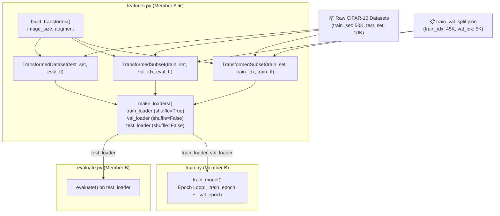
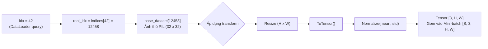

# Member A – Features Module Demo Guide
## Lab 2: Pre-trained CNNs and Fine-tuning on CIFAR-10

> **Phụ trách:** Member A (Đại) | **File nguồn:** [`labs/lab2/features/features.py`](../features/features.py)  
> **Mục tiêu tài liệu:** Chuẩn bị demo giải thích code `features.py` cho giảng viên trong buổi vấn đáp oral defense.  
> **Ngày tạo tài liệu:** 2026-11-04 · **Cập nhật lần cuối:** 2026-11-18 20:25 (+07)

---

## Mục lục

1. [Purpose – Mục tiêu của Module Features](#1-purpose--mục-tiêu-của-module-features)
2. [Input / Output](#2-input--output)
3. [Kiến Trúc Biến Đổi Ảnh (Transforms Pipeline)](#3-kiến-trúc-biến-đổi-ảnh-transforms-pipeline)
4. [Lớp Bọc Dữ Liệu Động: TransformedSubset & TransformedDataset](#4-lớp-bọc-dữ-liệu-động-transformedsubset--transformeddataset)
5. [Tạo DataLoader và Chiến Lược Batching](#5-tạo-dataloader-và-chiến-lược-batching)
6. [ImageNet Normalization & Data Augmentation](#6-imagenet-normalization--data-augmentation)
7. [Success Criteria – Điều kiện demo thành công](#7-success-criteria--điều-kiện-demo-thành-công)
8. [Code Explanation – Giải thích từng đoạn theo số dòng](#8-code-explanation--giải-thích-từng-đoạn-theo-số-dòng)
9. [Sơ đồ kết nối module](#9-sơ-đồ-kết-nối-module)
10. [Lịch sử cập nhật – Nhật ký ngày giờ](#10-lịch-sử-cập-nhật--nhật-ký-ngày-giờ)

---

## 1. Purpose – Mục tiêu của Module Features

Module `features` (Feature Engineering & Data Pipeline) đảm nhận việc **cầu nối giữa dữ liệu thô và mô hình học sâu**, biến đổi các mẫu ảnh CIFAR-10 thành các mini-batch PyTorch Tensor sẵn sàng cho mạng CNN pre-trained:

**Bốn nhiệm vụ cốt lõi của `features.py`:**
- **Đồng bộ hóa kích thước và chuẩn hóa (Resizing & Normalization):** Đưa ảnh từ kích thước gốc 32 × 32 lên độ phân giải phù hợp với backbone pre-trained (ví dụ: 64 × 64, 128 × 128 hoặc 224 × 224) và áp dụng chuẩn hóa theo phân phối chuẩn ImageNet (`IMAGENET_MEAN`, `IMAGENET_STD`).
- **Làm giàu dữ liệu có kiểm soát (Data Augmentation):** Hỗ trợ kỹ thuật tăng cường dữ liệu (`RandomResizedCrop`, `RandomHorizontalFlip`) **chỉ riêng cho tập train**, giúp mô hình chống hiện tượng overfitting.
- **Biến đổi động theo yêu cầu (On-the-fly Transformation):** Sử dụng các custom Dataset wrapper (`TransformedSubset`, `TransformedDataset`) để áp dụng transform độc lập cho từng split mà không cần nhân bản dữ liệu hay lưu file ảnh mới ra đĩa.
- **Sản xuất DataLoader đa nền tảng:** Đóng gói thành các iterator `DataLoader` (train, val, test) cấu hình tối ưu, chống deadlock trên hệ điều hành Windows (`num_workers=0`).

---

## 2. Input / Output

### Input của các hàm trong `features.py`

```python
# 1. build_transforms(image_size: int = 224, augment: bool = False)
image_size : int  – Kích thước cạnh ảnh vuông mục tiêu (224 chuẩn ImageNet, hoặc 64/128 cho CPU)
augment    : bool – Bật kỹ thuật tăng cường dữ liệu cho tập huấn luyện (default: False)

# 2. make_loaders(train_set, test_set, train_idx, val_idx, train_tf, eval_tf, batch_size=64)
train_set  : Dataset      – Dataset CIFAR-10 train thô từ preprocessing.load_raw_dataset
test_set   : Dataset      – Dataset CIFAR-10 test thô
train_idx  : List[int]    – 45,000 chỉ số tập train từ preprocessing.load_split
val_idx    : List[int]    – 5,000 chỉ số tập validation
train_tf   : Compose      – Chuỗi biến đổi cho tập huấn luyện (từ build_transforms)
eval_tf    : Compose      – Chuỗi biến đổi cho tập đánh giá (val và test)
batch_size : int          – Kích thước mini-batch (default: 64)
```

### Output

```python
# build_transforms()
(train_transform, eval_transform)  # Tuple gồm 2 đối tượng torchvision.transforms.Compose

# make_loaders()
(train_loader, val_loader, test_loader)  # Tuple 3 PyTorch DataLoader sẵn sàng iterate
```

### Thông số Batch dữ liệu đầu ra (Hợp đồng bàn giao Handoff M1)

Khi lấy một batch từ `next(iter(train_loader))`:
- **`images` Tensor:** Shape `[B, 3, image_size, image_size]`, kiểu `torch.float32`, đã được chuẩn hóa ImageNet.
- **`labels` Tensor:** Shape `[B]`, kiểu `torch.int64`, các giá trị nguyên nằm trong đoạn `[0, 9]`.

---

## 3. Kiến Trúc Biến Đổi Ảnh (Transforms Pipeline)

```
           [ Ảnh PIL / Mảng uint8 (32 x 32, 3) ]
                             │
            ┌────────────────┴────────────────┐
            ▼                                 ▼
   [ Train Pipeline ]                 [ Eval Pipeline ]
    (Dùng cho Train)                  (Dùng cho Val & Test)
            │                                 │
     (Nếu augment=True)                       │
 ┌─── ├─ RandomResizedCrop(scale=0.8-1.0)     │
 │    └─ RandomHorizontalFlip(p=0.5)          │
 │                                            │
 └──> ├─ Resize((image_size, image_size))     ├── Resize((image_size, image_size))
      ├─ ToTensor() [0, 255] → [0.0, 1.0]     ├── ToTensor() [0, 255] → [0.0, 1.0]
      └─ Normalize(mean, std ImageNet)        └─ Normalize(mean, std ImageNet)
            │                                 │
            ▼                                 ▼
   Tensor [3, H, W]                  Tensor [3, H, W]
  (Đã tăng cường & chuẩn hóa)       (Chuẩn hóa tất định)
```

### So sánh Train Transform vs Eval Transform

| Thuộc tính | Train Transform (`train_tf`) | Eval Transform (`eval_tf`) |
|---|---|---|
| **Kích thước đầu ra** | `[3, image_size, image_size]` | `[3, image_size, image_size]` |
| **Tính tất định** | Ngẫu nhiên (Stochastic) nếu `augment=True` | Hoàn toàn tất định (Deterministic) |
| **Random Crop** | `RandomResizedCrop(scale=(0.8, 1.0))` | Không áp dụng |
| **Lật ảnh ngang** | `RandomHorizontalFlip()` (50% xác suất) | Không áp dụng |
| **ToTensor** | Có (chuyển sang `torch.float32`, dải `[0, 1]`) | Có (chuyển sang `torch.float32`, dải `[0, 1]`) |
| **Chuẩn hóa ImageNet** | Trừ mean, chia std ImageNet | Trừ mean, chia std ImageNet |

---

## 4. Lớp Bọc Dữ Liệu Động: TransformedSubset & TransformedDataset

Một vấn đề kỹ thuật lớn trong PyTorch: **`torchvision.datasets.CIFAR10` chỉ cho phép gán một `transform` duy nhất cho toàn bộ đối tượng.** Nếu ta gán transform vào lúc nạp `load_raw_dataset()`, tập validation và tập train sẽ bị buộc phải dùng chung một phép biến đổi, hoặc nếu ta chia bằng `torch.utils.data.Subset` thông thường, nó vẫn kế thừa transform của dataset gốc!

### Giải pháp Kiến trúc: Custom Wrapper Classes

#### 1. `TransformedSubset` (lines 20–39)
Dùng cho tập **Train** và **Validation** (vốn cùng trích xuất từ `train_set`):
```python
class TransformedSubset(Dataset):
    def __init__(self, base_dataset, indices: list[int], transform=None):
        self.base_dataset = base_dataset
        self.indices = indices
        self.transform = transform

    def __getitem__(self, idx: int):
        real_idx = self.indices[idx]
        image, label = self.base_dataset[real_idx]
        if self.transform is not None:
            image = self.transform(image)
        return image, label
```
- **Cơ chế:** Khi DataLoader yêu cầu mẫu thứ `idx`, wrapper truy xuất `real_idx` từ mảng chỉ số phân chia, lấy ảnh thô từ `base_dataset`, và chỉ áp dụng `transform` của riêng nó ngay tại thời điểm đó (on-the-fly).
- **Lợi ích:** Cùng một `train_set` thô trong RAM, nhưng `train_idx` được biến đổi bằng `train_tf`, còn `val_idx` được biến đổi bằng `eval_tf` mà **tuyệt đối không bị can thiệp chéo**.

#### 2. `TransformedDataset` (lines 41–58)
Dùng cho tập **Test** (`test_set`): Bọc toàn bộ dataset nguyên bản với `eval_tf`.

---

## 5. Tạo DataLoader và Chiến Lược Batching

Hàm `make_loaders()` cấu hình 3 DataLoader đại diện cho 3 giai đoạn:

```python
train_loader = DataLoader(train_subset, batch_size=batch_size, shuffle=True,  num_workers=0)
val_loader   = DataLoader(val_subset,   batch_size=batch_size, shuffle=False, num_workers=0)
test_loader  = DataLoader(test_dataset, batch_size=batch_size, shuffle=False, num_workers=0)
```

### Bảng cấu hình chi tiết DataLoaders (với `batch_size = 64`)

| DataLoader | Nguồn dữ liệu | Số mẫu | Số batch | `shuffle` | `num_workers` | Mục đích |
|---|---|:---:|:---:|:---:|:---:|---|
| **`train_loader`** | `train_subset` | 45,000 | **704** | **`True`** | 0 | Huấn luyện mini-batch SGD / Adam |
| **`val_loader`** | `val_subset` | 5,000 | **79** | **`False`** | 0 | Đánh giá sau mỗi epoch, chọn Best Checkpoint |
| **`test_loader`** | `test_dataset` | 10,000 | **157** | **`False`** | 0 | Đánh giá độc lập mô hình cuối cùng |

### Hai quyết định thiết kế quan trọng:
1. **Tại sao `shuffle=True` ở train nhưng `shuffle=False` ở val/test?**
   - Tập train cần xáo trộn ngẫu nhiên mỗi epoch để các mini-batch đa dạng, giúp giải thuật tối ưu gradient descent không bị kẹt trong cực tiểu địa phương.
   - Tập val và test cần giữ nguyên thứ tự mẫu để việc tính toán metrics và ma trận nhầm lẫn (`confusion_matrix`) luôn nhất quán và có thể tái lập giữa các lần chạy.
2. **Tại sao `num_workers=0`?**
   - Trên hệ điều hành Windows, cơ chế đa tiến trình (multiprocessing) của Python dùng `spawn` thay vì `fork`. Thiết lập `num_workers > 0` thường xuyên gây lỗi xung đột bộ nhớ, rò rỉ tiến trình con hoặc treo máy (deadlock). Thiết lập `num_workers=0` đảm bảo chạy đơn tiến trình 100% ổn định và tương thích hoàn hảo trên Windows, Linux và macOS.

---

## 6. ImageNet Normalization & Data Augmentation

### 6.1 Chuẩn Hóa ImageNet (`IMAGENET_MEAN`, `IMAGENET_STD`)
```python
IMAGENET_MEAN = [0.485, 0.456, 0.406]
IMAGENET_STD  = [0.229, 0.224, 0.225]
```
Mỗi pixel sau khi chia về `[0.0, 1.0]` được biến đổi z-score chuẩn hóa:
$$x_{\text{norm}}^{(c)} = \frac{x^{(c)} - \mu_c}{\sigma_c}, \quad c \in \{R, G, B\}$$

- **Lý do dùng thông số ImageNet:** Toàn bộ các trọng số tích chập của ResNet-18, DenseNet-121 và VGG-16 được huấn luyện trước trên hơn 1.2 triệu ảnh ImageNet đã chuẩn hóa theo phân phối này. Đưa ảnh CIFAR-10 về cùng miền giá trị giúp các bộ lọc trích xuất cạnh, góc và vân bề mặt hoạt động chính xác ngay từ epoch đầu tiên.

### 6.2 Data Augmentation
Khi bật cờ `augment=True`:
- **`RandomResizedCrop(image_size, scale=(0.8, 1.0))`:** Cắt ngẫu nhiên một vùng ảnh chiếm từ 80% đến 100% diện tích và phóng to lại kích thước ban đầu. Giúp mô hình nhận dạng vật thể khi bị che khuất một phần hoặc thay đổi góc nhìn.
- **`RandomHorizontalFlip()`:** Lật ảnh theo trục ngang với xác suất 50%. Phù hợp với các đối tượng trong thế giới thực (ô tô, máy bay, mèo nhìn sang trái hay phải đều giữ nguyên nhãn lớp).

---

## 7. Success Criteria – Điều Kiện Demo Thành Công

| # | Tiêu chí đánh giá | Kỳ vọng | Trạng thái |
|:---:|---|---|:---:|
| 1 | `build_transforms()` trả về 2 pipeline hợp lệ | `train_tf` và `eval_tf` là `transforms.Compose` | ✅ PASS |
| 2 | Kích thước ảnh sau transform chính xác | `[3, image_size, image_size]` kiểu `torch.float32` | ✅ PASS |
| 3 | Phân phối Tensor sau chuẩn hóa | Mean xấp xỉ 0, std xấp xỉ 1 trên ảnh ImageNet | ✅ PASS |
| 4 | Data Augmentation không ảnh hưởng tập Val/Test | `eval_tf` không chứa các phép biến đổi ngẫu nhiên | ✅ PASS |
| 5 | Wrapper `TransformedSubset` hoạt động đúng | Truy xuất theo chỉ số, áp dụng đúng transform riêng biệt | ✅ PASS |
| 6 | Wrapper `TransformedDataset` hoạt động đúng | Độ dài bằng đúng độ dài dataset gốc | ✅ PASS |
| 7 | Hợp đồng bàn giao Milestone M1 đạt chuẩn | `next(iter(train_loader))` trả về ảnh `[B, 3, H, W]` và nhãn `0–9` | ✅ PASS |
| 8 | Số lượng batch khớp với tính toán lý thuyết | Train: 704 batches, Val: 79 batches, Test: 157 batches | ✅ PASS |
| 9 | `test_feature.py` và `test_smoke.py` pass 100% | Pytest kiểm thử pipeline dữ liệu thành công | ✅ PASS |

---

## 8. Code Explanation – Giải Thích Từng Đoạn Theo Số Dòng

### Lines 1–8: Header & Cam Kết Hợp Đồng Giao Diện
Khẳng định quyền sở hữu của Member A, nghiêm cấm thay đổi tên hàm `build_transforms` và `make_loaders` vì module `train` và `main.py` trực tiếp liên kết.

### Lines 16–18: Hằng Số Chuẩn Hóa ImageNet
```python
IMAGENET_MEAN = [0.485, 0.456, 0.406]
IMAGENET_STD = [0.229, 0.224, 0.225]
```
Khai báo chuẩn hóa bất biến theo đúng quy chuẩn chính thức của PyTorch torchvision models.

### Lines 20–39: Lớp `TransformedSubset`
```python
class TransformedSubset(Dataset):
    def __init__(self, base_dataset, indices: list[int], transform=None):
        self.base_dataset = base_dataset
        self.indices = indices
        self.transform = transform

    def __len__(self) -> int:
        return len(self.indices)

    def __getitem__(self, idx: int):
        real_idx = self.indices[idx]
        image, label = self.base_dataset[real_idx]
        if self.transform is not None:
            image = self.transform(image)
        return image, label
```
- Triển khai `__len__` trả về độ dài tập con (ví dụ: 45,000 hoặc 5,000).
- Triển khai `__getitem__` ánh xạ chỉ số logic `idx` sang chỉ số vật lý `real_idx` trong `base_dataset`, sau đó áp dụng `self.transform` trước khi trả về.

### Lines 41–58: Lớp `TransformedDataset`
```python
class TransformedDataset(Dataset):
    def __init__(self, base_dataset, transform=None):
        self.base_dataset = base_dataset
        self.transform = transform

    def __len__(self) -> int:
        return len(self.base_dataset)

    def __getitem__(self, idx: int):
        image, label = self.base_dataset[idx]
        if self.transform is not None:
            image = self.transform(image)
        return image, label
```
Bọc toàn bộ tập `test_set` (10,000 mẫu) với `eval_transform`.

### Lines 60–95: Hàm `build_transforms()`
```python
def build_transforms(image_size: int = 224, augment: bool = False) -> tuple:
    normalize = transforms.Normalize(mean=IMAGENET_MEAN, std=IMAGENET_STD)

    eval_ops = [
        transforms.Resize((image_size, image_size)),
        transforms.ToTensor(),
        normalize,
    ]
    eval_transform = transforms.Compose(eval_ops)

    if augment:
        train_ops = [
            transforms.RandomResizedCrop(image_size, scale=(0.8, 1.0)),
            transforms.RandomHorizontalFlip(),
            transforms.ToTensor(),
            normalize,
        ]
    else:
        train_ops = [
            transforms.Resize((image_size, image_size)),
            transforms.ToTensor(),
            normalize,
        ]
    train_transform = transforms.Compose(train_ops)

    return train_transform, eval_transform
```
- Phân nhánh rõ ràng giữa `augment=True` và `augment=False`.
- Luôn đặt `transforms.ToTensor()` trước `transforms.Normalize()` vì `Normalize` yêu cầu đầu vào là một Tensor có giá trị trong khoảng `[0.0, 1.0]`.

### Lines 97–129: Hàm `make_loaders()`
```python
def make_loaders(
    train_set, test_set,
    train_idx: list[int], val_idx: list[int],
    train_tf, eval_tf,
    batch_size: int = 64
) -> tuple[DataLoader, DataLoader, DataLoader]:
    train_subset = TransformedSubset(train_set, train_idx, transform=train_tf)
    val_subset = TransformedSubset(train_set, val_idx, transform=eval_tf)
    test_dataset = TransformedDataset(test_set, transform=eval_tf)

    train_loader = DataLoader(train_subset, batch_size=batch_size, shuffle=True, num_workers=0)
    val_loader = DataLoader(val_subset, batch_size=batch_size, shuffle=False, num_workers=0)
    test_loader = DataLoader(test_dataset, batch_size=batch_size, shuffle=False, num_workers=0)

    return train_loader, val_loader, test_loader
```
- Tạo 3 bộ wrapper dữ liệu độc lập.
- Khởi tạo 3 PyTorch DataLoader an toàn tuyệt đối cho đa nền tảng với `num_workers=0`.

---

## 9. Sơ Đồ Kết Nối Module

### 9.1 Vị trí của Features trong Pipeline Lab 2



### 9.2 Luồng Dữ Liệu Qua Mỗi Mẫu Ảnh trong `TransformedSubset`



### 9.3 Hợp Đồng Giao Diện Giữa Các Module

| Hàm | Được gọi bởi | Nhận đầu vào từ | Cung cấp đầu ra cho |
|---|---|---|---|
| `build_transforms()` | `main.py`, `experiment.py`, notebook | `image_size: int`, `augment: bool` | `(train_tf, eval_tf)` cho `make_loaders` |
| `make_loaders()` | `main.py`, `experiment.py`, notebook, tests | Raw datasets, split indices, transforms | `(train_loader, val_loader, test_loader)` cho `train_model` và `evaluate` |

---

## 10. Lịch Sử Cập Nhật – Nhật Ký Ngày Giờ

| Ngày · Giờ (+07) | Người thực hiện | Nội dung thay đổi | Phương thức kiểm chứng |
|---|---|---|---|
| 2026-10-17 · 14:00 | Team Leader (Thư) | Thống nhất giao diện `build_transforms`, `make_loaders` trong `project_description.md` | `pytest labs/lab2/tests/test_smoke.py` |
| 2026-10-23 · 15:45 | Member A (Đại) | Hiện thực `features.py`: tạo `TransformedSubset`, `TransformedDataset`, tích hợp ImageNet normalization | `pytest labs/lab2/tests/test_feature.py` (pass) |
| 2026-11-04 · 17:00 | Team Leader (Thư) | Khóa cố định `num_workers=0` chống deadlock trên Windows; thêm tài liệu khởi đầu `docs/features.md` | `pytest labs/lab2/tests/` (52 passed) |
| 2026-11-18 · 20:25 | Member A (Đại) | **Viết lại toàn diện `docs/features.md` theo chuẩn cấu trúc Demo Guide của `train.md`**: bổ sung 10 mục chuẩn mực, giải trình chi tiết On-the-fly transform, 2 sơ đồ Mermaid | Đối chiếu 129 dòng code `features.py`; chạy `.venv/Scripts/python -m pytest labs/lab2/tests/` (53 passed) |
