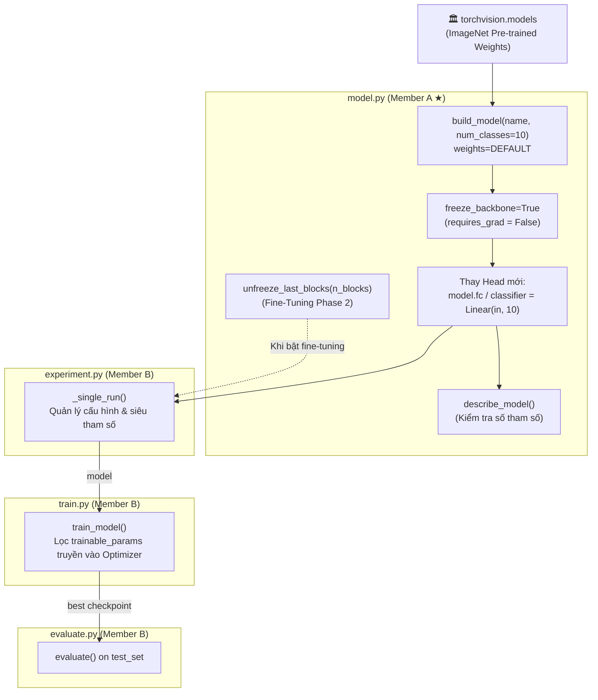

# Member A – Model Module Demo Guide
## Lab 2: Pre-trained CNNs and Fine-tuning on CIFAR-10

> **Phụ trách:** Member A (Đại) | **File nguồn:** [`labs/lab2/model/model.py`](../model/model.py)  
> **Mục tiêu tài liệu:** Chuẩn bị demo giải thích code `model.py` cho giảng viên trong buổi vấn đáp oral defense.  
> **Ngày tạo tài liệu:** 2026-11-04 · **Cập nhật lần cuối:** 2026-11-18 20:25 (+07)

---

## Mục lục

1. [Purpose – Mục tiêu của Module Model](#1-purpose--mục-tiêu-của-module-model)
2. [Input / Output](#2-input--output)
3. [Kiến Trúc Ba Mạng CNN Tiền Huấn Luyện (ResNet-18, DenseNet-121, VGG-16)](#3-kiến-trúc-ba-mạng-cnn-tiền-huấn-luyện-resnet-18-densenet-121-vgg-16)
4. [Transfer Learning: Feature Extraction vs Fine-Tuning](#4-transfer-learning-feature-extraction-vs-fine-tuning)
5. [Cơ Chế Đóng Băng (Freezing) & Thay Thế Lớp Phân Loại (Classifier Head)](#5-cơ-chế-đóng-băng-freezing--thay-thế-lớp-phân-loại-classifier-head)
6. [Chiến Lược Mở Khóa Khối Sâu (unfreeze_last_blocks)](#6-chiến-lược-mở-khóa-khối-sâu-unfreeze_last_blocks)
7. [Success Criteria – Điều kiện demo thành công](#7-success-criteria--điều-kiện-demo-thành-công)
8. [Code Explanation – Giải thích từng đoạn theo số dòng](#8-code-explanation--giải-thích-từng-đoạn-theo-số-dòng)
9. [Sơ đồ kết nối module](#9-sơ-đồ-kết-nối-module)
10. [Lịch sử cập nhật – Nhật ký ngày giờ](#10-lịch-sử-cập-nhật--nhật-ký-ngày-giờ)

---

## 1. Purpose – Mục tiêu của Module Model

Module `model` giữ vị trí trọng tâm trong kiến trúc học sâu của Lab 2, hiện thực hóa các chiến lược **Transfer Learning (Học chuyển giao)** và **Fine-Tuning (Tinh chỉnh mô hình)** trên các mạng nơ-ron tích chập (CNN) hiện đại:

**Bốn trách nhiệm cốt lõi của `model.py`:**
- **Nạp các kiến trúc CNN tiền huấn luyện:** Tải trọng số ImageNet cho ba họ kiến trúc tiêu biểu (`resnet18`, `densenet121`, `vgg16`) sử dụng API hiện đại `weights=` của torchvision (thay thế cho tham số cũ đã deprecated `pretrained=True`).
- **Thay thế Classification Head:** Tháo bỏ lớp phân loại 1,000 lớp của ImageNet và thay bằng lớp `nn.Linear` mới thích ứng với 10 lớp của bài toán CIFAR-10.
- **Hỗ trợ Feature Extraction (Đóng băng backbone):** Đặt `requires_grad = False` cho toàn bộ các tầng trích xuất đặc trưng phía dưới, chỉ huấn luyện classifier head mới.
- **Hỗ trợ Fine-Tuning có kiểm soát (`unfreeze_last_blocks`):** Mở khóa có chọn lọc các khối tích chập sâu ngữ nghĩa cao (`requires_grad = True`) để tinh chỉnh các đặc trưng cấp cao phù hợp với miền dữ liệu CIFAR-10.

---

## 2. Input / Output

### Input của các hàm trong `model.py`

```python
# 1. build_model(name: str, num_classes: int = 10, freeze_backbone: bool = True, pretrained: bool = True)
name            : str  – Tên kiến trúc ('resnet18', 'densenet121', 'vgg16')
num_classes     : int  – Số lớp phân loại mục tiêu (default: 10 cho CIFAR-10)
freeze_backbone : bool – Đóng băng trọng số của toàn bộ backbone hay không (default: True)
pretrained      : bool – Tải và nạp trọng số ImageNet pre-trained hay không (default: True)

# 2. describe_model(model: nn.Module)
model           : nn.Module – Đối tượng mô hình PyTorch cần phân tích số lượng tham số

# 3. unfreeze_last_blocks(model: nn.Module, n_blocks: int)
model           : nn.Module – Mô hình cần mở khóa các khối sâu (cập nhật tại chỗ in-place)
n_blocks        : int       – Số lượng khối tích chập ngữ nghĩa cuối cần mở khóa (phải >= 1)
```

### Output

```python
# build_model()
nn.Module  # Mô hình PyTorch đã thay lớp phân loại cuối, sẵn sàng nhận batch [B, 3, H, W]
           # và xuất logits thô có kích thước [B, 10]

# describe_model()
{
    "total_params"    : int,        # Tổng số tham số của mô hình (ví dụ: 11,181,642 với ResNet-18)
    "trainable_params": int,        # Số tham số có requires_grad=True (ví dụ: 5,130 khi freeze)
    "layer_names"     : List[str],  # Danh sách tên các module con cấp cao nhất
}

# unfreeze_last_blocks()
None  # Cập nhật thuộc tính requires_grad của các tensor trọng số trực tiếp trên mô hình
```

---

## 3. Kiến Trúc Ba Mạng CNN Tiền Huấn Luyện (ResNet-18, DenseNet-121, VGG-16)

Module hỗ trợ 3 họ kiến trúc kinh điển đại diện cho 3 cơ chế kết nối trong Deep Learning:

| Kiến trúc | Cơ chế cốt lõi | Vị trí Head cần thay thế | Số tham số tổng (`total_params`) | Trainable khi Freeze (`trainable_params`) | Trainable khi Unfreeze 1 block |
|---|---|---|:---:|:---:|:---:|
| **`resnet18`** | Residual Connection (Skip connection $x + F(x)$) | `model.fc` | **11,181,642** (~11.2M) | **5,130** (~0.05%) | **8,398,858** (~75.1%) |
| **`densenet121`** | Dense Connectivity (Nối concat feature maps) | `model.classifier` | **6,964,106** (~7.0M) | **10,250** (~0.15%) | **3,158,538** (~45.4%) |
| **`vgg16`** | Mạng tích chập sâu cổ điển tuần tự (Sequential) | `model.classifier[6]` | **134,301,514** (~134M) | **40,970** (~0.03%) | **7,120,458** (~5.3%) |

```
1. ResNet-18:
   Input [B, 3, H, W] → conv1 → bn1 → relu → maxpool
   → layer1 (2 blocks) → layer2 (2 blocks) → layer3 (2 blocks) → layer4 (2 blocks)
   → avgpool → Flatten → model.fc (Linear: 512 → 10) → Logits [B, 10]

2. DenseNet-121:
   Input [B, 3, H, W] → features (conv0, denseblock1, transition1, ..., denseblock4, norm5)
   → relu → AdaptiveAvgPool2d → Flatten → model.classifier (Linear: 1024 → 10) → Logits [B, 10]

3. VGG-16:
   Input [B, 3, H, W] → features (31 layers chia thành 5 conv blocks kết thúc bằng MaxPool)
   → avgpool → Flatten → classifier (Linear 25088→4096 → ReLU → Dropout → Linear 4096→4096
   → ReLU → Dropout → model.classifier[6] (Linear: 4096 → 10)) → Logits [B, 10]
```

---

## 4. Transfer Learning: Feature Extraction vs Fine-Tuning

Bài toán đặt ra: CIFAR-10 có kích thước tập train nhỏ (50,000 ảnh 32 × 32). Nếu huấn luyện một mạng CNN sâu từ đầu (Scratch), mô hình rất dễ bị overfitting và mất hàng giờ đồng hồ để hội tụ. Chúng ta áp dụng hai chiến lược:

```
[ Chiến Lược B: Feature Extraction ]       [ Chiến Lược C: Fine-Tuning ]
           (Freeze Backbone)                         (Unfreeze Last Blocks)
┌───────────────────────────────────────┐ ┌───────────────────────────────────────┐
│ [Backbone]                            │ │ [Backbone: Early Blocks]              │
│  - Trọng số ImageNet cố định          │ │  - Trọng số ImageNet cố định          │
│  - requires_grad = False              │ │  - requires_grad = False              │
│  - Đóng vai trò máy trích đặc trưng   │ │  - Giữ lại các đặc trưng tổng quát   │
├───────────────────────────────────────┤ ├───────────────────────────────────────┤
│ [Classifier Head]                     │ │ [Backbone: Deep Blocks (layer4)]      │
│  - Lớp Linear mới (512 → 10)          │ │  - requires_grad = True               │
│  - requires_grad = True               │ │  - Tinh chỉnh theo đặc trưng CIFAR-10 │
│  - Optimizer chỉ cập nhật 5,130 params│ ├───────────────────────────────────────┤
└───────────────────────────────────────┘ │ [Classifier Head]                     │
                                          │  - requires_grad = True               │
                                          │  - Cập nhật đồng thời với layer4     │
                                          └───────────────────────────────────────┘
```

### So sánh Hiệu Năng Thực Tế (Đối chiếu Báo Cáo & Notebook)
- **Feature Extraction:** Thời gian huấn luyện rất nhanh (chỉ tính gradient cho 5K tham số), nhưng độ chính xác trần bị giới hạn ở mức **~78.9%** (ResNet-18) và **~83.2%** (DenseNet-121).
- **Fine-Tuning:** Mở khóa khối sâu cho phép điều chỉnh các bộ lọc thích nghi với ảnh CIFAR-10, đưa độ chính xác nhảy vọt lên **~91.9%** (ResNet-18) và **~92.0%** (DenseNet-121).

---

## 5. Cơ Chế Đóng Băng (Freezing) & Thay Thế Lớp Phân Loại (Classifier Head)

### 5.1 Sử dụng Modern `weights=` API thay cho `pretrained=True`
Kể từ torchvision 0.13, việc sử dụng `pretrained=True` bị cảnh báo lỗi deprecation. Module `model.py` ánh xạ chuẩn xác:
```python
if name_lower == "resnet18":
    weights = models.ResNet18_Weights.DEFAULT if pretrained else None
    model = models.resnet18(weights=weights)
```
- `ResNet18_Weights.DEFAULT` trỏ tới bộ trọng số có độ chính xác cao nhất (ImageNet-1K V1).
- Khi `pretrained=False`, mô hình được khởi tạo với trọng số ngẫu nhiên (Scratch initialization).

### 5.2 Đóng Băng Toàn Bộ Tham Số
```python
if freeze_backbone:
    for param in model.parameters():
        param.requires_grad = False
```
Vòng lặp duyệt qua tất cả tensor trọng số (`weight`) và độ lệch (`bias`) trong mô hình và vô hiệu hóa việc tính gradient.

### 5.3 Thay Lớp Phân Loại Cuối
```python
# Với ResNet-18:
in_features = model.fc.in_features          # 512
model.fc = nn.Linear(in_features, num_classes)

# Với DenseNet-121:
in_features = model.classifier.in_features  # 1024
model.classifier = nn.Linear(in_features, num_classes)

# Với VGG-16:
in_features = model.classifier[6].in_features # 4096
model.classifier[6] = nn.Linear(in_features, num_classes)
```
- **Điểm mấu chốt khi vấn đáp:** Khi tạo một module `nn.Linear` mới, PyTorch **mặc định luôn gán `requires_grad = True`** cho toàn bộ trọng số của module đó. Do đó, việc thay thế lớp phân loại **SAU** khi chạy vòng lặp đóng băng sẽ tự động đảm bảo rằng: **Chỉ duy nhất lớp Linear mới này được huấn luyện.**

---

## 6. Chiến Lược Mở Khóa Khối Sâu (`unfreeze_last_blocks`)

Trong hàm `unfreeze_last_blocks(model, n_blocks)`:

### 6.1 Xử lý ResNet-18
Kiến trúc ResNet có 4 nhóm tầng dư (`layer1`, `layer2`, `layer3`, `layer4`):
```python
stage_blocks = [model.layer1, model.layer2, model.layer3, model.layer4]
for block in stage_blocks[-min(n_blocks, len(stage_blocks)):]:
    _unfreeze(block)
_unfreeze(model.fc)
```
- Khi `n_blocks = 1`, chỉ khối sâu nhất `layer4` và `model.fc` được mở khóa.

### 6.2 Xử lý VGG-16: Thuật Toán Tách Khối Tích Chập (`_split_vgg_conv_blocks`)
> **Vấn đề kỹ thuật hóc búa của VGG:**  
> Trong torchvision, `model.features` của VGG-16 là một danh sách phẳng `nn.Sequential` gồm 31 tầng liên tiếp:
> `Conv2d → ReLU → Conv2d → ReLU → MaxPool2d → ...`  
> Nếu làm theo cách ngây thơ là lấy 2 tầng cuối cùng của `features`, ta sẽ chỉ lấy phải `ReLU` và `MaxPool2d` (hai tầng này không hề có tham số nào!).
> 
> **Giải pháp trong `model.py` (lines 94–115):**  
> Dựa vào đặc tính kiến trúc: Mỗi khối tích chập của VGG luôn kết thúc bằng một tầng `nn.MaxPool2d`. Hàm `_split_vgg_conv_blocks()` nhóm các tầng lại và cắt thành đúng **5 khối tích chập**. Khi gọi `n_blocks = 1`, hàm sẽ mở khóa toàn bộ khối tích chập thứ 5 (gồm 3 tầng Conv2d 512 bộ lọc, 3 tầng ReLU và 1 MaxPool2d), kích hoạt chính xác hơn 7 triệu tham số!

### 6.3 Xử lý DenseNet-121
Mỗi `denseblock` trong DenseNet đi kèm với một `transition` block phía sau. Do đó, hàm mở khóa `n_blocks * 2` module con từ cuối danh sách `model.features`, đồng thời luôn giữ `model.classifier` mở khóa.

---

## 7. Success Criteria – Điều Kiện Demo Thành Công

| # | Tiêu chí đánh giá | Kỳ vọng | Trạng thái |
|:---:|---|---|:---:|
| 1 | `build_model("resnet18")` chạy không lỗi | Trả về `nn.Module`, output shape `[B, 10]` | ✅ PASS |
| 2 | Nạp đúng 3 họ kiến trúc | Hỗ trợ `resnet18`, `densenet121`, `vgg16` | ✅ PASS |
| 3 | Báo lỗi khi tên model không hợp lệ | `build_model("alexnet")` ném ra `ValueError` | ✅ PASS |
| 4 | Đóng băng backbone chính xác | ResNet-18 khi freeze có đúng 5,130 trainable params | ✅ PASS |
| 5 | `describe_model()` đếm tham số chuẩn | Trả về dict đủ 3 keys: `total_params, trainable_params, layer_names` | ✅ PASS |
| 6 | Mở khóa ResNet-18 với `n_blocks=1` | `layer4` được mở khóa, trainable params đạt 8,398,858 | ✅ PASS |
| 7 | Tách khối VGG-16 chuẩn xác 5 blocks | Mở khóa đúng block tích chập thứ 5 thay vì chỉ mở ReLU/MaxPool | ✅ PASS |
| 8 | Kiểm tra ràng buộc tham số `n_blocks` | `n_blocks < 1` ném `ValueError`, kiểu không phải int ném `TypeError` | ✅ PASS |
| 9 | `test_model.py` & `test_model_unfreezing.py` pass 100% | Toàn bộ 11 tests về kiến trúc và unfreezing đều pass | ✅ PASS |

---

## 8. Code Explanation – Giải Thích Từng Đoạn Theo Số Dòng

### Lines 1–8: Header & Hợp Đồng Giao Diện
Khẳng định quyền sở hữu của Member A, nghiêm cấm đổi tên hàm `build_model`, `describe_model`, `unfreeze_last_blocks` vì module `train`, `experiment` và `main.py` trực tiếp liên kết.

### Lines 15–43: Khởi Tạo Trọng Số Bằng Modern API
```python
name_lower = name.lower()
if name_lower == "resnet18":
    weights = models.ResNet18_Weights.DEFAULT if pretrained else None
    model = models.resnet18(weights=weights)
elif name_lower == "densenet121":
    weights = models.DenseNet121_Weights.DEFAULT if pretrained else None
    model = models.densenet121(weights=weights)
elif name_lower == "vgg16":
    weights = models.VGG16_Weights.DEFAULT if pretrained else None
    model = models.vgg16(weights=weights)
else:
    raise ValueError(f"Unsupported model name: {name}...")
```
Tải trọng số chính thống từ torchvision mà không sinh bất kỳ cảnh báo deprecation nào.

### Lines 46–49: Vòng Lặp Đóng Băng Trọng Số
```python
if freeze_backbone:
    for param in model.parameters():
        param.requires_grad = False
```
Vô hiệu hóa việc tính đạo hàm trên toàn bộ backbone ImageNet.

### Lines 50–60: Thay Thế Lớp Phân Loại Cuối Theo Từng Kiến Trúc
```python
if name_lower == "resnet18":
    in_features = model.fc.in_features
    model.fc = nn.Linear(in_features, num_classes)
elif name_lower == "densenet121":
    in_features = model.classifier.in_features
    model.classifier = nn.Linear(in_features, num_classes)
elif name_lower == "vgg16":
    in_features = model.classifier[6].in_features
    model.classifier[6] = nn.Linear(in_features, num_classes)
```
Lấy đúng `in_features` nguyên bản và thay bằng `nn.Linear(in_features, 10)`. Lớp mới tạo tự động có `requires_grad=True`.

### Lines 64–83: Hàm Thống Kê Tham Số `describe_model()`
```python
def describe_model(model: nn.Module) -> dict:
    total_params = sum(p.numel() for p in model.parameters())
    trainable_params = sum(p.numel() for p in model.parameters() if p.requires_grad)
    layer_names = [name for name, _ in model.named_children()]
```
- Dùng `p.numel()` để đếm số phần tử của từng tensor tham số.
- Lọc `if p.requires_grad` để tách biệt tham số huấn luyện được và tham số bị đóng băng.

### Lines 85–92: Hàm Phụ Trợ `_unfreeze()`
```python
def _unfreeze(module: nn.Module) -> None:
    for param in module.parameters():
        param.requires_grad = True
```
Bật cờ tính toán đạo hàm cho toàn bộ tham số của một module con.

### Lines 94–115: Hàm Nhóm Khối Tích Chập VGG `_split_vgg_conv_blocks()`
```python
def _split_vgg_conv_blocks(features: nn.Sequential) -> list[nn.Sequential]:
    blocks: list[nn.Sequential] = []
    current: list[nn.Module] = []
    for layer in features.children():
        current.append(layer)
        if isinstance(layer, nn.MaxPool2d):
            blocks.append(nn.Sequential(*current))
            current = []
    if current:
        blocks.append(nn.Sequential(*current))
    return blocks
```
Nhóm các tầng tích chập và activation lại, lấy `nn.MaxPool2d` làm mốc phân tách, tạo ra đúng 5 khối tích chập chuẩn mực.

### Lines 117–183: Hàm `unfreeze_last_blocks()`
```python
if isinstance(n_blocks, bool) or not isinstance(n_blocks, int):
    raise TypeError(f"n_blocks must be an int, got {type(n_blocks).__name__}.")
if n_blocks < 1:
    raise ValueError(f"n_blocks must be >= 1, got {n_blocks}.")
```
- Kiểm tra kiểu nghiêm ngặt (chặn `bool` vì trong Python `bool` là lớp con của `int`).
- Phân nhánh mở khóa chuyên biệt cho ResNet, VGG, DenseNet và fallback cho các mạng thông thường.

---

## 9. Sơ Đồ Kết Nối Module

### 9.1 Vị trí của Model trong Pipeline Lab 2



### 9.2 Cơ Chế Đóng Băng và Mở Khóa trên ResNet-18

```mermaid
flowchart LR
    INPUT["Batch Ảnh\n[B, 3, H, W]"] --> C1["conv1 + bn1 + relu + maxpool\n[ĐÓNG BĂNG: requires_grad=False]"]
    C1 --> L1["layer1 (2 blocks)\n[ĐÓNG BĂNG]"]
    L1 --> L2["layer2 (2 blocks)\n[ĐÓNG BĂNG]"]
    L2 --> L3["layer3 (2 blocks)\n[ĐÓNG BĂNG]"]
    L3 --> L4{"layer4 (2 blocks)\nTrạng thái?"}
    
    L4 -->|Feature Extraction| L4_F["[ĐÓNG BĂNG]\nrequires_grad = False"]
    L4 -->|Fine-Tuning (n_blocks=1)| L4_U["[MỞ KHÓA]\nrequires_grad = True"]
    
    L4_F --> HEAD["model.fc = nn.Linear(512, 10)\n[LUÔN TRAINABLE: requires_grad=True]"]
    L4_U --> HEAD
    HEAD --> LOGITS["Logits [B, 10]"]
```

### 9.3 Hợp Đồng Giao Diện Giữa Các Module

| Hàm | Được gọi bởi | Nhận đầu vào từ | Cung cấp đầu ra cho |
|---|---|---|---|
| `build_model()` | `main.py`, `experiment.py`, `train.py`, notebook | Tên kiến trúc, cấu hình freeze/pretrained | `nn.Module` cho pipeline huấn luyện |
| `describe_model()` | `main.py`, notebook, tests | `nn.Module` | `dict` thống kê tham số phục vụ báo cáo |
| `unfreeze_last_blocks()` | `experiment.py`, notebook, tests | `nn.Module`, số lượng blocks | Mô hình đã mở khóa gradient in-place |

---

## 10. Lịch Sử Cập Nhật – Nhật Ký Ngày Giờ

| Ngày · Giờ (+07) | Người thực hiện | Nội dung thay đổi | Phương thức kiểm chứng |
|---|---|---|---|
| 2026-10-17 · 14:00 | Team Leader (Thư) | Thống nhất giao diện `build_model`, `describe_model`, `unfreeze_last_blocks` trong `project_description.md` | `pytest labs/lab2/tests/test_smoke.py` |
| 2026-10-24 · 10:30 | Member A (Đại) | Hiện thực `model.py`: hỗ trợ ResNet-18, DenseNet-121, VGG-16 bằng `weights=` API; đóng băng backbone | `pytest labs/lab2/tests/test_model.py` (pass) |
| 2026-11-04 · 18:00 | Team Leader (Thư) | PR #48: Nâng cấp `unfreeze_last_blocks` tách đúng 5 conv blocks của VGG-16 thay vì lấy 2 module cuối; bổ sung `docs/model.md` | `pytest labs/lab2/tests/test_model_unfreezing.py` (9 passed) |
| 2026-11-18 · 20:25 | Member A (Đại) | **Viết lại toàn diện `docs/model.md` theo chuẩn cấu trúc Demo Guide của `train.md`**: bổ sung 10 mục chuẩn mực, phân tích sâu thuật toán tách khối VGG, 2 sơ đồ Mermaid | Đối chiếu 183 dòng code `model.py`; chạy `.venv/Scripts/python -m pytest labs/lab2/tests/` (53 passed) |
