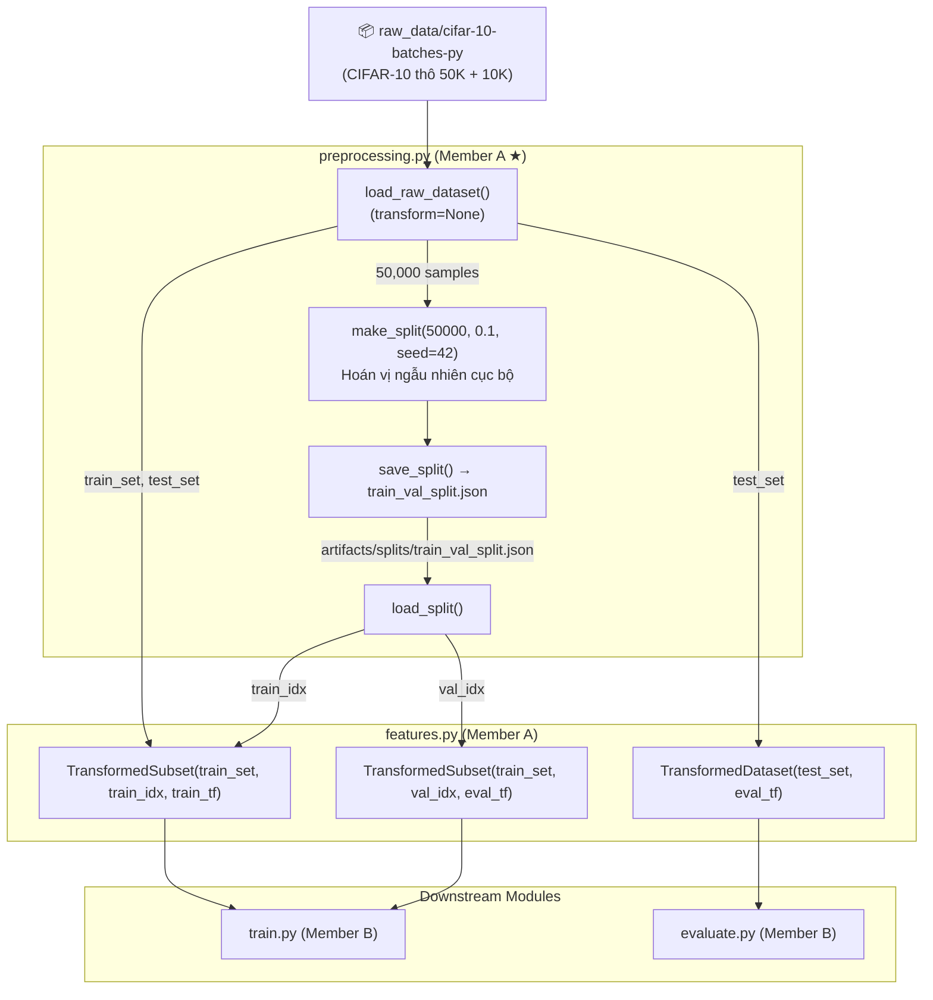
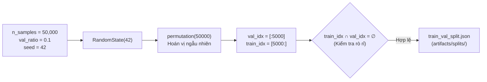

# Member A – Preprocessing Module Demo Guide
## Lab 2: Pre-trained CNNs and Fine-tuning on CIFAR-10

> **Phụ trách:** Member A (Đại) | **File nguồn:** [`labs/lab2/preprocessing/preprocessing.py`](../preprocessing/preprocessing.py)  
> **Mục tiêu tài liệu:** Chuẩn bị demo giải thích code `preprocessing.py` cho giảng viên trong buổi vấn đáp oral defense.  
> **Ngày tạo tài liệu:** 2026-11-04 · **Cập nhật lần cuối:** 2026-11-18 20:25 (+07)

---

## Mục lục

1. [Purpose – Mục tiêu của Module Preprocessing](#1-purpose--mục-tiêu-của-module-preprocessing)
2. [Input / Output](#2-input--output)
3. [Dữ Liệu Thô và Chiến Lược Phân Chia](#3-dữ-liệu-thô-và-chiến-lược-phân-chia)
4. [Preprocessing Process – Luồng Xử Lý và Phân Tách Tập Dữ Liệu](#4-preprocessing-process--luồng-xử-lý-và-phân-tách-tập-dữ-liệu)
5. [Tính Tái Lập và Chống Rò Rỉ Dữ Liệu (Zero Data Leakage)](#5-tính-tái-lập-và-chống-rò-rỉ-dữ-liệu-zero-data-leakage)
6. [Handoff Artifacts – Cấu Trúc File JSON Phân Chia](#6-handoff-artifacts--cấu-trúc-file-json-phân-chia)
7. [Success Criteria – Điều kiện demo thành công](#7-success-criteria--điều-kiện-demo-thành-công)
8. [Code Explanation – Giải thích từng đoạn theo số dòng](#8-code-explanation--giải-thích-từng-đoạn-theo-số-dòng)
9. [Sơ đồ kết nối module](#9-sơ-đồ-kết-nối-module)
10. [Lịch sử cập nhật – Nhật ký ngày giờ](#10-lịch-sử-cập-nhật--nhật-ký-ngày-giờ)

---

## 1. Purpose – Mục tiêu của Module Preprocessing

Module `preprocessing` giải quyết bài toán **nạp dữ liệu thô nguyên bản và phân chia tập dữ liệu một cách tất định, có thể tái lập 100% (deterministic & reproducible split)** mà không làm biến dạng dữ liệu gốc.

**Bốn trách nhiệm cốt lõi của `preprocessing.py`:**
- **Nạp dữ liệu thô (Raw Loading):** Tải và nạp CIFAR-10 từ `torchvision.datasets` với `transform=None`, bảo toàn nguyên vẹn giá trị pixel gốc `[0, 255]`.
- **Phân chia tập Train/Validation:** Tách 50,000 mẫu train ban đầu thành tập huấn luyện (45,000 mẫu - 90%) và tập kiểm định (5,000 mẫu - 10%).
- **Nguyên tắc Chống rò rỉ dữ liệu (Zero Data Leakage):** Tuyệt đối không để xảy ra hiện tượng mẫu của tập validation xuất hiện trong tập train (`train_idx ∩ val_idx = ∅`).
- **Hiện vật bàn giao chuẩn hóa (Handoff Artifact):** Lưu trữ danh sách chỉ số phân chia ra file JSON `train_val_split.json` làm hợp đồng chuyển giao bất biến giữa Member A và Member B.

---

## 2. Input / Output

### Input của các hàm trong `preprocessing.py`

```python
# 1. load_raw_dataset(data_root: str, download: bool = True)
data_root : str  – Thư mục lưu trữ dataset (ví dụ: "labs/lab2/raw_data")
download  : bool – Tự động tải về nếu máy chưa có dữ liệu (default: True)

# 2. make_split(n_samples: int, val_ratio: float = 0.1, seed: int = 42)
n_samples : int   – Tổng số mẫu cần phân chia (50,000 cho tập train CIFAR-10)
val_ratio : float – Tỷ lệ tập validation (0.1 tương ứng 10%)
seed      : int   – Hạt giống ngẫu nhiên để tái lập phân chia (default: 42)

# 3. save_split(train_idx: list[int], val_idx: list[int], path: str)
train_idx : List[int] – Danh sách 45,000 chỉ số mẫu tập train
val_idx   : List[int] – Danh sách 5,000 chỉ số mẫu tập validation
path      : str       – Đường dẫn file JSON đích (ví dụ: "artifacts/splits/train_val_split.json")

# 4. load_split(path: str)
path      : str – Đường dẫn file JSON cần nạp lại
```

### Output

```python
# load_raw_dataset()
(train_set, test_set)         # Tuple 2 đối tượng torchvision.datasets.CIFAR10 nguyên bản

# make_split()
(train_idx, val_idx)          # Tuple 2 danh sách số nguyên (45000 phần tử, 5000 phần tử)

# save_split()
None                          # Ghi file JSON xuống đĩa cứng tại đường dẫn chỉ định

# load_split()
(train_idx, val_idx)          # Tái nạp lại danh sách chỉ số chính xác từ file JSON
```

### Handoff Artifact trên đĩa cứng

| Artifact | Vị trí lưu trữ | Vai trò trong dự án |
|---|---|---|
| `train_val_split.json` | `labs/lab2/artifacts/splits/` | Chứa danh sách chỉ số mẫu train/val cố định, được commit vào Git để toàn bộ thành viên dùng chung |

---

## 3. Dữ Liệu Thô và Chiến Lược Phân Chia

Trong học sâu thị giác máy tính, việc phân chia dữ liệu cần tuân thủ nghiêm ngặt chuẩn mực phân đoạn 3 tập:

```
CIFAR-10 Toàn Bộ (60,000 ảnh)
├── Test Set (10,000 ảnh)  ← Giữ nguyên từ torchvision, CHỈ dùng cho đánh giá cuối cùng
└── Train Set Gốc (50,000 ảnh)
    ├── Train Split (45,000 ảnh - 90%) ← Dùng huấn luyện trọng số mô hình
    └── Val Split   (5,000 ảnh  - 10%) ← Dùng tinh chỉnh siêu tham số & chọn Best Checkpoint
```

### Tại sao phân chia bằng chỉ số (Index Splitting) thay vì tách thư mục ảnh?
1. **Tiết kiệm dung lượng bộ nhớ & đĩa cứng:** Không cần sao chép thêm 50,000 file ảnh ra đĩa (tiết kiệm hàng trăm MB).
2. **Tránh lỗi I/O file:** Thao tác trên mảng số nguyên trong RAM cực kỳ nhanh (dưới 0.05 giây).
3. **Dễ dàng quản lý phiên bản với Git:** File `train_val_split.json` chỉ chứa mảng chỉ số, dung lượng nhẹ (~250 KB), dễ commit và theo dõi lịch sử.
4. **Tách biệt dữ liệu và biến đổi:** Cho phép cùng một tập ảnh thô nhưng áp dụng hai phép biến đổi (`transforms`) khác nhau (tập train có Augmentation, tập val chỉ Resize và Normalize).

---

## 4. Preprocessing Process – Luồng Xử Lý và Phân Tách Tập Dữ Liệu

```
load_raw_dataset() + make_split() + save_split()
│
├─ 1. Nạp Dataset Thô (lines 17–30)
│   ├─ CIFAR10(root=data_root, train=True, transform=None)   → train_set (50,000)
│   └─ CIFAR10(root=data_root, train=False, transform=None)  → test_set  (10,000)
│
├─ 2. Sinh Chỉ Số Ngẫu Nhiên Tất Định (lines 32–52)
│   ├─ Kiểm tra tính hợp lệ: 0.0 < val_ratio < 1.0 (raise ValueError nếu sai)
│   ├─ Khởi tạo RandomState độc lập: rng = np.random.RandomState(seed=42)
│   ├─ Hoán vị ngẫu nhiên toàn bộ chỉ số: indices = rng.permutation(50000)
│   ├─ Tính kích thước val_size: int(round(50000 * 0.1)) = 5,000
│   ├─ Cắt chỉ số:
│   │   ├─ val_idx   = indices[:5000]   (5,000 mẫu)
│   │   └─ train_idx = indices[5000:]   (45,000 mẫu)
│   └─ Trả về (train_idx, val_idx)
│
├─ 3. Lưu Trữ Artifact Bàn Giao (lines 54–74)
│   ├─ file_path.parent.mkdir(parents=True, exist_ok=True)
│   ├─ Đóng gói dictionary: train_idx, val_idx, n_train, n_val
│   └─ json.dump(payload, f, indent=2) → train_val_split.json
│
└─ 4. Tái Nạp Ở Các Module Sau (lines 76–91)
    ├─ Kiểm tra tồn tại file: if not file_path.is_file() → FileNotFoundError
    └─ json.load(f) → khôi phục (train_idx, val_idx) nguyên bản
```

---

## 5. Tính Tái Lập và Chống Rò Rỉ Dữ Liệu (Zero Data Leakage)

### 5.1 Sử dụng `np.random.RandomState(seed)` thay vì `np.random.seed()`
- Trong `make_split()`, mã nguồn sử dụng:
  ```python
  rng = np.random.RandomState(seed)
  indices = rng.permutation(n_samples)
  ```
- **Lý do kỹ thuật khi bảo vệ đồ án:**  
  Nếu dùng `np.random.seed(seed)` toàn cục, trạng thái ngẫu nhiên có thể bị thay đổi bởi bất kỳ thư viện hoặc đoạn code nào khác chạy trước đó trong runtime. Sử dụng một đối tượng `RandomState` cục bộ cô lập đảm bảo rằng dù chạy ở máy tính nào, thời điểm nào, mảng hoán vị `indices` sinh ra cũng giống nhau từng phần tử một.

### 5.2 Kiểm định Toán học Chống Rò Rỉ Dữ Liệu
Trong bài test `test_preprocessing.py`, chúng ta xác thực ba bất biến (invariants):
1. **Giao rỗng (Disjoint):**
   $$\text{set}(\text{train\_idx}) \cap \text{set}(\text{val\_idx}) = \emptyset$$
   Đảm bảo không có bất kỳ mẫu nào vừa dùng để huấn luyện vừa dùng để kiểm định.
2. **Hội toàn vẹn (Full Coverage):**
   $$\text{len}(\text{train\_idx}) + \text{len}(\text{val\_idx}) = N = 50,000$$
   Không có mẫu nào bị thất thoát trong quá trình chia.
3. **Bảo vệ tập Test độc lập:** Tập `test_set` (10,000 ảnh) được giữ hoàn toàn tách biệt ở cấp độ dataset, không tham gia vào quá trình split này.

---

## 6. Handoff Artifacts – Cấu Trúc File JSON Phân Chia

File `labs/lab2/artifacts/splits/train_val_split.json` được định dạng cấu trúc rõ ràng:

```json
{
  "train_idx": [
    12458,
    49302,
    7,
    "..."
  ],
  "val_idx": [
    3421,
    18903,
    45112,
    "..."
  ],
  "n_train": 45000,
  "n_val": 5000
}
```

- **Mục đích bàn giao (Handoff Milestone M1):**
  - Member A tạo ra file này và commit vào kho mã nguồn Git.
  - Member B khi bắt đầu code module `train.py` chỉ cần gọi `load_split()` để nạp đúng mảng chỉ số này, không cần chạy lại hàm `make_split()`, đảm bảo tính đồng bộ tuyệt đối trong toàn nhóm.

---

## 7. Success Criteria – Điều Kiện Demo Thành Công

| # | Tiêu chí đánh giá | Kỳ vọng | Trạng thái |
|:---:|---|---|:---:|
| 1 | `load_raw_dataset()` nạp đúng dữ liệu thô | `transform is None`, đủ 50K train và 10K test | ✅ PASS |
| 2 | `make_split()` chia đúng tỷ lệ 9:1 | `len(train_idx) == 45000`, `len(val_idx) == 5000` | ✅ PASS |
| 3 | Tính tái lập (Reproducibility) | Chạy 2 lần với `seed=42` cho ra 2 danh sách giống hệt nhau | ✅ PASS |
| 4 | Chống rò rỉ (Zero Leakage) | `set(train_idx).isdisjoint(set(val_idx)) is True` | ✅ PASS |
| 5 | Xử lý tham số không hợp lệ | `val_ratio <= 0` hoặc `>= 1` ném ra `ValueError` | ✅ PASS |
| 6 | `save_split()` tạo file JSON hợp lệ | Tự động tạo thư mục cha, lưu đúng schema JSON | ✅ PASS |
| 7 | `load_split()` nạp lại chính xác | Trả về tuple 2 list số nguyên đúng nội dung đã lưu | ✅ PASS |
| 8 | Báo lỗi khi file không tồn tại | `load_split("non_existent.json")` ném ra `FileNotFoundError` | ✅ PASS |
| 9 | `test_preprocessing.py` pass 100% | Pytest chạy hoàn toàn tự động thành công | ✅ PASS |

---

## 8. Code Explanation – Giải Thích Từng Đoạn Theo Số Dòng

### Lines 1–8: Module Header & Hợp Đồng Bất Biến
Ghi rõ bản quyền Member A phụ trách, tuân thủ `progress_status.md`, quy định không thay đổi chữ ký hàm vì các module `features`, `train` và `main.py` đều phụ thuộc vào giao diện này.

### Lines 17–30: Hàm `load_raw_dataset()`
```python
def load_raw_dataset(data_root: str, download: bool = True) -> tuple:
    train_set = datasets.CIFAR10(root=data_root, train=True, download=download, transform=None)
    test_set = datasets.CIFAR10(root=data_root, train=False, download=download, transform=None)
    return train_set, test_set
```
- Sử dụng `transform=None` nhằm giữ mảng pixel ở dạng ảnh PIL thô hoặc uint8 mảng nguyên bản.
- Biến cờ `download=download` linh hoạt: trên máy cá nhân tự động tải, trên môi trường offline/CI chỉ đọc thư mục có sẵn.

### Lines 32–44: Kiểm Tra Hợp Lệ Tỷ Lệ Chia (Validation Check)
```python
def make_split(n_samples: int, val_ratio: float = 0.1, seed: int = 42) -> tuple:
    if not (0.0 < val_ratio < 1.0):
        raise ValueError(f"val_ratio must be between 0 and 1, got {val_ratio}")
```
Chặn ngay lập tức các giá trị biên vô nghĩa (như `val_ratio = 0` khiến tập val rỗng, hoặc `val_ratio >= 1.0` khiến tập train rỗng).

### Lines 45–52: Xáo Trộn Tất Định & Cắt Tập Chỉ Số
```python
    rng = np.random.RandomState(seed)
    indices = rng.permutation(n_samples)
    val_size = int(round(n_samples * val_ratio))

    val_idx = indices[:val_size].tolist()
    train_idx = indices[val_size:].tolist()
    return train_idx, val_idx
```
- `np.random.RandomState(seed)`: Bộ sinh số giả ngẫu nhiên cô lập độc lập.
- `rng.permutation(n_samples)`: Hoán vị ngẫu nhiên danh sách $0, 1, \dots, n-1$.
- `val_size`: Làm tròn số nguyên chính xác bằng `round()`.
- Chuyển sang `tolist()` để các phần tử là số nguyên Python thuần túy (`int`), thuận tiện cho việc serialize ra file JSON.

### Lines 54–74: Lưu File JSON Bàn Giao (`save_split`)
```python
    file_path = Path(path)
    file_path.parent.mkdir(parents=True, exist_ok=True)
    payload = {
        "train_idx": [int(i) for i in train_idx],
        "val_idx": [int(i) for i in val_idx],
        "n_train": len(train_idx),
        "n_val": len(val_idx),
    }
    with open(file_path, "w", encoding="utf-8") as f:
        json.dump(payload, f, indent=2)
```
- `Path.mkdir(parents=True, exist_ok=True)`: Tự tạo thư mục `artifacts/splits/` nếu chưa có.
- Ghi dữ liệu dạng UTF-8 với thụt đầu dòng `indent=2` để người đọc và git diff dễ dàng kiểm tra.

### Lines 76–91: Tái Nạp Chỉ Số (`load_split`)
```python
    file_path = Path(path)
    if not file_path.is_file():
        raise FileNotFoundError(f"Split file not found: {file_path}")
    with open(file_path, "r", encoding="utf-8") as f:
        data = json.load(f)
    return data["train_idx"], data["val_idx"]
```
Kiểm tra tính tồn tại của file trước khi mở, trả về đúng bộ tuple 2 danh sách số nguyên.

---

## 9. Sơ Đồ Kết Nối Module

### 9.1 Vị trí của Preprocessing trong Pipeline Lab 2



### 9.2 Luồng Dữ Liệu Qua `make_split()` và `save_split()`



### 9.3 Hợp Đồng Giao Diện Giữa Các Module

| Hàm | Được gọi bởi | Nhận đầu vào từ | Cung cấp đầu ra cho |
|---|---|---|---|
| `load_raw_dataset()` | `main.py`, `features.py`, test | Thư mục `raw_data/` | `(train_set, test_set)` cho `features.make_loaders` |
| `make_split()` | `main.py`, scripts tiền xử lý | Số lượng mẫu (50,000) | `(train_idx, val_idx)` cho `save_split` |
| `save_split()` | `main.py`, pipeline setup | Mảng chỉ số và đường dẫn | File JSON trong `artifacts/splits/` |
| `load_split()` | `features.py`, `main.py`, tests | Đường dẫn file JSON | Khôi phục `(train_idx, val_idx)` |

---

## 10. Lịch Sử Cập Nhật – Nhật Ký Ngày Giờ

| Ngày · Giờ (+07) | Người thực hiện | Nội dung thay đổi | Phương thức kiểm chứng |
|---|---|---|---|
| 2026-10-17 · 14:00 | Team Leader (Thư) | Thống nhất giao diện `load_raw_dataset`, `make_split`, `save_split` trong `project_description.md` | `pytest labs/lab2/tests/test_smoke.py` |
| 2026-10-22 · 11:15 | Member A (Đại) | Cài đặt `preprocessing.py`: sử dụng `np.random.RandomState(42)`, kiểm tra điều kiện `val_ratio`, xuất JSON | `pytest labs/lab2/tests/test_preprocessing.py` (pass) |
| 2026-11-04 · 16:30 | Team Leader (Thư) | Thêm hàm `load_split()` an toàn có kiểm tra `is_file()`; tạo tài liệu ban đầu `docs/preprocessing.md` | `pytest labs/lab2/tests/` (52 passed) |
| 2026-11-18 · 20:25 | Member A (Đại) | **Viết lại toàn diện `docs/preprocessing.md` theo chuẩn cấu trúc Demo Guide của `train.md`**: bổ sung 10 mục chuẩn mực, luận giải Zero Data Leakage, 2 sơ đồ Mermaid | Đối chiếu 91 dòng code `preprocessing.py`; chạy `.venv/Scripts/python -m pytest labs/lab2/tests/` (53 passed) |
