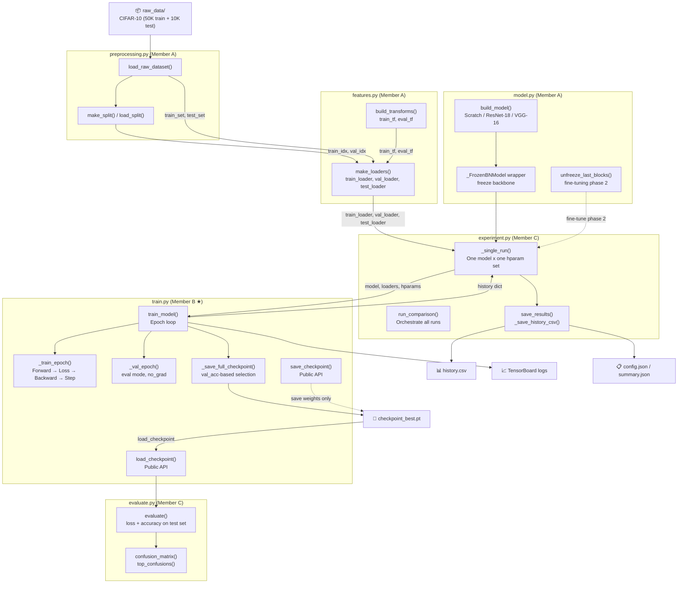
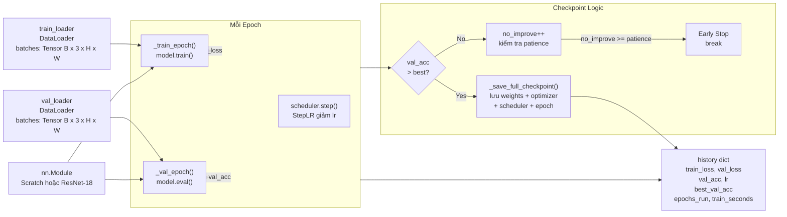

# Member B – Train Module Demo Guide
## Lab 2: Pre-trained CNNs and Fine-tuning on CIFAR-10

> **Phụ trách:** Member B | **File nguồn:** [`labs/lab2/train/train.py`](../train/train.py)
> **Mục tiêu tài liệu:** Chuẩn bị demo giải thích code `train.py` cho giảng viên.
> **Ngày tạo tài liệu:** 2026-11-04 · **Cập nhật lần cuối:** 2026-11-13 20:55 (+07)

---

## Mục lục

1. [Purpose – Mục tiêu](#1-purpose--mục-tiêu-của-module-training)
2. [Input / Output](#2-input--output)
3. [Model Architecture](#3-model-architecture--cách-model-được-truyền-vào)
4. [Training Process](#4-training-process--luồng-huấn-luyện)
5. [Validation](#5-validation--tính-val-loss-và-accuracy)
6. [Checkpoint](#6-checkpoint--lựa-chọn-và-lưu-mô-hình-tốt-nhất)
7. [Success Criteria](#7-success-criteria--điều-kiện-demo-thành-công)
8. [Code Explanation](#8-code-explanation--giải-thích-từng-đoạn-theo-số-dòng)
9. [Sơ đồ kết nối module](#9-sơ-đồ-kết-nối-module)
10. [Lịch sử cập nhật – Nhật ký ngày giờ](#10-lịch-sử-cập-nhật--nhật-ký-ngày-giờ)
---

## 1. Purpose – Mục tiêu của Module Training

Module `train` giải quyết bài toán **huấn luyện mô hình phân loại ảnh** trên CIFAR-10 (10 lớp) với ba chiến lược thực nghiệm:

| Chiến lược | Mô tả |
|------------|-------|
| **A – Scratch** | Huấn luyện từ đầu, toàn bộ tham số đều trainable |
| **B – Feature Extraction** | Backbone đóng băng (frozen), chỉ train classifier head |
| **C – Fine-tuning** | Phase 1: warmup head → Phase 2: mở một phần backbone |

**Trách nhiệm của `train.py`:**
- Điều phối vòng lặp epoch: `_train_epoch` → `_val_epoch` → checkpoint → TensorBoard
- Lưu checkpoint tốt nhất theo **validation accuracy** (không phải val loss)
- Hỗ trợ early stopping khi accuracy không cải thiện
- Trả về `history` dict đầy đủ cho module `experiment` sử dụng

---

## 2. Input / Output

### Input của `train_model()`

```
model         : nn.Module          – model cần huấn luyện (sửa in-place)
train_loader  : DataLoader         – loader dữ liệu train (batches [B, 3, H, W])
val_loader    : DataLoader         – loader dữ liệu validation
epochs        : int                – số epoch tối đa
lr            : float              – learning rate ban đầu
device        : torch.device       – CPU hoặc CUDA
ckpt_path     : str                – đường dẫn lưu checkpoint tốt nhất
writer        : SummaryWriter|None – TensorBoard writer (None = tắt)
optimizer_name: str                – 'adam' (default) hoặc 'sgd'
weight_decay  : float              – L2 regularisation (default 0.0)
patience      : int                – early stopping patience (default 10)
lr_step_size  : int                – StepLR step_size (default 7)
lr_gamma      : float              – StepLR gamma (default 0.1)
```

### Output – `history` dict

```python
{
    "train_loss"   : List[float],  # mean loss mỗi epoch (train set)
    "val_loss"     : List[float],  # mean loss mỗi epoch (val set)
    "val_acc"      : List[float],  # accuracy mỗi epoch (val set, range 0–1)
    "lr"           : List[float],  # learning rate sau scheduler mỗi epoch
    "best_val_acc" : float,        # accuracy tốt nhất đạt được
    "epochs_run"   : int,          # số epoch thực tế chạy (sớm dừng nếu có)
    "train_seconds": float,        # tổng thời gian huấn luyện (giây)
}
```

### Artifacts ghi ra disk

| Artifact | Mô tả |
|----------|-------|
| `checkpoint_best.pt` | Full checkpoint: model weights + optimizer + scheduler + epoch + best_val_acc |
| TensorBoard logs | `Loss/train`, `Loss/val`, `Accuracy/val`, `LR` per epoch |

---

## 3. Model Architecture – Cách Model Được Truyền Vào

`train_model()` nhận bất kỳ `nn.Module` nào từ `build_model()` (Member A). Có hai trường hợp:

### Trường hợp 1: Scratch CNN (`_ScratchCNN`)

```
Input [B, 3, 32, 32]
  ↓  Conv(3→32, 3×3) + BN + ReLU + MaxPool(2)
  ↓  Conv(32→64, 3×3) + BN + ReLU + MaxPool(2)
  ↓  Conv(64→128, 3×3) + BN + ReLU + AdaptiveAvgPool(4×4)
  ↓  Flatten → Dropout(0.4) → Linear(2048→256) → ReLU → Linear(256→10)
Output [B, 10]  ← logits (raw scores, chưa softmax)
```

*~550K tham số, tất cả trainable.*

### Trường hợp 2: ResNet-18 (Feature Extraction / Fine-tuning)

```
Input [B, 3, 64, 64]
  ↓  [BACKBONE – FROZEN] conv1 → BN → ReLU → MaxPool
  ↓  layer1 → layer2 → layer3 → layer4 → AvgPool
  ↓  [HEAD – TRAINABLE] Linear(512 → 10)
Output [B, 10]  ← logits
```

*Backbone đóng băng qua `_FrozenBNModel` wrapper – giữ BN ở eval mode.*

> **Điểm quan trọng (line 81–86):** `train_model` tự động lọc chỉ truyền các tham số `requires_grad=True` vào optimizer. Nếu không có tham số nào trainable sẽ raise `ValueError`.

---

## 4. Training Process – Luồng Huấn Luyện

```
train_model()
│
├─ Khởi tạo (lines 78–104)
│   ├─ model.to(device)
│   ├─ Lọc trainable params → chỉ truyền vào optimizer
│   ├─ _build_optimizer()     → Adam hoặc SGD
│   ├─ StepLR scheduler
│   ├─ CrossEntropyLoss
│   └─ Khởi tạo history dict + timer
│
└─ Epoch Loop (lines 106–151)
    │
    ├─ _train_epoch()          ← FORWARD + BACKWARD + OPTIMIZE
    │   ├─ model.train()       # Bật training mode (BN/Dropout active)
    │   └─ for batch in loader:
    │       ├─ optimizer.zero_grad()     # Xóa gradient cũ
    │       ├─ logits = model(imgs)      # Forward pass
    │       ├─ loss = criterion(logits, labels)  # CrossEntropy
    │       ├─ loss.backward()           # Backpropagation
    │       └─ optimizer.step()         # Cập nhật weights
    │
    ├─ _val_epoch()            ← VALIDATION (no gradient)
    │   ├─ model.eval()        # Tắt Dropout, BN dùng running stats
    │   └─ with torch.no_grad():
    │       └─ tính val_loss và val_acc
    │
    ├─ scheduler.step()        # Điều chỉnh learning rate (StepLR)
    ├─ Ghi history
    ├─ In log ra console
    ├─ Ghi TensorBoard (nếu writer ≠ None)
    └─ Checkpoint logic
        ├─ val_acc > best → lưu checkpoint, reset no_improve
        └─ val_acc ≤ best → no_improve++
            └─ no_improve >= patience → EARLY STOP (break)
```

### Chi tiết Forward Pass

```
Batch → model(imgs)
      → logits: [B, 10]   (raw scores, chưa softmax)
      → loss = CrossEntropyLoss(logits, labels)
               = -log(softmax(logit[true_class]))
               = -logit[true_class] + log(Σ exp(logit[k]))
```

### Chi tiết Backpropagation

```
loss.backward()
  → PyTorch tự động tính ∂loss/∂θ cho mọi θ có requires_grad=True
  → Gradient được tích lũy trong param.grad

optimizer.step()
  → Adam: θ ← θ - lr × m̂ / (√v̂ + ε)
         (m̂: moment 1 bias-corrected, v̂: moment 2 bias-corrected)
  → SGD:  θ ← θ - lr × (∇ + momentum·v)
```

---

## 5. Validation – Tính Val Loss và Accuracy

**Hàm `_val_epoch()` (lines 232–248):**

```python
def _val_epoch(model, loader, criterion, device):
    model.eval()              # Chuyển sang inference mode
    total_loss = 0.0
    correct    = 0
    total      = 0
    with torch.no_grad():     # Tắt tính gradient (tiết kiệm bộ nhớ)
        for imgs, labels in loader:
            imgs, labels = imgs.to(device), labels.to(device)
            logits = model(imgs)
            loss   = criterion(logits, labels)
            total_loss += loss.item()
            preds  = logits.argmax(dim=1)   # Lấy class có score cao nhất
            correct += (preds == labels).sum().item()
            total   += labels.size(0)
    avg_loss = total_loss / max(len(loader), 1)   # Trung bình theo số batch
    accuracy = correct / max(total, 1)            # Trung bình theo số mẫu
    return avg_loss, accuracy
```

**Điểm quan trọng:**
- `model.eval()` → BatchNorm dùng running mean/var (không dùng batch stats)
- `torch.no_grad()` → Không tính gradient, tiết kiệm ~2× bộ nhớ
- Accuracy = số dự đoán đúng / tổng số mẫu ∈ [0, 1]

---

## 6. Checkpoint – Lựa Chọn và Lưu Mô Hình Tốt Nhất

**Tiêu chí:** Checkpoint được lưu khi `val_acc > best_val_acc`.

> **Thiết kế quan trọng:** Dùng **`val_acc`** (không phải `val_loss`) để chọn checkpoint, đảm bảo nhất quán: `history["best_val_acc"] == max(history["val_acc"])` luôn đúng.

**Hàm `_save_full_checkpoint()` (lines 251–261):**

```python
checkpoint = {
    "epoch"               : epoch,
    "model_state_dict"    : inner.state_dict(),
    "optimizer_state_dict": optimizer.state_dict(),
    "scheduler_state_dict": scheduler.state_dict(),
    "best_val_acc"        : best_val_acc,
}
torch.save(checkpoint, path)
```

**Hỗ trợ `_FrozenBNModel`:** Line 253 lấy `model.inner` nếu có wrapper, tránh lưu cả layer wrapper.

**Load lại (lines 179–197):**

```python
state = torch.load(path, map_location=device, weights_only=True)
if isinstance(state, dict) and "model_state_dict" in state:
    state = state["model_state_dict"]   # Hỗ trợ cả 2 format
inner.load_state_dict(state)
model.eval()
```

---

## 7. Success Criteria – Điều Kiện Demo Thành Công

| # | Tiêu chí | Trạng thái |
|---|----------|------------|
| 1 | `train_model()` chạy không lỗi với dữ liệu synthetic | ✅ PASS |
| 2 | `history` chứa đủ 7 keys | ✅ PASS |
| 3 | `best_val_acc == max(history["val_acc"])` | ✅ PASS |
| 4 | File checkpoint tồn tại sau training | ✅ PASS |
| 5 | Checkpoint chứa đúng keys + giá trị nhất quán | ✅ PASS |
| 6 | Load checkpoint → forward pass thành công | ✅ PASS |
| 7 | Early stopping hoạt động khi patience nhỏ | ✅ PASS |
| 8 | `TestCheckpointConsistency` (6 tests) pass | ✅ 6/6 PASS |
| 9 | `TestVGG16Unfreezing` (12 tests) pass | ✅ 12/12 PASS |
| 10 | `TestPipelineIntegration` (10 tests) pass | ✅ 10/10 PASS |

---

## 8. Code Explanation – Giải Thích Từng Đoạn Theo Số Dòng

### Lines 1–17: Module Docstring

Ghi rõ thiết kế: Val_acc làm tiêu chí, TensorBoard là optional, CPU-friendly, không dùng mixed precision.

### Lines 33–47: Function Signature

```python
def train_model(
    model, train_loader, val_loader,
    epochs, lr, device, ckpt_path,
    writer=None,            # None → TensorBoard tắt
    optimizer_name="adam",  # Mặc định Adam
    weight_decay=0.0,
    patience=10,            # Early stopping patience
    lr_step_size=7,
    lr_gamma=0.1,
) -> Dict:
```

Interface ổn định – module `experiment` gọi hàm này, không được đổi signature.

### Lines 78–92: Initialization Block

```python
model.to(device)                              # (L78)

trainable_params = [p for p in model.parameters()   # (L81)
                    if p.requires_grad]
if not trainable_params:                             # (L82-86)
    raise ValueError("no trainable parameters...")

optimizer = _build_optimizer(...)            # (L88)
scheduler = torch.optim.lr_scheduler.StepLR(# (L89-91)
    optimizer, step_size=lr_step_size, gamma=lr_gamma
)
criterion = nn.CrossEntropyLoss()           # (L92)
```

### Lines 94–104: Checkpoint Dir + History Init

```python
Path(ckpt_path).parent.mkdir(parents=True, exist_ok=True)  # (L94)

history = {"train_loss": [], "val_loss": [], "val_acc": [], "lr": []}
best_val_acc = 0.0
no_improve   = 0                            # Counter cho early stopping
t0 = time.time()                            # Bắt đầu đếm thời gian
```

### Lines 106–131: Epoch Loop + Logging

Vòng lặp chính: gọi `_train_epoch` → `_val_epoch` → `scheduler.step()` → ghi history → in log.

### Lines 133–138: TensorBoard Logging (Optional)

```python
if writer is not None:
    writer.add_scalar("Loss/train",   train_loss, epoch)
    writer.add_scalar("Loss/val",     val_loss,   epoch)
    writer.add_scalar("Accuracy/val", val_acc,    epoch)
    writer.add_scalar("LR",           current_lr, epoch)
```

Chỉ ghi khi `writer` được truyền vào – TensorBoard hoàn toàn optional.

### Lines 140–151: Checkpoint + Early Stopping

```python
if val_acc > best_val_acc:
    best_val_acc = val_acc
    no_improve   = 0
    _save_full_checkpoint(model, optimizer, scheduler, epoch, best_val_acc, ckpt_path)
else:
    no_improve += 1
    if no_improve >= patience:
        print(f"  Early stopping after {epoch} epochs...")
        break
```

### Lines 153–161: Finalize + Return

```python
total_seconds = time.time() - t0
history["best_val_acc"]  = best_val_acc
history["epochs_run"]    = epoch
history["train_seconds"] = total_seconds
return history
```

### Lines 164–176: `save_checkpoint()` – Public API

Chỉ lưu `state_dict()` (weights), không lưu optimizer/scheduler. Dùng bởi module evaluate.

### Lines 179–197: `load_checkpoint()` – Public API

Hỗ trợ cả 2 format: raw state_dict và full checkpoint dict. Dùng `weights_only=True` cho bảo mật.

### Lines 204–213: `_build_optimizer()`

Tạo Adam (`lr, weight_decay`) hoặc SGD (`lr, momentum=0.9, weight_decay`).

### Lines 216–229: `_train_epoch()` – Vòng Lặp Train

`model.train()` → `zero_grad()` → `forward()` → `criterion()` → `backward()` → `step()`.

### Lines 232–248: `_val_epoch()` – Vòng Lặp Val

`model.eval()` → `no_grad()` → đếm `correct / total` → trả về `(avg_loss, accuracy)`.

### Lines 251–261: `_save_full_checkpoint()` – Private

Lưu `epoch, model_state_dict, optimizer_state_dict, scheduler_state_dict, best_val_acc`.

---

## 9. Sơ Đồ Kết Nối Module

### 9.1 Tổng quan pipeline Lab 2



### 9.2 Luồng dữ liệu qua `train_model()`



### 9.3 Vị trí `train.py` trong cấu trúc thư mục

```
Lab-DL/
└── labs/lab2/
    ├── preprocessing/preprocessing.py   ← load data, split
    ├── features/features.py             ← transforms, DataLoaders
    ├── model/model.py                   ← build_model, freeze/unfreeze
    ├── train/
    │   └── train.py  ★ Member B        ← train_model, save/load_checkpoint
    ├── evaluate/evaluate.py             ← evaluate, confusion_matrix
    ├── experiment/experiment.py         ← run_comparison, orchestration
    ├── docs/
    │   ├── train_demo.md               ← tài liệu này
    │   └── train_demo_script.py
    ├── artifacts/
    │   └── runs/<run_id>/
    │       ├── checkpoint_best.pt       ← output của train.py
    │       ├── history.csv
    │       ├── config.json
    │       └── tb_logs/                 ← TensorBoard events
    └── tests/
        ├── test_smoke.py
        └── test_implementations.py
```

### 9.4 Interface giữa các module (hợp đồng giao diện)

| Hàm | Được gọi bởi | Nhận input từ | Trả output cho |
|-----|-------------|---------------|----------------|
| `train_model()` | `experiment._single_run` | `model.py`, `features.py` | `history` dict → `experiment` |
| `save_checkpoint()` | `evaluate`, `experiment` | `nn.Module` | `.pt` file trên disk |
| `load_checkpoint()` | `evaluate`, `experiment` | `.pt` file | `nn.Module` ở eval mode |

> **Quy tắc nhóm:** Không được đổi tên hoặc thay đổi signature 3 hàm public trên mà không báo nhóm trưởng. Các module khác phụ thuộc trực tiếp vào chúng.

---

## 10. Lịch sử cập nhật – Nhật ký ngày giờ

| Ngày · Giờ (+07) | Người | Thay đổi | Kiểm chứng |
|---|---|---|---|
| 2026-10-26 · — | Member B (Bảo) | Viết `train.py` (`train_model`, `save_checkpoint`, `load_checkpoint`) + `tests/test_train.py` | `pytest labs/lab2/tests` – 18 passed (theo `progress_status.md`) |
| 2026-11-04 · — | Team leader (Thư) | PR #48: `train_model` ghi thêm `best_epoch` / `best_val_loss` / `best_val_acc`, chọn checkpoint theo validation loss; `load_checkpoint` dùng `weights_only=True` | `pytest labs/lab2/tests` – 52 passed; `test_train.py` 4 passed; `ruff check` pass |
| 2026-11-04 · — | Team leader (Thư) | Tạo tài liệu module `docs/train.md` (bản "guide for AI agents") | Đối chiếu chữ ký trong `project_description.md` bằng `inspect` |
| 2026-11-13 · 20:38 | Member B | Viết lại `train.md` thành Demo Guide: 9 mục, cây ASCII + 2 sơ đồ mermaid, giải thích theo số dòng | Đối chiếu với bản `train.py` 261 dòng ở nhánh `feat/lab2-main` |
| 2026-11-13 · 20:55 | Member B | **Thêm ngày giờ**: dòng ngày tạo / cập nhật ở header + mục 10 (mục lục + lịch sử này) | So định dạng với `docs/evaluate.md`, `docs/experiment.md`; **chưa chạy lại pytest** (máy không có `torch` trong Python mặc định) |

> **Lưu ý đồng bộ (2026-11-13):** tài liệu này đang mô tả bản `train.py` **261 dòng** ở nhánh `origin/feat/lab2-main` (có StepLR, `patience`, history 7 key, checkpoint theo **val_acc**). `train.py` trên nhánh đang làm việc là **197 dòng** (không scheduler/early stopping, checkpoint theo **val_loss**, history có `best_epoch` / `best_val_loss` / `best_val_acc`). Trước khi demo cần chốt dùng bản nào, rồi sửa tài liệu hoặc sửa code cho khớp.

