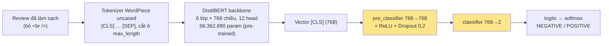

# Model card — DistilBERT fine-tune trên IMDB  (v1)
- Tác giả: Thư (Initial model), Phúc (Trained model, AI soạn), tạo 2026-11-20T02:18:37+07:00 | Cập nhật: Phúc, 2026-11-20T12:38:11+07:00
- Khuôn: [../templates/MODEL_CARD_TEMPLATE_v1.md](../templates/MODEL_CARD_TEMPLATE_v1.md)

## Purpose
Phân loại cảm xúc review phim IMDB thành NEGATIVE (0) / POSITIVE (1) (Bài 2). So với pipeline zero-shot `distilbert-base-uncased-finetuned-sst-2-english` của Bài 1 trên cùng 25k review test.

## Initial model
- **Backbone pre-trained:** `distilbert-base-uncased` (Hugging Face Hub, commit `12040accade4e8a0f71eabdb258fecc2e7e948be`; Sanh et al. 2019) — không train từ đầu, fine-tune toàn bộ
- **Cấu hình backbone** (đọc từ model đã nạp, `outputs/results/model_summary.json`): 6 lớp Transformer, `dim` 768, 12 head, `hidden_dim` 3072, tối đa 512 vị trí, dropout 0,1, từ vựng 30.522 token WordPiece (uncased)
- **Đầu phân loại** (khởi tạo ngẫu nhiên theo seed, `DistilBertForSequenceClassification`): lấy vector của token `[CLS]` → `pre_classifier` Linear 768→768 → ReLU → Dropout 0,2 (`seq_classif_dropout`) → `classifier` Linear 768→2 → logits
- `id2label`: {0: NEGATIVE, 1: POSITIVE}
- **Số param** (đếm từ code, `model.count_parameters`):

| Nhóm | Số param |
|---|---|
| Backbone DistilBERT | 66.362.880 |
| Đầu phân loại (pre_classifier + classifier) | 592.130 |
| **Tổng** (đều train được) | **66.955.010** |

- **Input:** `input_ids`, `attention_mask` [B, ≤ max_length] — tokenizer cùng checkpoint, cắt theo `max_length`, pad theo batch | **Output:** logits [B, 2]
- **Source:** `labs/lab3/model/model.py`

Ô màu vàng: đầu phân loại mới (592.130 param), khởi tạo ngẫu nhiên. Khi nạp, transformers báo `pre_classifier`, `classifier` là MISSING (khởi tạo mới) và `vocab_transform`, `vocab_layer_norm`, `vocab_projector` là UNEXPECTED (đầu masked-LM của lúc pre-train, không dùng) — đúng như mong đợi.

## Trained model
- **Người train:** Phúc (Member B; AI chạy theo uỷ quyền của Thư) | **Ngày train xong:** 2026-11-20 | **Nơi chạy:** Kaggle, Tesla T4 (1 GPU, fp16), torch 2.11.0+cu130, transformers 5.22.1
- **Log/config:** `outputs/logs/20261120_105134_main_seed42.*`, `20261120_105200_main_seed43.*`, `20261120_112347_main_seed44.*`; bảng `outputs/results/main_runs.csv`
- **Cấu hình:** `max_length` 512, lr 2e-5 (AdamW), warmup 10% rồi linear decay, batch 16, weight decay 0,01, trần 6 epoch, đánh giá val mỗi 352 step (≈ 1/4 epoch), early stopping patience 8, threshold 0. Chọn checkpoint theo val acc cao nhất (trần, patience, threshold: [AI chốt theo uỷ quyền của Thư 2026-11-20 — Thư đã duyệt 2026-11-20], `docs/experiments/experiment_log.md` S2b)
- **Checkpoint:** `outputs/models/<ts>_main_seed<s>_best/` (không commit; nằm trong output của kernel Kaggle `pptt1103/lab3-main-main-seed<s>`)

| Seed | Epoch tốt nhất | Val acc | Test acc | Test F1 |
|---|---|---|---|---|
| 42 | 3,0 | 0,9288 | 0,9300 | 0,9304 |
| 43 | 5,5 | 0,9308 | 0,9309 | 0,9319 |
| 44 | 2,75 | 0,9312 | 0,9338 | 0,9345 |
| **Trung bình ± std** | | **0,9303 ± 0,0013** | **0,9315 ± 0,0020** | **0,9323 ± 0,0021** |
| Zero-shot SST-2 (Bài 1) | — | — | 0,8922 | 0,8892 |

- **Ngưỡng L13 (test acc trung bình ≥ 91%): đạt.** DistilBERT paper báo 92,82 (Sanh et al. 2019, Table 2). Nguồn số: `outputs/results/test_summary.csv` (test dùng đúng một lần cho mỗi model).
- **Giới hạn đã biết:**
  - Review dài hơn 512 token bị cắt (12,3% review test, `outputs/results/eda_summary.csv`). Nhóm này có tỉ lệ lỗi 10,05%, so với 6,14% ở nhóm không bị cắt (`outputs/results/error_by_group.csv`, seed 44).
  - Lỗi tập trung ở review có rating sát ranh giới: rating 4 sai 17,2%, rating 7 sai 11,7%.
  - Sai cả 2 câu phủ định ngắn trong 6 câu kiểm soát, trong khi zero-shot đúng (`outputs/demo/control_sentences.csv`). Không nên dùng cho câu ngắn có phủ định.
  - Std chỉ gồm seed và tính không tất định của GPU, chưa gồm độ lệch do cách chia dữ liệu (`experiment_v1.md`).
