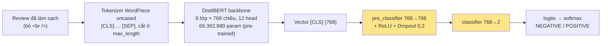

# Model card — DistilBERT fine-tune trên IMDB  (v1)
- Tác giả: Thư, tạo 2026-11-20T02:18:37+07:00 | Cập nhật: Thư, 2026-11-20T02:18:37+07:00
- Khuôn: [../templates/MODEL_CARD_TEMPLATE_v1.md](../templates/MODEL_CARD_TEMPLATE_v1.md)

## Purpose
Phân loại cảm xúc review phim IMDB thành NEGATIVE (0) / POSITIVE (1) (Bài 2). So với pipeline zero-shot `distilbert-base-uncased-finetuned-sst-2-english` của Bài 1 trên cùng 25k review test.

## Initial model
- **Backbone pre-trained:** `distilbert-base-uncased` (Hugging Face Hub, commit `12040accade4e8a0f71eabdb258fecc2e7e948be`; Sanh et al. 2019) — không train từ đầu, fine-tune toàn bộ
- **Cấu hình backbone** (đọc từ model đã nạp, `outputs/results/model_summary.json`): 6 lớp Transformer, `dim` 768, 12 head, `hidden_dim` 3072, tối đa 512 vị trí, dropout 0,1, từ vựng 30.522 token WordPiece (uncased)
- **Đầu phân loại** (khởi tạo ngẫu nhiên theo seed, `DistilBertForSequenceClassification`): lấy vector của token `[CLS]` → `pre_classifier` Linear 768→768 → ReLU → Dropout 0,2 (`seq_classif_dropout`) → `classifier` Linear 768→2 → logits
- `id2label`: {0: NEGATIVE, 1: POSITIVE}
- **Số param** (đếm từ code, `model.count_parameters`):

| Nhóm | Số param |
|---|---|
| Backbone DistilBERT | 66.362.880 |
| Đầu phân loại (pre_classifier + classifier) | 592.130 |
| **Tổng** (đều train được) | **66.955.010** |

- **Input:** `input_ids`, `attention_mask` [B, ≤ max_length] — tokenizer cùng checkpoint, cắt theo `max_length`, pad theo batch | **Output:** logits [B, 2]
- **Source:** `labs/lab3/model/model.py`

Ô màu vàng: đầu phân loại mới (592.130 param), khởi tạo ngẫu nhiên. Khi nạp, transformers báo `pre_classifier`, `classifier` là MISSING (khởi tạo mới) và `vocab_transform`, `vocab_layer_norm`, `vocab_projector` là UNEXPECTED (đầu masked-LM của lúc pre-train, không dùng) — đúng như mong đợi.

## Trained model
Chưa train — điền sau lần chạy chính 3 seed trên Kaggle (Member B, plan §4 S3, S5).
- Người train | Ngày train xong | Nơi chạy: Kaggle <GPU> | Log/config: `outputs/logs/<ts>_<run>.*`
- Cấu hình: max_length, lr, batch, warmup, trần epoch, patience
- Checkpoint: `outputs/models/<ts>_<run>_best/` (không commit)
- Kết quả 3 seed: val acc, test acc, test F1 — từng seed và trung bình ± std
- So sánh: pipeline zero-shot (Bài 1) trên cùng 25k test
- Giới hạn đã biết: review dài hơn max_length bị cắt (tỉ lệ: `outputs/results/eda_summary.csv`)
