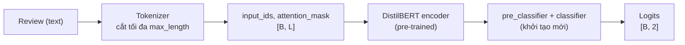

# Model card — distilbert_imdb (v1)

- **Created**: 2026-11-18T13:00:00+07:00 (Member B)
- **Last Updated**: 2026-11-18T13:00:00+07:00 (Member B)
- Khuôn: [../../../lab1/docs/templates/MODEL_CARD_TEMPLATE_v1.md](../../../lab1/docs/templates/MODEL_CARD_TEMPLATE_v1.md)

## Purpose
Model fine-tune của Lab 3: DistilBERT phân loại cảm xúc review IMDB thành NEGATIVE / POSITIVE. Model được so với baseline zero-shot (`distilbert-base-uncased-finetuned-sst-2-english`, Bài 1, không train thêm) trên cùng 500 review test.

## Initial model
- **Architecture:** DistilBERT encoder và đầu phân loại 2 nhãn (`DistilBertForSequenceClassification`); `pre_classifier` và `classifier` được khởi tạo mới, các phần còn lại nạp từ checkpoint.
- **Xây từ đâu:** nạp pre-trained `distilbert-base-uncased` từ Hugging Face Hub bằng `AutoModelForSequenceClassification`; không tự viết kiến trúc. Tokenizer lấy từ cùng checkpoint.
- **Số param:** 67,0 triệu (notebook ô 15) | **Input:** `input_ids` và `attention_mask` dạng `[B, L]`, `L` ≤ `max_length` (128 ở lần chạy đã ghi), padding theo batch | **Output:** logits `[B, 2]`; `id2label` = {0: NEGATIVE, 1: POSITIVE}
- **Source:** `labs/lab3/model/model.py` (`load_model_and_tokenizer`, dòng 7)

| Phần của model | Trạng thái khi nạp (báo cáo nạp ở notebook ô 15) |
|---|---|
| Encoder DistilBERT | nạp từ checkpoint |
| `pre_classifier.weight`, `pre_classifier.bias`, `classifier.weight`, `classifier.bias` | `MISSING` — khởi tạo mới, được học khi fine-tune |
| `vocab_transform.*`, `vocab_layer_norm.*`, `vocab_projector.bias` | `UNEXPECTED` — có trong checkpoint nhưng không dùng cho phân loại, bỏ qua được |

Cảnh báo của Hugging Face về đầu phân loại mới là bình thường.

## Trained model
- **Người train:** Member B | **Ngày train xong:** 2026-10-31 (chưa ghi giờ), CPU, khoảng 17 phút (`../../README.md`; `progress_status.md:36`)
- **Huấn luyện:** 1 epoch, lr 2e-5, batch 8, weight decay 0,01, seed 42, `max_length` 128; 2000 review train, 500 review validation; chọn epoch theo F1 validation (notebook ô 17; `labs/lab3/train/train.py:38`, `:42`)
- **Log / config:** `labs/lab3/artifacts/logs/distilbert_imdb_log.json` (log của Trainer), `labs/lab3/artifacts/logs/lab3_results.json` (bảng so sánh); không commit
- **Checkpoint:** `labs/lab3/artifacts/models/distilbert_imdb/` (best epoch là epoch 1, epoch duy nhất); không commit, nằm trên máy người chạy notebook
- **Kết quả** (notebook ô 18, 20, 26, 27):

| Tập | Loss | Accuracy | F1 |
|---|---:|---:|---:|
| Validation 500 review (epoch 1) | 0,3607 | 0,8340 | 0,8337 |
| Test 500 review (chạy một lần) | 0,3803 | **0,8220** | **0,8195** |
| Test 500 review — zero-shot (Bài 1, không train thêm) | — | 0,8920 | 0,8889 |

- **Ghi chú:**
  - Training loss giảm từ 0,6912 xuống 0,4108 (25 điểm log). Trên validation: ma trận nhầm lẫn `[[209, 34], [49, 208]]` (hàng = nhãn thật, cột = dự đoán), 83 sai trên 500.
  - Trên cùng 500 review test, model fine-tune thấp hơn zero-shot 7,0 điểm accuracy, lớn hơn sai số lấy mẫu (khoảng 1,4 đến 1,7 điểm). Chỉ có một lần chạy, một seed, một epoch; nguyên nhân chưa được kiểm chứng. Hai model cũng cắt review ở độ dài khác nhau (128 token so với 512 token).
  - Số validation lấy từ epoch được chọn bằng chính tập validation nên hơi lạc quan; tập test chỉ dùng một lần ở cuối.
  - Câu `Not bad at all` bị model này đoán NEGATIVE (0,6667) trong khi pipeline đoán POSITIVE (0,9991); chỉ 3 câu nên chưa đủ kết luận.
  - Luồng `main.py --run-training` lưu model ở `artifacts/models/distilbert_sentiment/`, khác thư mục của notebook; chưa có lần chạy `main.py` nào được ghi (xem [train_v1.md](../phases/train_v1.md)).
