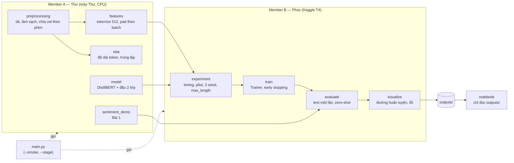

# Lab 3: Phân tích cảm xúc và fine-tuning với Hugging Face — tổng quan dự án

- **Created**: 2026-11-20T14:29:08+07:00 (pptthu)
- **Last Updated**: 2026-11-21T01:42:29+07:00 (pptthu)
- Desc hiện hành: [`docs/lab3_description_v1.md`](docs/lab3_description_v1.md) · Plan: [`docs/plans/detail_plan_lab3_md_v1.md`](docs/plans/detail_plan_lab3_md_v1.md) · Kết quả: [`README.md`](README.md) · Mục lục tài liệu: [`docs/00_README_v1.md`](docs/00_README_v1.md)

## 1. Define

| Mục | Nội dung |
|---|---|
| Bài toán | Bài 1: phân tích cảm xúc câu mẫu bằng model pre-trained. Bài 2: fine-tune model pre-trained phân loại review phim tích cực / tiêu cực (đề Practice 3) |
| Dữ liệu | IMDB gốc `aclImdb_v1.tar.gz` (Maas et al. 2011): 25.000 train, 25.000 test, nhãn cân bằng, có mã phim của từng review |
| Input / Output | Vào: thư mục aclImdb trong `data/raw/`; một mẫu = 1 file `.txt` (một review) + nhãn 0/1 theo thư mục `neg`/`pos`, kèm rating và mã phim. Model nhận tối đa 512 token (`input_ids`, `attention_mask`), trả 2 logits → softmax ra xác suất khen; loss cross-entropy; metric accuracy (chính) + F1 bằng `evaluate`. Ra: checkpoint tốt nhất (trên Kaggle, không commit); file dự đoán test (`uid, label, pred, prob_pos`); `test_summary.csv`; log mỗi lần chạy, hình, CSV Bài 1 trong `outputs/` |
| Yêu cầu của đề | Bài 1: cài `transformers`, nạp model cảm xúc, tokenize câu mẫu, phân tích cảm xúc. Bài 2: `datasets`, tokenize, model pre-trained, `evaluate`, `TrainingArguments`, `Trainer`, fine-tune, đánh giá |
| Phạm vi | `distilbert-base-uncased`, `max_length` 512, 3 seed, chọn trên val, test dùng một lần. Mở rộng: pilot chọn số epoch, thí nghiệm `max_length`, so sánh zero-shot, 6 câu kiểm soát, phân tích lỗi. Không làm: ROC/PR, head + tail, model khác, LoRA, Optuna |
| Tiêu chí đạt | Test acc trung bình 3 seed ≥ 91% (DistilBERT paper: 92,82%); mọi số liệu trỏ tới file của một lần chạy có log; test 25k chạy một lần cho mỗi model |
| Kết quả | Fine-tuned test **0,9315 ± 0,0020** ✔ (F1 0,9323); zero-shot 0,8922; val 0,9303 ± 0,0013 |

## 2. Design

### 2.1 Kiến trúc hệ thống

### 2.2 Trình tự chạy (mỗi bước xong mới chốt số của bước sau)

| Bước | Việc | Chạy ở | Chốt được |
|---|---|---|---|
| S0 | Code, `pytest`, smoke run | Máy Thư | Pipeline chạy hết |
| S1 | EDA trên dữ liệu gốc | Máy Thư | `max_length` 512 |
| S2 | Đo thời gian, pilot 6 epoch không dừng sớm | Kaggle | Trần 6 epoch, patience 8, threshold 0 |
| S3 | 3 seed (42, 43, 44) | Kaggle | std val 0,13 điểm → 1 seed cho mỗi giá trị ở S4 |
| S4 | `max_length` 128 / 256 / 512 trên val | Kaggle | Giữ 512 |
| S5 | Test 25k: fine-tuned (3 seed) và zero-shot, mỗi model một lần | Kaggle | Kết quả báo cáo |

Mỗi bước Kaggle chạy trong một kernel riêng (`labs/lab3/kaggle/`), chỉ dùng 1 GPU để batch thật đúng là 16.

### 2.3 Chọn checkpoint và quy tắc dừng
Đánh giá val mỗi 1/4 epoch (352 step), giữ checkpoint có **val accuracy** cao nhất. Không chọn theo val loss vì khi fine-tune, val loss tăng từ epoch 1 trong khi val acc còn tăng (pilot). Early stopping: 8 lần đánh giá liên tiếp không cải thiện thì dừng, tối đa 6 epoch. Nếu điểm tốt nhất rơi vào lần đánh giá cuối thì trần quá thấp, phải tăng trần và chạy lại (không xảy ra). Log mỗi run gồm `.log`, `_history.csv`, `_config.json` ([`LOG_TEMPLATE_v1.md`](docs/templates/LOG_TEMPLATE_v1.md)).

### 2.4 Module, người phụ trách, interface

| Module | Phụ trách | Hàm chính | Desc |
|---|---|---|---|
| `sentiment_demo` | Member A (Thư) | `load_sentiment_pipeline`, `tokenize_sentence`, `predict_sentiment`, `run_demo`; `CONTROL_SENTENCES` | [sentiment_demo_v1](docs/phases/sentiment_demo_v1.md) |
| `preprocessing` | Member A (Thư) | `download_imdb`, `load_split`, `clean_text`, `make_train_val_split`, `save_split`, `read_split`, `load_datasets` | [preprocessing_v1](docs/phases/preprocessing_v1.md) |
| `eda` | Member A (Thư) | `token_lengths`, `length_summary`, `duplicate_counts`, `run_eda` | [eda_v1](docs/phases/eda_v1.md) |
| `features` | Member A (Thư) | `tokenize_datasets(ds, tokenizer, max_length)`, `make_collator` | [features_v1](docs/phases/features_v1.md) |
| `model` | Member A (Thư) | `load_tokenizer`, `build_model(seed)`, `count_parameters`, `model_summary` | [model_v1](docs/phases/model_v1.md) |
| `train` | Member B (Phúc) | `default_cfg`, `make_training_args`, `train_model(cfg, model, tokenized, collator, ...)` | [train_v1](docs/phases/train_v1.md) |
| `experiment` | Member B (Phúc) | `make_configs(stage)`, `run_stage(stage, ...)`, `seed_spread` | [experiment_v1](docs/phases/experiment_v1.md) |
| `evaluate` | Member B (Phúc) | `compute_metrics`, `evaluate_on_test`, `evaluate_zero_shot`, `summarize`, `evaluate_control_sentences` | [evaluate_v1](docs/phases/evaluate_v1.md) |
| `visualize` | Member B (Phúc) | `plot_training_curves`, `plot_confusion`, `plot_maxlen`, `error_analysis`, `run_all` | [visualize_v1](docs/phases/visualize_v1.md) |
| `main.py` | Thư (phần A), Phúc (`--stage`) | `run_member_a(smoke)`, `run_member_b(parts, smoke)`, `main` | — |
| `kaggle/` | Member B (Phúc) | `kaggle_run.py` (`publish-code`, `push`, `status`, `wait`, `fetch`) | [kaggle/README.md](kaggle/README.md) |

Mọi tham số đặt trong `config.py`; module khác đọc từ đó. Chữ ký đầy đủ kèm số dòng: mục "Triển khai" của từng file phase.

### 2.5 Thư mục và quy trình
- `data/` (vào), `outputs/` (ra), `docs/`, 9 folder module, `kaggle/`, `notebook/`, `tests/` — [`FOLDER_STRUCTURE_v1.md`](docs/rules/FOLDER_STRUCTURE_v1.md)
- Quy trình: desc → detail plan → Thư duyệt → small prompt từng bước → smoke run → normal run → audit ([`RULES_v1.md`](docs/rules/RULES_v1.md)). File phase phần A có mục "Kết quả audit (2026-11-20)".

### 2.6 Rủi ro kỹ thuật và cách xử lý

| Rủi ro | Cách xử lý |
|---|---|
| Cùng phim ở cả train và val làm val acc cao hơn thực tế | Chia val theo phim, gộp review trùng nội dung chung nhóm; `groups_in_both` = 0 |
| Dùng test để chọn model | Số epoch, patience, `max_length` đều chốt trên val; test chạy một lần, có cờ `test_evaluated` trong `_config.json` |
| Review dài bị cắt mất nội dung | EDA đo trước; chọn 512 (cắt 13%); thí nghiệm `max_length` đo mức mất accuracy |
| Chọn checkpoint theo val loss bỏ lỡ model tốt | Chọn theo val accuracy (`metric_for_best_model="accuracy"`, `greater_is_better=True`) |
| Trần epoch quá thấp | Pilot không dừng sớm; kiểm `best_is_last_eval` |
| Kết quả lệch theo seed và GPU | 3 seed, báo trung bình ± std; ghi phiên bản thư viện, GPU, commit code vào log |
| Kaggle 2 GPU làm batch thật thành 32 | Kernel đặt `CUDA_VISIBLE_DEVICES=0` |
| Repo private, Kaggle không clone được | Đưa code lên Kaggle dataset private, ghi commit vào log; không đưa token GitHub lên Kaggle |
