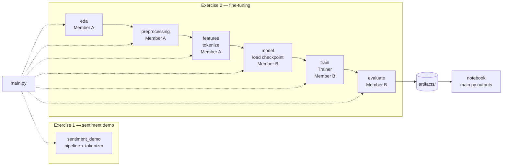

# Lab 3: Hugging Face sentiment analysis and fine-tuning (PyTorch) — project description

- **Created**: 2026-10-12T10:27:18+07:00 (pptthu)
- **Last Updated**: 2026-11-19T12:05:08+07:00
- **Status**: seven code modules are implemented and audited; [`main.py`](main.py) and the short report are integrated
- **Detailed description**: [`lab3_description_v1.md`](lab3_description_v1.md) · Brief report: [`README.md`](README.md) · Progress: [`progress_status.md`](progress_status.md)

## 1. Define

| Item | Description |
|---|---|
| Problem | Practice 3 has two exercises: (1) use a pre-trained sentiment pipeline and inspect tokenizer output; (2) fine-tune a pre-trained DistilBERT transformer for binary text classification with the Hugging Face `Trainer` API |
| Target users | The lecturer (grading and oral Q&A) and the student group (implementation and learning) |
| Data | IMDB binary movie-review sentiment data from Hugging Face: `stanfordnlp/imdb` |
| Input | Raw sentences for Exercise 1; text reviews and integer labels `0`/`1` for Exercise 2 |
| Output | Sentence labels/scores and token IDs; a fine-tuned DistilBERT model; accuracy and binary F1; EDA figures; test metrics in `artifacts/` |
| Core requirements | Load a pre-trained sentiment checkpoint; inspect tokenization; load and clean IMDB subsets; split train/validation/test reproducibly; tokenize with the model tokenizer; build `TrainingArguments`; fine-tune with dynamic padding and `Trainer`; evaluate once on test |
| Scope | DistilBERT for one binary-classification task, one seed, CPU-friendly subsets, and an Exercise 1 zero-shot baseline. Not in scope: parameter-efficient tuning (LoRA), ensembles, cleanlab, custom architectures, or statistical multi-seed validation |
| Technology constraints | Python, PyTorch, `transformers`, `datasets`, NumPy and `accelerate`; internet is required for the first model/dataset download; tokenizer and model must use the same checkpoint |
| Evaluation criteria | Confirmed deliverables: source code for the lab, a PDF report at the team level, and oral Q&A. The slide does not specify a minimum accuracy threshold; `accuracy` and binary F1 must be reported |
| Current result | The 500-review test baseline from the pre-trained SST-2 pipeline was accuracy **0.8920** and F1 **0.8889**. The one-run fine-tuned result was accuracy **0.8220** and F1 **0.8195** with `max_length=128`, 1 epoch, batch size 8 |

## 2. Design

### 2.1 System architecture



### 2.2 Data flow and run sequence

1. Exercise 1 loads `distilbert-base-uncased-finetuned-sst-2-english`, prints tokens and predicts three sample sentences.
2. Exercise 2 loads IMDB and creates reproducible subsets. The Hub train pool is shuffled before selecting train and validation; test comes from the independently shuffled test pool.
3. EDA uses only the training subset: label counts, word-length statistics and three PNG figures are written to `artifacts/figures/`.
4. The model and tokenizer are loaded from the same `distilbert-base-uncased` checkpoint. The model is created with two labels.
5. Every split is cleaned and tokenized with `max_length`; text padding is not fixed in advance.
6. `Trainer` uses dynamic padding through `DataCollatorWithPadding`. It evaluates on validation at each epoch and keeps the epoch with the best F1.
7. The test split is passed to `evaluate_on_test` only once, after training and model selection.
8. The model is saved under `artifacts/models/distilbert_sentiment/`; test metrics are saved in `artifacts/logs/test_metrics.json`.

Main pipeline commands:

```bash
python -m labs.lab3.main --run-demo
python -m labs.lab3.main --run-training --max-steps 2
python -m labs.lab3.main --run-training --seed 42 --n-train 2000 --n-val 500 --n-test 500
```

`--max-steps 2` is a smoke/slow-hardware check; it does not represent the reported full run.

### 2.3 Module ownership and interfaces

| Module | Owner | Function / class | Input | Output |
|---|---|---|---|---|
| `sentiment_demo` | Member A | `show_tokens(sentence, model_name=None)` | sentence; optional checkpoint | `dict`: `tokens`, `input_ids` |
| `sentiment_demo` | Member A | `analyze_sentences(sentences, model_name=None)` | string or list; optional checkpoint | list of `sentence`, `label`, `score` |
| `eda` | Member A | `run_eda(dataset, out_dir, text_col='text', label_col='label')` | train dataset and output folder | dict with sample count, label counts and word-length statistics; PNG files |
| `preprocessing` | Member A | `load_text_dataset(name='imdb', n_train=2000, n_val=1000, n_test=2000, seed=42)` | dataset name, subset sizes and seed | `(train, val, test)` with cleaned `text` and integer `label` |
| `preprocessing` | Member A | `label_counts(dataset, label_col='label')` | dataset and label column | sorted label/count dict |
| `preprocessing` | Member A | `clean_text(text)` | raw text | minimally cleaned text |
| `features` | Member A | `tokenize_dataset(dataset, tokenizer, max_length=256, text_col='text')` | dataset, tokenizer and maximum length | tokenized dataset with `input_ids`, `attention_mask`, `label` |
| `model` | Member B | `load_model_and_tokenizer(model_name='distilbert-base-uncased', num_labels=2)` | checkpoint and label count | `(model, tokenizer)` from the same checkpoint |
| `train` | Member B | `build_training_args(output_dir, epochs=2, lr=2e-5, batch_size=16, *, max_steps=-1, seed=42, logging_steps=10)` | output folder and training settings | version-compatible `TrainingArguments` |
| `train` | Member B | `train_with_trainer(model, tokenized_train, tokenized_val, args, compute_metrics, tokenizer=None)` | model, train/validation datasets, arguments and metric callback | trained `Trainer`; model saved under `args.output_dir` |
| `evaluate` | Member B | `classification_metrics(labels, predictions)` | integer labels and predictions | `accuracy`, binary F1 |
| `evaluate` | Member B | `compute_metrics(eval_pred)` | logits and labels | `accuracy`, binary F1 |
| `evaluate` | Member B | `evaluate_on_test(trainer, tokenized_test)` | trainer and held-out test dataset | test metrics dict |
| `evaluate` | Member B | `predict_texts(model, tokenizer, texts, *, max_length=256, batch_size=16)` | model, tokenizer and raw texts | list of `text`, integer `label`, `score` |
| `evaluate` | Member B | `zero_shot_labels(results)` | pipeline result list | integer labels `0`/`1` in the same order |
| `main.py` | Team leader | `main()` / `run_sentiment_demo()` / `run_training(args)` | CLI arguments | demo output, EDA figures, model and test metrics |

Function names and signatures are implementation contracts. `tests/test_smoke.py` and the module tests check the names and key behavior.

### 2.4 Folder structure

```text
labs/lab3/
├── README.md
├── project_description.md
├── progress_status.md
├── lab3_description_v1.md
├── main.py
├── requirements.txt
├── sentiment_demo/sentiment_demo.py
├── eda/eda.py
├── preprocessing/preprocessing.py
├── features/features.py
├── model/model.py
├── train/train.py
├── evaluate/evaluate.py
├── raw_data/                  # downloaded data; not committed
├── artifacts/
│   ├── figures/               # EDA output
│   ├── models/                # fine-tuned model; not committed
│   └── logs/                  # test metrics/logs; not committed
├── logbook/                   # bug reports and experiment notes
├── notebook/lab3_presentation.ipynb
├── tests/                     # module and smoke tests
└── docs/                      # per-module guides and model information
```

### 2.5 Milestones

| Milestone | Done check |
|---|---|
| M1: Exercise 1 | `show_tokens` starts with `[CLS]` and ends with `[SEP]`; three sample predictions run |
| M2: Preprocessing and EDA | train/validation/test subsets are reproducible and balanced where required; EDA uses train only |
| M3: Tokenization | tokenized data contains `input_ids`, `attention_mask` and `label` without fixed padding |
| M4: Model and smoke training | model/tokenizer come from the same checkpoint; `--run-training --max-steps 2` completes |
| M5: Fine-tuning | validation F1 selects the best epoch; model is saved and reloadable |
| M6: Evaluation/report | test is used once; accuracy and F1 are reported; code and PDF report are complete |

### 2.6 Technical risks and mitigations

| Risk | Mitigation |
|---|---|
| Slow download or first-run network failure | Cache data/models under Lab 3 folders; run demo/training only with network available |
| Tokenizer/model mismatch | Always load both with `load_model_and_tokenizer` and the same checkpoint |
| CPU memory and runtime | Use 2000/500/500 subsets, `max_length=128` or 256, small batch size, and `--max-steps` for smoke runs |
| IMDB pool may contain only one label | Shuffle each pool with seed 42 before selecting train/validation/test subsets |
| Validation may leak into test selection | Choose the epoch on validation F1; call test evaluation once, after training |
| Label or prefix format errors | Labels remain integer 0/1; `Trainer` metrics remove the `test_` prefix before reporting |
| `TrainingArguments` API differences | Inspect installed dataclass fields and select `eval_strategy` or `evaluation_strategy` |
| `Trainer` dynamic-padding differences | Select `processing_class` or `tokenizer` by the installed `Trainer` signature and pass a `DataCollatorWithPadding` |
| GPU/CPU and library-version drift | Record device, package versions and actual command in `progress_status.md`; keep seed 42 |

---

**Tiếng Việt**

# Lab 3: Phân tích cảm xúc và fine-tuning bằng Hugging Face (PyTorch) — mô tả dự án

- **Ngày tạo**: 2026-10-12T10:27:18+07:00 (pptthu)
- **Cập nhật lần cuối**: 2026-11-19T12:05:08+07:00
- **Trạng thái**: bảy module code đã được triển khai và kiểm tra; [`main.py`](main.py) và báo cáo ngắn đã được tích hợp
- **Tài liệu chi tiết**: [`lab3_description_v1.md`](lab3_description_v1.md) · Báo cáo ngắn: [`README.md`](README.md) · Tiến độ: [`progress_status.md`](progress_status.md)

## 1. Define

| Mục | Nội dung |
|---|---|
| Bài toán | Practice 3 gồm hai bài: (1) dùng pipeline cảm xúc có sẵn và xem tokenizer; (2) fine-tune DistilBERT pre-trained cho phân loại cảm xúc văn bản nhị phân bằng API `Trainer` |
| Người dùng | Cô (chấm bài và vấn đáp) và nhóm sinh viên (code và học) |
| Dữ liệu | Dataset cảm xúc IMDB nhị phân trên Hugging Face: `stanfordnlp/imdb` |
| Input / Output | Vào: câu văn cho Bài 1; review và nhãn `0`/`1` cho Bài 2. Ra: nhãn/điểm câu, model đã fine-tune, accuracy/F1, hình EDA và metric test trong `artifacts/` |
| Tính năng chính | Nạp model cảm xúc có sẵn; xem tokenization; nạp/làm sạch tập con IMDB; chia train/validation/test có seed; tokenize bằng tokenizer của model; tạo `TrainingArguments`; fine-tune bằng padding theo batch và `Trainer`; đánh giá test |
| Phạm vi | DistilBERT cho một bài phân loại nhị phân, một seed và tập con nhẹ cho CPU. Không làm: LoRA, ensemble, cleanlab, kiến trúc tùy chỉnh hay kiểm định nhiều seed |
| Ràng buộc công nghệ | Python, PyTorch, `transformers`, `datasets`, NumPy, `accelerate`; lần đầu cần mạng để tải dữ liệu/model; tokenizer và model phải cùng checkpoint |
| Tiêu chí đạt | Đã chốt nộp: source code của cả ba lab, báo cáo PDF do nhóm viết sau và vấn đáp. Slide không nêu ngưỡng accuracy; bắt buộc báo cáo accuracy và F1 nhị phân |
| Kết quả hiện tại | Baseline zero-shot SST-2 trên 500 review test đạt accuracy **0,8920** và F1 **0,8889**. Lần fine-tune ghi nhận đạt accuracy **0,8220** và F1 **0,8195** với `max_length=128`, 1 epoch, batch 8 |

## 2. Design

### 2.1 Kiến trúc hệ thống

Sơ đồ luồng ở phần tiếng Anh phía trên. Luồng Bài 1 đi qua `sentiment_demo`; luồng Bài 2 đi qua `preprocessing -> eda -> features -> model -> train -> evaluate`.

### 2.2 Luồng dữ liệu và thứ tự chạy

1. Bài 1 nạp `distilbert-base-uncased-finetuned-sst-2-english`, in token và dự đoán 3 câu mẫu.
2. Bài 2 nạp IMDB và tạo tập con có seed. Pool train được xáo trộn trước khi cắt train/validation; test cắt từ pool test đã xáo trộn độc lập.
3. EDA chỉ dùng train: đếm nhãn, thống kê độ dài từ và lưu ba hình PNG vào `artifacts/figures/`.
4. Model và tokenizer được nạp từ cùng checkpoint `distilbert-base-uncased`, model có 2 nhãn.
5. Cả ba tập được làm sạch và tokenize cùng `max_length`; không padding cố định trước.
6. `Trainer` dùng `DataCollatorWithPadding` để padding theo từng batch, đánh giá validation sau mỗi epoch và giữ epoch có F1 validation tốt nhất.
7. Tập test chỉ truyền vào `evaluate_on_test` một lần sau khi chọn model.
8. Model lưu vào `artifacts/models/distilbert_sentiment/`; metric test lưu vào `artifacts/logs/test_metrics.json`.

Cách chạy tương tự các lệnh ở phần tiếng Anh phía trên. `--max-steps 2` chỉ dùng để kiểm tra pipeline; không thay cho lần chạy đầy đủ.

### 2.3 Module, người phụ trách và interface

Tên module, tên hàm và chữ ký thực tế xem bảng interface ở phần tiếng Anh. Đây là hợp đồng nội bộ được kiểm tra bởi `tests/test_smoke.py` và các test module.

- Member A: `sentiment_demo`, `eda`, `preprocessing`, `features`
- Member B: `model`, `train`, `evaluate`
- Nhóm trưởng: `main.py`, `README.md`, `progress_status.md`, `AI_usage.md` và duyệt PR

### 2.4 Cấu trúc thư mục

Cấu trúc thư mục xem cây ở phần tiếng Anh phía trên. Dữ liệu tải về và toàn bộ model/log/hình lớn không được commit.

### 2.5 Mốc và cách xác nhận

| Mốc | Cách xác nhận |
|---|---|
| M1: Bài 1 | `show_tokens` bắt đầu bằng `[CLS]`, kết thúc bằng `[SEP]`; 3 câu mẫu chạy được |
| M2: Tiền xử lý và EDA | Tập con có seed và nhãn đúng; EDA chỉ dùng train |
| M3: Tokenization | Có `input_ids`, `attention_mask`, `label`; không padding cố định |
| M4: Model và smoke training | Tokenizer/model cùng checkpoint; lệnh `--max-steps 2` chạy hết |
| M5: Fine-tuning | F1 validation chọn epoch tốt nhất; model lưu và nạp lại được |
| M6: Đánh giá/báo cáo | Test chỉ dùng một lần; accuracy/F1 được ghi; code và PDF hoàn tất |

### 2.6 Rủi ro kỹ thuật và cách xử lý

Xem bảng rủi ro ở phần tiếng Anh phía trên. Các rủi ro chính là mạng/lần tải đầu tiên, mismatch tokenizer-model, giới hạn CPU/RAM, trùng hoặc rò rỉ tập test, thay đổi API của `TrainingArguments`/`Trainer`, và khác biệt GPU/thư viện giữa các máy.
